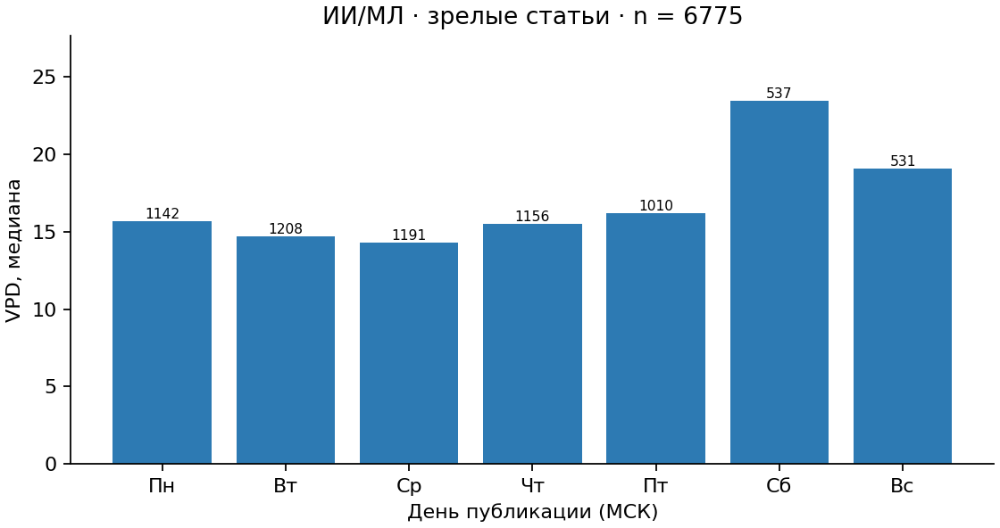

# Выходные, автор и длинные слова: просмотры статей Хабра

Исходные данные и воспроизводимый анализ для статьи о времени публикации,
авторах и формальных свойствах языка. В архивном срезе — **46845 уникальных
публикаций** из двух пересекающихся корпусов: ИИ/МЛ и пяти крупных хабов.

**Короткий результат:** статьи, опубликованные в выходные, имеют более
высокие медианные просмотры. Это наблюдательная связь, а не гарантия
прироста от переноса конкретной статьи. CatBoost лучше ранжирует статьи,
чем исходный пуассоновский LightGBM, но дополнительный сигнал для точного
выбора времени невелик и зависит от корпуса. Дополнительные проверки с
календарными кварталами и возрастными группами подтверждают порядок величины
выходной связи; исходы праздничных статей сильнее ограничены числом эпизодов.

Срез сделан **9–10 ноября 2026 года**. Просмотры измерены единовременно,
а самые свежие данные уже анализировались при разработке исследования.
Поэтому результат не является ни независимым будущим прогнозом, ни
причинной оценкой эффекта времени публикации.

**После 9 ноября 2026 года:** Хабр изменил типы и форматы публикаций.
Общая лента существовала и раньше (с 2023 года), но прежний отбор
«статей» не обязан соответствовать новой классификации. Результаты
архивного корпуса воспроизводимы; для повторного сбора нужно проверить
фильтры API и сохранить формат публикации. Рекомендации и ограничения
описаны в [разделе 13 статьи](article.md) и
[документации о новом сборе](docs/collection.md).

**English:** Reproducible observational study of publication timing, author differences and text features on Habr (46,845 unique articles). Code, frozen metadata and statistical checks accompany the Russian article.



## Быстрый старт

Python 3.12. Команды выполняются из корня проекта:

```bash
python -m venv .venv
source .venv/bin/activate          # Windows: .venv\Scripts\activate
python -m pip install -r requirements.txt
python -m pip install -r experiments/catboost/requirements-catboost.txt
python -m pytest                    # основной анализ и CatBoost, одна команда
python run_analysis.py --metrics-only
```

Этот запуск пересчитывает описательную часть, строит иллюстрации и
формирует `article.md` из `article_template.md`. Для разделов о ML
он использует сохранённые результаты, **без повторного обучения**.
Полные тексты чужих статей в публичный пакет не входят, поэтому
`--metrics-only` использует приложенные лексические признаки.

**Как исправлять текст статьи:** редактируйте `article_template.md`, затем
выполняйте `python 10_build_article.py` и сохраняйте в коммите оба файла —
шаблон и полученный `article.md`. Прямые изменения только в `article.md`
будут перезаписаны при пересчёте и не пройдут CI: это намеренная проверка
соответствия опубликованного текста его источнику.

GitHub Actions побайтово сравнивает `article.md` с версией в репозитории,
а расчётные JSON проверяет с численными допусками для малых расхождений
между вычислительными средами (см. [описание](docs/reproducibility.md)).

Для повторного запуска ML-эксперимента:

```bash
python -m pip install -r experiments/catboost/requirements-catboost.txt
python experiments/catboost/run_experiments.py all
```

Полный перезапуск моделей требует заметно больше ресурсов, чем генерация
статьи: обучение и повторные бутстреп-проверки выполняются на CPU
(в конфигурации задано 2 потока). Проверенное универсальное время запуска
отсутствует: оно зависит от оборудования и версии библиотек. Для оценки
в своём окружении можно использовать команду `time` перед запуском `all`.
Порядок воспроизведения результатов разделов 9–10 полной версии описан в
`experiments/catboost/README.md`.

## Версия для цитирования

Редакция статьи для публикации на Хабре — [v1.1.0](https://github.com/vadimkaa/habr_analytics/tree/v1.1.0). Для воспроизведения опубликованных результатов используйте этот тег, а не подвижную ветку `main`. Первый публичный выпуск [v1.0.0](https://github.com/vadimkaa/habr_analytics/releases/tag/v1.0.0) сохранён без изменений, включая архив таблиц B2; модели и результаты B2 в новой редакции не переобучались и не изменились.

## Сокращённая версия для Хабра

[Сокращённая статья из 12 разделов](short_article/article.md) подготовлена на основе полной версии исследования. Она использует те же архивные расчёты и иллюстрации из `figs/` и `short_article/figures/`, но номера её разделов **не совпадают** с нумерацией полной статьи `article.md`. Для методологии и воспроизводимости ориентируйтесь на полную статью и `docs/`.

| Раздел короткой версии | Где в полной версии |
| --- | --- |
| 1. Сверим часы | [2–5. Предшественники, вопросы, данные, VPD](article.md#2-что-уже-исследовали) |
| 2. Суббота наносит ответный удар | [6. Выходные, часы и автор](article.md#6-выходные-часы-и-автор) |
| 3. Кто здесь главный — автор или календарь? | [6. Авторские сравнения](article.md#6-выходные-часы-и-автор) |
| 4. Поправка на возраст и состав | [6. Проверки устойчивости](article.md#6-выходные-часы-и-автор) |
| 5. Чеширская корреляция | [7. Плотность ленты](article.md#7-плотность-ленты-и-праздники), [6. Вовлечённость](article.md#6-выходные-часы-и-автор) |
| 6. Праздник, который всегда с тобой | [7. Праздники](article.md#7-плотность-ленты-и-праздники) |
| 7. Имеет ли размер значение? | [8. Читаемость текста](article.md#8-читаемость-текста) |
| 8. Ответ есть. Вопрос был другой | [9–10. Модель и выбор слота](article.md#9-модель-можно-ли-предсказать-просмотры-заранее) |
| 9. Если результат слишком хорош, проверьте код | [11. Грабли](article.md#11-грабли-на-которые-я-наступил) |
| 10. Публиковать нельзя откладывать | [12. Что делать автору Хабра](article.md#12-что-делать-автору-хабра) |
| 11. Хабр уже переписал правила игры | [13. Изменения Хабра](article.md#13-хабр-уже-переписал-правила-игры) |
| 12. Вниз по кроличьей норе | [14. Ограничения и дальнейшие исследования](article.md#14-ограничения-и-дальнейшие-исследования) |

После установки обоих наборов зависимостей запуск `python -m pytest` включает тесты CatBoost и release contract. Без CatBoost часть тестов эксперимента пропускается (`pytest.importorskip`).

## Структура проекта

| Путь | Назначение |
|---|---|
| `article.md`, `article_template.md` | Статья и шаблон с подстановкой чисел |
| `figs/` | Рисунки статьи |
| `data/` | Метаданные, производные таблицы и результаты |
| `habrpub/` | Общие функции загрузки и анализа |
| `01_*.py` – `19_*.py` | Этапы описательного анализа, диагностики и сборки |
| `run_analysis.py` | Порядок запуска и проверка данных |
| `experiments/catboost/` | Отдельный эксперимент с A/B1/B2 |
| `tests/` | Проверки корректности расчётов |
| `build_public.py` | Локальная сборка разрешённых к публикации файлов |

**Дополнительные проверки:** `python 16_review_robustness.py` формирует
`data/results/16_review_robustness.json`: исключение одного праздничного
эпизода, альтернативные календарные спецификации, возрастной состав
выходных и будней, контроль квартилей текстовой выборки. Расчёт входит в
`run_analysis.py --metrics-only`; подробности в
[отчёте об устойчивости](docs/robustness.md).

`python 17_final_sensitivity.py --check` повторяет девять дополнительных
проверок на том же срезе: локальные праздничные перцентили, возрастные
спецификации, фиксированные эффекты авторов, тип блога, вовлечённость,
плотность, читаемость, возраст выборок CatBoost и мощность эксперимента.
Сохранённый JSON сверяется с повторным расчётом, а не перезаписывается.
`18_sensitivity_figures.py` строит восемь дополнительных рисунков. Оба
этапа входят в `run_analysis.py --metrics-only`.

**Откуда берутся расчётные показатели:** скрипты формируют JSON в
`data/results/`, затем `10_build_article.py` заполняет шаблон. Для ML
используются `experiments/catboost/results/metrics/` и
`15_ml_figures.py`. Сохранённые конфигурации и поартикульные прогнозы
позволяют проверить итоговые метрики без переобучения моделей.

## Подробная документация

- [Архитектура и стадии анализа](docs/architecture.md)

- [Воспроизведение и происхождение результатов](docs/reproducibility.md)
- [Поля и показатели](docs/data_dictionary.md)
- [Методологические решения и ограничения](docs/audit.md)
- [Проверка устойчивости: праздники, возраст и выборка](docs/robustness.md)
- [Новый сбор и панель наблюдений](docs/collection.md)
- [Методика экспериментов CatBoost: A/B1/B2](experiments/catboost/README.md)

## Лицензии и границы воспроизводимости

Код распространяется по MIT (`LICENSE`). Условия использования собственных
производных материалов указаны в `LICENSE-DATA.md`; права на метаданные и
тексты третьих лиц определяются их источниками. В публичном репозитории
**нет полных текстов сторонних публикаций**. Извлечение текстовых метрик из
HTML поэтому нельзя побайтово воспроизвести без нового скачивания; страницы
могли измениться. Входной срез и контрольные суммы — в
`data/input_manifest.json`.

Таблицы альтернатив B2 **только для двух выбранных моделей** размещаются отдельно
в файлах GitHub Release; их можно пересчитать стадией `policy`. В самом репозитории сохранены
поартикульные оценки и агрегированные результаты.

Для цитирования используйте `CITATION.cff`.
