# Выходные, автор и длинные слова: с чем связаны просмотры статей Хабра

## Что 46 тысяч статей говорят о времени публикации, авторах и языке

*Белый Кролик сверяется с часами. По мотивам иллюстрации Джона Тенниела к «Приключениям Алисы в Стране чудес» Льюиса Кэрролла (1865).*

Пока моя первая статья для Хабра ждала правок от редактора, я задался простым вопросом: когда её лучше публиковать? Почитал существующие разборы, но прямого ответа не нашёл. Пришлось разбираться глубже. Так появилась вторая статья, которая, по иронии судьбы, выходит раньше первой. Неплохое начало для исследования о времени публикации.

Лорду Морли приписывают слова: «В речи имеют значение три вещи: кто говорит, как говорит и что говорит. Из этих вещей наименьшее значение имеет третья». К ним я добавил четвёртую — когда — и проверил, что из этого видно на Хабре.

Я собрал данные о десятках тысяч статей Хабра (когда вышла, сколько просмотров набрала, кто автор), отдельно проверил язык полутора тысяч текстов и попробовал предсказать моделью удачное для публикации время. Нашлись и практические наблюдения, и методические сложности. Несколько красивых результатов пришлось пересмотреть, когда я перепроверил собственные расчёты.

Главная оговорка работы: содержание статей (о чём они, насколько глубоки, полезны и интересны) я не оценивал. Это огромная и интересная самостоятельная задача, влияющая на успех статьи, и… здесь она не решается. Всё, что ниже, касается только времени публикации, авторов и формальных свойств языка.

**TL;DR.** Я сравнил, сколько просмотров набирают статьи Хабра, вышедшие в разные дни, и как это связано с автором и с языком текста. В данных {{unique}} уникальных статей из двух пересекающихся корпусов. Первый — «Искусственный интеллект» вместе с «Машинным обучением». Второй — пять крупных хабов: «Информационная безопасность», «Программирование», «Научно-популярное», «Веб-разработка» и «Python».

Что получилось:

— Выходные дни. В простом сравнении медианный VPD выходных статей выше в 1.4–1.5 раза. В отдельной регрессионной проверке накопленных просмотров с учётом возраста, хабов, типа блога и плотности публикаций условное отношение составляет 1.2–1.3. Оба подхода показывают положительную связь, но не доказывают, что перенос статьи на выходной увеличит её просмотры. У одних и тех же авторов выходные статьи тоже обычно набирают больше.

— Автор и тема. Медианный VPD авторов из верхней четверти распределения как минимум втрое выше, чем из нижней. А при сравнении публикаций одного автора с поправками на другие измеренные различия условное отношение просмотров + 1 составляет {{s_fe_ai}} и {{s_fe_wide}}. Автор, аудитория и тематика неразделимы в этой оценке.

— Праздничные дни. В нерабочие будни статей выходит почти вдвое меньше. При сравнении с публикациями близких дат (окно ±7 дней) медианный перцентиль просмотров выше на {{s_holiday_7_ai}} п.п. в ИИ/МЛ и {{s_holiday_7_wide}} п.п. в пяти хабах.

— Язык текста. Тексты с меньшей долей длинных слов в среднем набирают чуть больше просмотров. Связь слаба, сохраняется после учёта хабов, но внутри авторов чувствительна к способу сравнения; длина предложений почти ни при чём.

— Попытка прогноза. Смена функции потерь и, в меньшей степени, переход на CatBoost улучшили ранжирование статей по ожидаемой популярности по сравнению с первой пуассоновской моделью. Но прогноз популярности и выбор времени — разные задачи: помимо самих выходных календарный сигнал небольшой и зависит от корпуса.

— Грабли. Несколько красивых результатов по дороге оказались ошибками расчёта; как я их нашёл — в разделе 11.

Результат помещается в одну картинку. VPD на ней — среднее число просмотров в день с момента публикации (подробнее в разделах 1 и 5). Будни почти не отличаются друг от друга, а вот выходные выше.

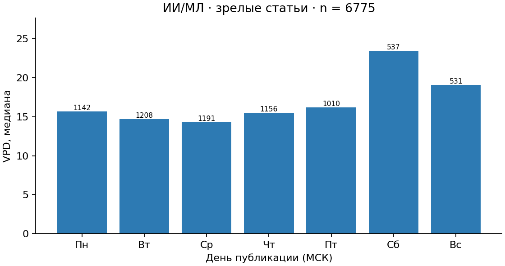

*Рисунок 1. Медианный VPD по дням недели для корпуса ИИ/МЛ (над столбцами указано количество статей)*

Всё это наблюдения, а не управляемый эксперимент. Авторы сами выбирают момент публикации, и по выходным может выходить другой тип статей. Поэтому данные не говорят, сколько просмотров вы получите, если перенесёте конкретную статью со вторника на субботу. Почему — в первом разделе.

[Сокращённая версия исследования](short_article/article.md) предназначена для публикации на Хабре. Код, данные и тесты лежат в репозитории [github.com/vadimkaa/habr_analytics](https://github.com/vadimkaa/habr_analytics/tree/v1.1.1); все расчёты статьи основаны на сохранённых в нём результатах; что и как воспроизводится — в разделе 16.

Если вас интересуют только практические рекомендации, можно сразу перейти к [разделу 12](#12-что-делать-автору-хабра).

### Содержание

- [1. На какой вопрос я отвечаю](#1-на-какой-вопрос-я-отвечаю)
- [2. Что уже исследовали](#2-что-уже-исследовали)
- [3. Вопросы исследования](#3-вопросы-исследования)
- [4. Данные](#4-данные)
- [5. Почему делить просмотры на возраст недостаточно](#5-почему-делить-просмотры-на-возраст-недостаточно)
- [6. Выходные, часы и автор](#6-выходные-часы-и-автор)
- [7. Плотность ленты и праздники](#7-плотность-ленты-и-праздники)
  - [Плотность ленты](#плотность-ленты)
  - [Праздники](#праздники)

- [8. Читаемость текста](#8-читаемость-текста)
- [9. Модель: можно ли предсказать просмотры заранее](#9-модель-можно-ли-предсказать-просмотры-заранее)
- [10. Можно ли доверить модели выбор слота](#10-можно-ли-доверить-модели-выбор-слота)
- [11. Грабли, на которые я наступил](#11-грабли-на-которые-я-наступил)
- [12. Что делать автору Хабра](#12-что-делать-автору-хабра)
- [13. Хабр уже переписал правила игры](#13-хабр-уже-переписал-правила-игры)
- [14. Ограничения и дальнейшие исследования](#14-ограничения-и-дальнейшие-исследования)
- [15. Список использованных источников и литературы](#15-список-использованных-источников-и-литературы)
- [16. Воспроизведение результатов](#16-воспроизведение-результатов)

## 1. На какой вопрос я отвечаю

Прежде чем считать, стоит договориться, что именно мы хотим узнать. Иначе легко ответить на вопрос, которого никто не задавал.

Для автора закономерен интерес: «Если я перенесу эту статью со среды на субботу, сколько просмотров дополнительно получу?» Данные же отвечают на другой вопрос: «Чем отличаются результаты статей, которые их авторы уже решили опубликовать в среду и в субботу?»

Ответы на них расходятся из-за темы, качества текста, популярности автора, продвижения, срочности новости и ещё нескольких неизвестных. Авторы сами выбирают время. У корпоративного блога может быть редакционный календарь, а у личного автора — свободный вечер. Сравниваемые группы изначально разные.

Поэтому дальше анализ раскрывается на трёх уровнях: описательная статистика показывает, как устроены собранные данные; проверки устойчивости помогают понять, не исчезает ли связь после учёта возраста и состава статей; модель показывает, можно ли вообще предсказать просмотры заранее. Причинный эффект переноса публикации потребовал бы отдельного исследования, и здесь я его не оцениваю.

Само определение «успеха» тоже спорно. Просмотры, рейтинг, комментарии и закладки отвечают на разные вопросы. У публикации может быть большой поисковый хвост и мало голосов, а у узкого технического разбора — небольшой охват и много сохранений. Основная метрика этой работы — накопленные просмотры, делённые на возраст статьи, то есть на число дней от публикации до сбора данных. Далее по тексту буду использовать термин VPD (views per day, просмотры в день).

VPD проще всего посчитать по открытым данным. Но основную часть просмотров статья набирает только в первые дни (находится в топе выдачи), поэтому с ростом возраста статьи её VPD падает. В разделе 5 расскажу, как этим можно работать.

## 2. Что уже исследовали

Как говорится, месяц в лаборатории экономит час в библиотеке. Я решил не экономить и начал с обзора уже написанного.

Популярность публикаций часто предсказывают по первым реакциям читателей: ранним комментариям [1] или первым репостам [2]. Опора на содержание и источник до публикации даёт неоднозначные результаты. В работе [3] классификатор определял один из трёх диапазонов популярности новости в Twitter с точностью около 84%. При этом около 76% публикаций приходились на один диапазон: простая модель, всегда выбирающая его, уже получила бы около 76% правильных ответов. Точного числа просмотров такой прогноз не даёт. Неплохой обзор подходов приведён в работе [4]. Моя модель относится ко второй категории (реакций читателей она не видит), поэтому многого от неё ждать не стоит.

Гораздо ближе к рассматриваемой постановке вопроса разборы на самом Хабре. Пока нашёл 19, из которых 5 самых полезных (на мой взгляд) собраны в таблице 1.

| Публикация | Что полезно для настоящего исследования | Что нашли авторы |
| --- | --- | --- |
| «ХаброСтатистика — в какое время лучше публиковать» (2016) [5] | Напоминание, что лучшее время может оказаться результатом нескольких публикаций | «Победитель» таблицы — ловушка малых выборок: в «лучшем» часе всего две статьи, одна из них — хит; вывод — в первую очередь статья должна быть хорошей |
| «Первые три дня жизни поста на Хабре» (2019) [6] | Наблюдение ранней динамики просмотров; нельзя считать накопление равномерным | Основная масса просмотров — первые трое суток; таблица долей для прогноза итога |
| «Когда лучше публиковаться на Хабре» (2026) [7] | Сравнение времени публикации, охвата и плотности публикаций | У нерабочих часов (вечер и ночь будней, выходные) медианный охват выше; вероятное объяснение — конкуренция |
| «Разобрал 1233 статьи Хабра» (2026) [8] | Сопоставление хитов с контрольной выборкой; чувствительность выводов к отбору | Формальные признаки объясняют около 6% разброса рейтинга; остальное — содержание и момент |
| «Считаем чужие просмотры» (2026) [9] | Различие источников трафика и динамики накопления просмотров | Охват не сводится к рейтингу и попаданию на главную; динамика накопления у статей разная |

*Таблица 1. Краткий разбор некоторых статей о времени публикации на Хабре.* Для каждого материала указано, в чём польза и что обнаружили авторы.

Формулировки в таблице 1 я привёл по тексту самих статей. Постановки задач у авторов разные, поэтому и выводы не во всём согласуются друг с другом. Но две мысли повторяются почти везде. Первая: «лучший час» легко найти на маленькой выборке и так же легко потерять на большой. Вторая: в нерабочее время статьи, судя по данным, идут лучше, и чаще всего это объясняют меньшей конкуренцией. Обе мысли я дальше проверяю.

Упомяну ещё две любопытные статьи — «48 часов жизни вашей публикации» [10] и «Хабр для взрослых: готовим статью к бою» [11]. Там в комментариях звучит мысль, что хороший текст прочитают в любой день. Спорить с этим трудно, так что запомним её.

## 3. Вопросы исследования

Работа шла шаг за шагом: отвечая на простой вопрос, я натыкался на связанные с ним вопросы и разбирал их по ходу. Поэтому найденные закономерности стоит перепроверить на новых данных, и не факт, что они подтвердятся. Ниже небольшая сводка, где я сразу уточню, на какие вопросы ответов не будет.

| Вопрос | Как проверяю | Чего это не докажет |
| --- | --- | --- |
| Набирают ли статьи, вышедшие в выходные, больше просмотров? | Сравниваю будни и выходные: все статьи, статьи одного возраста, статьи одного автора | Что та же статья, перенесённая на выходные, наберёт больше |
| Хуже ли идут статьи, вышедшие, когда публикаций много? | Связь просмотров с числом статей за предыдущие сутки | Как именно читатели распределяют внимание |
| Объясняется ли эффект выходных тем, что по выходным меньше публикаций? | Сравниваю выходные и будни при сходной загруженности ленты | Какая доля эффекта приходится на конкуренцию |
| Связана ли удобочитаемость статьи с числом просмотров? | Несколько индексов читаемости, отдельно по группам статей | Что упрощение текста прибавит просмотров |
| Можно ли заранее предсказать, сколько просмотров наберёт статья? | Модель, обученная на старых статьях и проверенная на новых | Что модель сработает на будущих статьях |

*Таблица 2. Вопросы исследования.* Что и как проверяется и какого вывода такая проверка НЕ даёт.

## 4. Данные

Прежде чем показывать результаты, расскажу, откуда взялись данные и чем они ограничены. Скучно, но от этого зависит, насколько можно доверять всему остальному.

Данные собраны 9–10 ноября 2026 года; 01_fetch_metadata.py в репозитории предназначен для повторного сбора, но исходный журнал запросов за эти даты не сохранился. После фильтров получились два набора статей, дальше я называю их корпусами. Я оставил только русскоязычные публикации типа «статья» с корректным счётчиком просмотров, убрал дубли и отсёк публикации, вышедшие позже момента снятия счётчиков (в широком корпусе таких 52).

{{corpus_table}}

*Таблица 3. Состав данных.* Число статей после фильтров, фактический период и число зрелых статей (старше 30 дней) в каждом корпусе.

«Зрелой» здесь и далее я называю статью, которой на момент сбора исполнилось не меньше 30 дней — почти бальзаковский возраст ;) Более «молодые» статьи ещё набирают просмотры, и сравнивать их со старыми нечестно. Порог я выбрал из общих соображений, а не подбирал. Основную массу просмотров статья набирает в первые дни [6], так что месяц — это запас. Главный результат статьи, отношение медиан VPD «выходные / будни» за последний год (раздел 6), от порога почти не зависит. При порогах от 7 до 90 дней оно остаётся в пределах {{mat_ai}} в ИИ/МЛ и {{mat_wide}} в пяти хабах.

ИИ/МЛ — объединение хабов «Искусственный интеллект» (artificial_intelligence) и «Машинное обучение» (machine_learning). Широкий корпус — хабы «Информационная безопасность» (infosecurity), «Программирование» (programming), «Научно-популярное» (popular_science), «Веб-разработка» (webdev) и «Python» (python). Я выбрал крупные хабы, близкие к теме (что это пять крупнейших, не проверял).

### Покрытие широкого корпуса и окна анализа

Широкий корпус покрыт неравномерно. В «Информационной безопасности» самая ранняя запись относится к 23 июня 2025 года, а по остальным четырём хабам данные доходят до ноября 2024 года. В скрипте сбора стоял предел в 420 страниц выдачи, и число записей инфобеза близко к этому потолку. Вероятнее всего, выдача по этому хабу просто оборвалась на последней разрешённой странице, но для подтверждения этого журнала исходного сбора у меня нет.

Поэтому для календарного анализа широкого корпуса я беру общее для всех 5 хабов окно, с 24 июня 2025 года. Для плотности ленты (числа статей, вышедших за предыдущие 24 часа, подробнее в разделе 7) окно начинается на день позже, поскольку у статей самого первого дня часть «предыдущих суток» приходится на время до начала окна, и число их конкурентов в противном случае было бы занижено.

Есть и другие ограничения выгрузки. То, что она начинается и заканчивается в нужные даты, ещё не значит, что внутри периода нет пропусков. Отдельные статьи могли выпасть, и по самой выгрузке это не проверить. Удалённые и скрытые статьи в неё не попали. Заголовки, хабы и счётчики сняты на момент сбора, в ноябре 2026 года, а не в день публикации. К тому же авторы могли менять заголовки, тексты и хабы, и я не могу оценить частоту таких случаев и их потенциальное влияние на полученные оценки.

И ещё одно совпадение по времени. 9 ноября 2026 года, в первый день сбора, Хабр объявил об изменении типов и форматов публикаций [12]. Большинство зрелых статей этого исследования набирали просмотры до реформы. Что именно изменилось и как это повлияет на повторные исследования, обсудим в разделе 13.

Для анализа дней недели и часов я беру публикации за последний год, с 9 ноября 2025 года. В этом окне {{ai_recent_n}} статей ИИ/МЛ и {{wide_recent_n}} статей пяти хабов. Статьи моложе 30 дней в сравнение не входят (они ещё набирали просмотры).

Корпуса пересекаются: {{overlap}} статьи входят в оба. Это объясняет, почему число разных статей ({{unique}}) не бьётся с построчной суммой таблицы 3. По той же причине одинаковый результат в двух корпусах полезен как проверка на другом наборе тем, но независимым подтверждением не является. Общие статьи участвуют в обеих проверках.

Ещё одна особенность состава — переводы чужих статей. Их стиль отражает предпочтения (и возможности) переводчика, а тема и успех частично заимствованы у оригинала. В полной выгрузке ИИ/МЛ переводов {{tr_corpus_share_ai}} ({{tr_corpus_n_ai}}), в годовом окне — {{tr_share_ai}}. В широком корпусе такого признака в выгрузке нет, поэтому там переводы не выделяются. В основных сравнениях переводы оставлены. Как меняется без них связь просмотров с выходными и с языком текста, я покажу в разделах 6 и 8.

Для анализа языка (раздел 8) нужны сами тексты, а скачивать их долго. Поэтому язык я проверял не на всех статьях, а на выборке примерно из полутора тысяч.

### Как устроена текстовая выборка

В выборку вошли 1200 статей широкого корпуса и 400 статей ИИ/МЛ. Это соотношение я задал экспертно, и оно не повторяет соотношение размеров корпусов. Поэтому объединённая выборка описывает именно такую смесь, и ниже я показываю результаты ещё и по каждому корпусу отдельно.

Внутри корпуса статьи отбирались поровну из каждой четверти (квартиля) по VPD, причём **среди статей всех возрастов**, а не только зрелых. В таком отборе квартиль представлен равномерно, но исключение молодых и коротких текстов способно изменить итоговый состав. Поэтому выборка не является простой случайной по зрелым статьям и результаты нельзя автоматически переносить на весь корпус.

Дальше выборка проходит два сужения.

— Из {{read_cache_n}} отобранных статей уникальных — {{read_unique_n}}. Ещё {{read_dup_n}} статей относятся к обоим корпусам и попали в обе выборки. Каждую такую статью я учитываю один раз и отношу к широкому корпусу. Это правило задано заранее, чтобы результат не зависел от порядка обработки.

— В анализ вошли {{read_n}} статей ({{read_n_wide}} широкого корпуса и {{read_n_ai}} ИИ/МЛ). Исключены 77 статей моложе 30 дней и 2 слишком коротких текста (меньше 30 слов), по которым индексы читаемости не считаются.

Список отобранных статей (номер статьи и корпус) лежит в репозитории, в файле data/text_sample_manifest.json. По нему тексты можно скачать заново.

Для разных задач используются разные, не обязательно вложенные подвыборки.

| Выборка | ИИ/МЛ | Пять хабов |
| --- | ---: | ---: |
| Все статьи | 21389 | 29399 |
| Зрелые статьи годового окна | {{ai_recent_n}} | {{wide_recent_n}} |
| Авторы для парного сравнения | 111 | 220 |
| Статьи в регрессии с авторскими эффектами | 2586 | 8963 |
| Тексты для анализа читаемости | {{read_n_ai}} | {{read_n_wide}} |

## 5. Почему делить просмотры на возраст недостаточно

Это главный методический нюанс всей работы. Если его пропустить, почти любой вывод о времени публикации можно случайно получить из одного только возраста статей.

Исходное определение:

VPD = накопленные просмотры / возраст в днях.

Это среднее число просмотров за день всей жизни статьи, а не её текущий суточный трафик. Представьте две статьи, которые набрали по 10000 просмотров и почти перестали расти. Через 100 дней VPD первой будет 100, а у второй (которой уже 1000 дней) — 10. Разница десятикратная, хотя охват одинаков.

Делить на возраст было бы честно, если бы статья набирала просмотры равномерно. Но у публикаций обычно ранний всплеск и длинный хвост, так что это сильное допущение. На полной истории зрелых статей ИИ/МЛ корреляция возраста и VPD составляет {{age_ai}}, в широком корпусе — {{age_wide}}. Отрицательная связь отчасти возникает механически: возраст входит в знаменатель VPD. По этим корреляциям нельзя оценить, как быстро падает реальный дневной трафик одной статьи.

Не весь этот разрыв создан делением на возраст. За эти годы менялись и сама платформа, и темы статей, и аудитория. Но игнорировать возраст нельзя: любая группа, в которой случайно оказалось больше свежих статей, будет выглядеть «успешнее».

Поэтому VPD я использую для описания, а выводы проверяю тремя способами, которые от возраста зависят меньше: сравниваю статьи одного возраста; смотрю, какое место статья занимает среди статей того же месяца; строю регрессию, которая учитывает возраст и другие различия. Идеальную метрику — просмотры за первую неделю у каждой статьи — они всё равно не заменят, но таких данных у меня нет.

## 6. Выходные, часы и автор

Гипотеза, с которой я начинал: статьи, вышедшие в выходные, набирают больше просмотров.

### Как читать статистику

Медиана — это середина распределения. Половина статей набирает меньше неё, половина больше. Она мало чувствительна к отдельным хитам. Среднее отвечает на другой вопрос (суммарный охват) и тоже полезно.

Перцентиль — место статьи среди статей своего месяца. Перцентиль 0.58 значит, что статья обошла 58% статей того же месяца. Разница медиан перцентилей двух групп выражается в процентных пунктах (п.п.).

Тест [Манна — Уитни](https://habr.com/ru/companies/avito/articles/709596/) сравнивает две группы по рангам и не требует нормального распределения. Проверяет он, склонны ли значения одной группы оказываться выше значений другой, а не равенство медиан: медианы двух групп могут совпадать, а тест всё равно покажет разницу. Вместе с ним я привожу вероятность превосходства (в англоязычной литературе — probability of superiority или common language effect size; численно это то же, что AUC). Вероятность превосходства 0.62 значит, что если случайно взять праздничную и контрольную статью, праздничная окажется выше в 62 случаях из 100. p-value того же теста показывает, насколько необычным было бы наблюдаемое (или ещё большее) расхождение рангов, если бы группы на самом деле не различались. Это не вероятность того, что вывод случаен. И малый p-value не означает большого или причинного эффекта.

Корреляция Спирмена (ρ) измеряет монотонную связь. При ρ = 0 связи нет, при ρ = 1 порядок строгий. Логарифмирование не меняет ранги, поэтому для Спирмена запись log10(VPD + 1) не даёт преимущества перед VPD.

95% ДИ — доверительный интервал. Представим, что мы много раз заново собрали бы такие же данные (другие статьи, порождённые тем же процессом) и каждый раз строили бы интервал тем же способом. Тогда примерно 95 интервалов из 100 накрыли бы истинное значение. Меняется при этом интервал, а истинное значение остаётся на месте. Поэтому правильнее говорить «интервал накрывает значение», а не «значение попадает в интервал».

Здесь интервалы считаются [бутстрепом](https://habr.com/ru/articles/829336/) с возвращением. Из списка авторов случайно набирается новый список той же длины. Один автор может попасть в него несколько раз, другой ни разу, и каждый выбранный автор приносит все свои статьи. По такой псевдовыборке заново считается оценка. Так повторяется 1000 раз, а границами интервала служат 2.5-й и 97.5-й перцентили полученных оценок. Авторов перевыбирают целиком, потому что статьи одного автора похожи друг на друга и не являются независимыми наблюдениями. Общие новостные события, которые задевают сразу многих авторов, такой интервал не учитывает.

Для текстовых метрик применяется поправка на множественные сравнения [Бенджамини — Хохберга](https://habr.com/ru/articles/772940/) в пределах одной таблицы. Когда проверяется сразу много метрик, часть «значимых» результатов может оказаться случайной, и поправка ограничивает их ожидаемую долю. Но она не учитывает все проверки, сделанные в работе в целом. Анализ отдельных праздничных блоков и текстовых показателей в основном разведочный, поэтому единичный небольшой p-value нельзя трактовать как независимое подтверждение гипотезы.

Отношения и разности в тексте посчитаны по неокруглённым значениям, поэтому из округлённых чисел таблиц они могут не сойтись в последнем знаке.

### Неделя и часы

Выходными я считаю субботу и воскресенье, кроме перенесённых рабочих дней производственного календаря. Рабочие субботы вроде 1 ноября 2025 года отнесены к будням; в основном годовом окне таких дней нет. Дни и часы везде указаны по московскому времени: у читателей из других часовых поясов те же публикации приходятся на другое местное время.

Что получается из данных.

{{weekend_table}}

*Таблица 4. Медианный VPD в выходные и будни за последний год.* Отношение — во сколько раз медиана выходных выше медианы будних; интервалы посчитаны бутстрепом авторов и недель.

В обоих корпусах типичная выходная статья имеет VPD примерно в полтора раза выше, чем будняя. Это накопленные просмотры, делённые на весь возраст статьи, а не измеренный текущий дневной поток. Доверительные интервалы стоят далеко от единицы, так что это не случайное колебание. Как устроена эта разница по дням недели, видно на рисунке 1 из начала статьи.

На рисунке 1 две вещи бросаются в глаза. Первая — будни почти не различаются между собой. Медианный VPD от понедельника до пятницы держится в узком коридоре, от {{wd_vpd_min}} до {{wd_vpd_max}}, и никакого «лучшего буднего дня» здесь нет. Вся разница сосредоточена на границе будней и выходных, причём суббота заметно выше воскресенья.

Вторая — числа над столбцами. В субботу и воскресенье выходит примерно вдвое меньше статей, чем в любой будний день. Это первый намёк на возможное объяснение. В выходные у статьи просто меньше конкурентов. К нему я вернусь в разделе 7. Но рисунок описывает уже вышедшие статьи и не обещает прибавку новой.

Теперь посмотрим на часы.

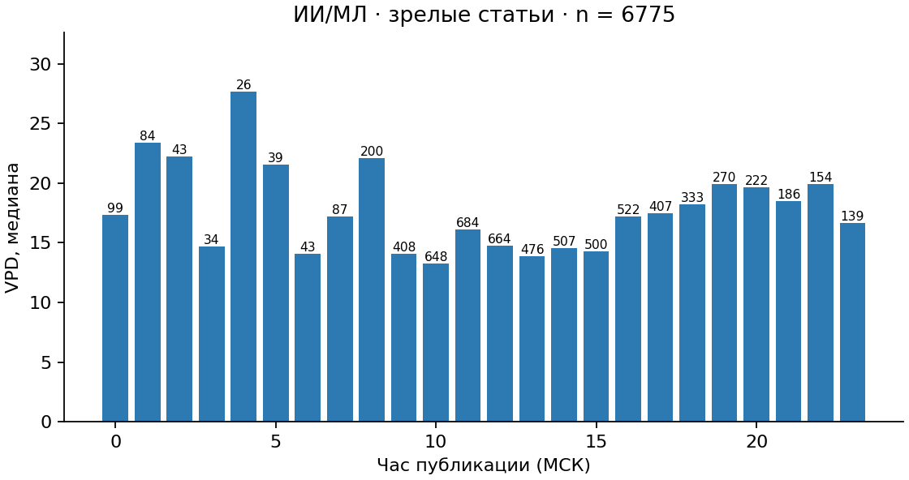

*Рисунок 2. Медианный VPD по часам для корпуса ИИ/МЛ (над столбцами указано количество статей)*

Если смотреть только на часы с большим числом статей (сотни), картина плавная. Днём, с 9 до 15 часов, медианный VPD самый низкий: {{hour_day_min}}–{{hour_day_max}}. К вечеру он растёт, и с 16 до 22 часов держится на уровне {{hour_eve_min}}–{{hour_eve_max}}. То есть вечерние статьи в среднем идут немного лучше дневных. Сравнение отдельно в будни и выходные (медианный VPD за часы 9–15 и 16–22): ИИ/МЛ — {{ed_ai_wd_day}} и {{ed_ai_wd_eve}}, {{ed_ai_we_day}} и {{ed_ai_we_eve}}; пять хабов — {{ed_wide_wd_day}} и {{ed_wide_wd_eve}}, {{ed_wide_we_day}} и {{ed_wide_we_eve}}. В выходные пяти хабов различие между днём и вечером невелико. Дневные публикации выходных не уступают вечерним публикациям будней в ИИ/МЛ, а в пяти хабах превосходят их. Выделяется и 8 утра: в ИИ/МЛ медианный VPD {{ed_ai_8_vpd}} на {{ed_ai_8_n}} статьях. Проверка после знакомства с этим пиком показала, что его не следует превращать в рекомендацию.

| Корпус | 7:00 | 8:00 | 9:00 | Отношение VPD в 8:00 к объединённой группе 7:00 и 9:00 (95% ДИ по авторам) |
| --- | --- | --- | --- | --- |
| ИИ/МЛ | {{am_ai_7}} ({{am_ai_n_7}}) | {{am_ai_8}} ({{am_ai_n_8}}) | {{am_ai_9}} ({{am_ai_n_9}}) | {{am_ai_ratio}} {{am_ai_ratio_ci}} |
| Пять хабов | {{am_wide_7}} ({{am_wide_n_7}}) | {{am_wide_8}} ({{am_wide_n_8}}) | {{am_wide_9}} ({{am_wide_n_9}}) | {{am_wide_ratio}} {{am_wide_ratio_ci}} |
| Пять хабов без статей корпуса ИИ/МЛ | {{am_wide_excluding_ai_7}} ({{am_wide_excluding_ai_n_7}}) | {{am_wide_excluding_ai_8}} ({{am_wide_excluding_ai_n_8}}) | {{am_wide_excluding_ai_9}} ({{am_wide_excluding_ai_n_9}}) | {{am_wide_excluding_ai_ratio}} {{am_wide_excluding_ai_ratio_ci}} |

В ячейках — медианный VPD (число статей). ДИ медианы в 8 утра: {{am_ai_8_ci}} в ИИ/МЛ, {{am_wide_8_ci}} в пяти хабах (VPD, границы округлены до сотых). Сравнение 8 утра с объединёнными соседями, а не усреднение двух часовых медиан, даёт больший вес более многочисленной группе 9 утра. Поэтому даже нижняя граница чуть выше единицы в пяти хабах не доказывает превосходство 8 утра над 7 утра.

Только в личных блогах медианы в 7, 8 и 9 утра составляют {{am_ai_personal_7}}, {{am_ai_personal_8}}, {{am_ai_personal_9}} для ИИ/МЛ и {{am_wide_personal_7}}, {{am_wide_personal_8}}, {{am_wide_personal_9}} для пяти хабов (без общих статей — {{am_wide_excluding_ai_personal_7}}, {{am_wide_excluding_ai_personal_8}}, {{am_wide_excluding_ai_personal_9}}). Во второй части годового окна (с 9 мая 2026) даже в ИИ/МЛ медиана в 7 утра выше, чем в 8 ({{am_ai_late_7}} против {{am_ai_late_8}}). Это разведочное сравнение: час выбран после просмотра данных, интервалы не скорректированы на множественные сравнения, исключение общих статей не делает выборки независимыми по авторам и событиям. Дополнительные разрезы по типу блога, выходным, частям года и месячным перцентилям сохранены в [результатах шага 20](data/results/20_morning_check.json).

А вот ночью столбцы скачут. Самый высокий из них — {{hour_top}}:00 (до минут не смотрел, возможно, там {{hour_top}}:20). Высок соблазн объявить это каким-то «счастливым часом», но над столбцом стоит число {{hour_top_n}}. Всего {{hour_top_n}} статей за год.

Это любопытный выброс. Ночной столбец выше всех потому, что статей в нём мало. При {{hour_top_n}} статьях медиану заметно сдвигают несколько удачных текстов. А чем больше вариантов перебирать, тем вернее среди них найдётся «победитель». Если искать лучший из 168 часов недели (сочетаний дня и часа, дальше я называю их слотами), какую-то закономерность мы найдём всегда, даже в шуме. Ровно на эту ловушку указывал разбор [5] 2016 года из таблицы 1.

Если разложить статьи одновременно по дням и часам, получится тепловая карта. На ней эффект малых выборок виден ещё нагляднее.

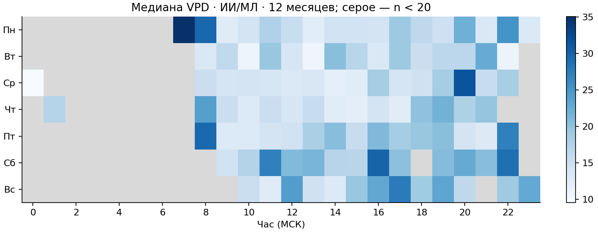

*Рисунок 3. Медианный VPD в ячейках «день недели × час», ИИ/МЛ (серым закрашены ячейки, где меньше 20 статей)*

Каждая клетка на рисунке 3 — медианный VPD статей, вышедших в соответствующий день недели и час. Чем темнее клетка, тем выше VPD. Ячейки, где статей меньше 20, закрашены серым. Порог условный, и в остальных ячейках оценки тоже шумные.

Сначала взгляд цепляется за самые тёмные клетки. Это {{heat_top1}} и {{heat_top2}}. Выглядят они как окна возможностей, но торопиться не надо. За каждой всего около трёх десятков статей, а среди {{heat_cells}} ячеек с данными несколько таких всплесков найдутся и случайно.

Гораздо интереснее общий рисунок. Нижние две строки, суббота и воскресенье, в целом насыщеннее будних: {{heat_we_above}} из {{heat_we_cells}} выходных ячеек выше медианы будних ячеек. Это та же разница выходных и будней, что на рисунке 1, только разложенная по часам. Она сохраняется почти в любое время дня, а значит, дело не в одном удачном часе.

Итог этой части: разница между выходными и буднями устойчива и видна на всех трёх рисунках. Разница между часами тоже есть, но слабее. А выбирать конкретный час по самой тёмной клетке не стоит: это почти наверняка шум.

### Может, дело в самих авторах?

Выходные статьи в среднем сильнее. Но такое сравнение смешивает два возможных объяснения. Первое — выходные действительно чем-то лучше для публикации. Второе — по выходным пишут другие авторы, например те, у кого и так больше читателей, либо те, кто до изнеможения работает по будням. Во втором случае медианы различались бы, даже если бы сам день публикации ни на что не влиял.

Чтобы проверить второе объяснение, можно сравнить каждого автора с самим собой. Берём только тех, кто публикуется и в будни, и в выходные, и смотрим, лучше ли идут у одного и того же человека его выходные статьи. Аудитория, известность и манера автора в таком сравнении в значительной степени сохраняются с обеих сторон, поэтому разницу ими объяснить уже трудно. Полностью одинаковыми они не будут: за год аудитория и популярность автора могут измениться.

Посчитано это так. Я оставил авторов, у которых не меньше двух зрелых статей и в будни, и в выходные. Для каждого посчитал отношение: медианный VPD его выходных статей, делённый на медианный VPD будних. Если отношение больше единицы, у этого автора выходные статьи набирают больше. Затем я взял медиану этих отношений по авторам. Каждый автор здесь — один голос, сколько бы статей он ни написал, чтобы результат не определяли несколько самых плодовитых.

{{paired_table}}

*Таблица 5. Сравнение автора с самим собой.* Медиана отношений «выходные / будни», посчитанных отдельно для каждого автора с хотя бы двумя зрелыми статьями в каждой группе.

Медиана отношений выше единицы в обоих корпусах, и интервалы тоже целиком выше единицы. Значит, среди **отобранных активных авторов** у типичного автора выходные статьи набирают больше будних. Следовательно, объяснить общую разницу только тем, что по выходным публикуются другие люди, не получается. В ИИ/МЛ отношение внутри автора почти совпадает с общим из таблицы 4, в пяти хабах оно немного ниже. Но оценить точный вклад состава авторов по такому сравнению нельзя.

Но и это сравнение не доказывает, что играет роль сам день недели. Автор мог оставлять на выходные другие темы или более обстоятельные работы. Кроме того, в проверку попали только активные авторы, которые публикуются и в будни, и в выходные. На всех авторов Хабра этот вывод переносить нельзя.

### Что важнее: «когда» или «кто»?

Мы выяснили, что день публикации связан с просмотрами. Но насколько это важно на фоне всего остального? Самый очевидный конкурент — сам автор. Устроим им очную ставку.

Для этого нужно оценить, насколько успешно обычно выступает автор, не подглядывая в результат самой статьи. Мерой служат просмотры других его статей за тот же год. Для краткости я называю её силой автора, хотя точнее было бы «результативность других публикаций автора»: в неё входит всё, что у него постоянно, — темы, хабы, блог, аудитория. По силе автора статьи делятся на три равные группы, нижнюю, среднюю и верхнюю, а время сведено к двум вариантам, выходные или будни. В ячейках таблицы 6 стоят медианы накопленных просмотров в тысячах.

{{author_slot_table}}

*Таблица 6. Медианы просмотров (тыс.) по группам силы автора, в будни и выходные.* Группы составлены из статей по результативности других публикаций того же автора.

Таблицу 6 удобно читать в двух направлениях. Если идти сверху вниз, от слабых авторов к сильным, просмотры растут быстро. В будни верхняя группа набирает больше нижней в {{author_slot_effect_ai}} раза в ИИ/МЛ и в {{author_slot_effect_wide}} раза в пяти хабах. Если же идти слева направо, от будней к выходным внутри одной группы, разница скромнее. Отношение выходных к будням по группам в ИИ/МЛ такое: {{author_slot_weekend_ai}}. В пяти хабах — {{author_slot_weekend_wide}}.

Преимущество выходных видно во всех трёх группах, но различия между группами в разы больше. Таблица 6 описывает уже вышедшие статьи и не отвечает на вопрос «что будет с новой статьёй», поэтому она стоит отдельно от модели (разделы 9 и 10).

Сила автора считалась так. Берём медиану VPD (в логарифмах) других статей автора за тот же год, а саму оцениваемую статью из расчёта исключаем. Иначе удачная статья поднимала бы оценку собственного автора, и связь «сильный автор — много просмотров» отчасти получалась бы сама собой. Такой приём в ML называется «без одного» (leave-one-out). В расчёт идут авторы, у которых за год не меньше трёх статей. Группы составлены из статей, а не из авторов. Поэтому статьи одного автора могут оказаться в разных группах: его сила немного меняется в зависимости от того, какая статья исключена. Так вышло у {{authors_span_ai}} из {{author_slot_authors_ai}} авторов ИИ/МЛ (в пяти хабах — у {{authors_span_wide}} из {{author_slot_authors_wide}}).

У такой оценки есть важное ограничение. Исключается только сама оцениваемая статья, а её соседи остаются. Допустим, вторая статья цикла оказалась очень удачной и привела читателей к третьей. Тогда при оценке третьей статьи успех второй войдёт в «силу» автора, хотя на деле это влияние одной статьи на другую. Кроме того, в расчёт идут все статьи года, в том числе вышедшие позже оцениваемой, а их успех мог отчасти вырасти на ней самой. Отделить постоянные свойства автора от такого взаимного влияния статей по этим данным нельзя. Поэтому связь «кто» с просмотрами здесь, скорее всего, несколько завышена.

Чтобы сравнить «кто» и «когда» на одной шкале, я смотрю, какую долю разброса просмотров объясняет каждый из них. Сначала — насколько велик разброс. Даже с поправкой на возраст статья из верхней четверти по просмотрам набирает в {{spread_q_ai}} раза больше статьи из нижней (в пяти хабах — в {{spread_q_wide}}). Верхние 10% статей набирают больше нижних 10% в {{spread_d_ai}} и {{spread_d_wide}} раза.

На этом фоне полуторная прибавка выходных выглядит скромно. По VPD выше медианы будних статей оказываются примерно {{we_above_wd_ai}} выходных статей в обоих корпусах; остальные около 39% её не превосходят ({{am_ai_below}}% и {{am_wide_below}}%), так что выходной день сам по себе успеха не гарантирует.

Ещё один способ описать этот срез — посмотреть на прирост доли объяснённого разброса (R²). Возьмём простую регрессию логарифма просмотров на логарифм возраста статьи. Если добавить в неё признак «вышла в выходные», R² вырастет на {{slot_var_ai}}–{{slot_var_wide}} п.п. Если вместо него добавить результативность остальных публикаций того же автора, R² вырастет на {{author_var_ai}}–{{author_var_wide}} п.п. Признаки добавлялись по очереди, в отдельных регрессиях. Это описательная связь: бинарный календарный флаг сопоставляется с признаком, построенным по результатам других статей, в том числе вышедших позднее. Поэтому численное различие не измеряет сравнительную важность автора и календаря, не разлагает дисперсию на их независимые вклады и не служит оценкой качества прогноза. Даже исключение самой статьи из расчёта не делает признаки равноценными.

Так что Морли здесь был бы наполовину прав. «Кто» заметно связан с просмотрами, а календарные различия выглядят скромнее на фоне разброса результатов. Но сравнивать причинные вклады факторов по этим данным нельзя. И его главный парадокс, что содержание значит меньше всего, проверить не получается: темы автора входят в его «силу», и отделить «кто» от «что» нельзя.

Можно посмотреть на различия между авторами проще, не строя признак из целевой переменной. Для каждого автора с не менее чем тремя зрелыми статьями в годовом окне я посчитал медианный VPD, а затем перцентили распределения этих медиан, дав каждому автору одинаковый вес. Порог в пять статей — проверка чувствительности.

{{s_author_iqr_table}}

*Таблица 7. Распределение медианных VPD авторов. Один автор — один голос.*

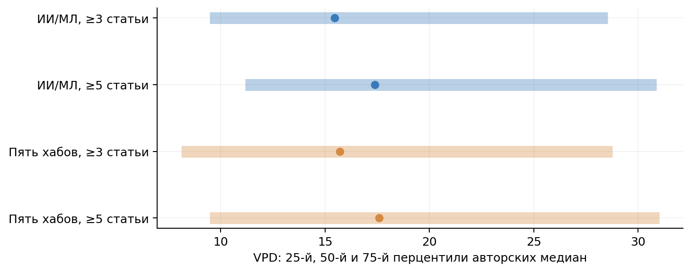

*Рисунок 4. Межквартильные интервалы авторских медиан VPD при двух порогах числа статей.*

И в том и в другом корпусе верхняя четверть авторов с не менее чем тремя статьями имеет медианный VPD как минимум примерно втрое выше нижней четверти. Это разброс результативности авторов, а не эффект смены автора: с автором меняются аудитория, тематика и продвижение.

### Проверки возраста статьи и состава

Остаётся проверить два альтернативных объяснения: возраст статей и их состав. VPD сильно зависит от возраста (раздел 5). Если бы выходных статей среди свежих оказалось больше, они выглядели бы сильнее без всякой пользы от дня публикации. Поэтому сначала сравним статьи близкого возраста.

{{age_table}}

*Таблица 8. Отношение медиан VPD «выходные / будни» по возрастным группам.* Сравниваются статьи близкого возраста, чтобы разница не объяснялась возрастом.

Во всех трёх возрастных группах и в обоих корпусах выходные статьи сильнее будних. Отношение меняется от группы к группе, но нигде не опускается до единицы. При этом медианный возраст выходных статей за год даже выше: {{age_median_we_ai}} против {{age_median_wd_ai}} дней в ИИ/МЛ и {{age_median_we_wide}} против {{age_median_wd_wide}} в пяти хабах. Таким образом, одним возрастом обнаруженную разницу объяснить не получается.

Вторая проверка — место статьи среди статей того же месяца. Перцентиль внутри месяца зависит от возраста гораздо меньше, чем VPD, и по нему выходные тоже впереди. Медианный перцентиль выходных статей {{rank_we_ai}} против {{rank_wd_ai}} у будних в ИИ/МЛ и {{rank_we_wide}} против {{rank_wd_wide}} в пяти хабах.

Третья проверка касается переводов, у которых успех отчасти заимствован у оригинала. Без них отношение медиан VPD «выходные / будни» в ИИ/МЛ равно {{tr_ratio_excl_ai}} (по всем статьям — {{tr_ratio_all_ai}}), а у самих переводов — {{tr_ratio_tr_only_ai}}. Медианный перцентиль внутри месяца без переводов — {{tr_rank_we_ai}} у выходных статей против {{tr_rank_wd_ai}} у будних. Переводы картину не создают. В широком корпусе признака перевода в выгрузке нет.

Четвёртая проверка — не держится ли разница на нескольких самых активных авторах или блогах. Авторский бутстреп учитывает, что статьи одного автора похожи, но на этот вопрос не отвечает. Если убрать 10 самых активных авторов, 1% самых активных ({{top1pct_n_ai}} человек в ИИ/МЛ и {{top1pct_n_wide}} в пяти хабах) или 10 крупнейших корпоративных блогов, отношение медиан VPD «выходные / будни» остаётся в пределах {{top_range_ai}} в ИИ/МЛ и {{top_range_wide}} в пяти хабах, и все интервалы выше единицы. Личные блоги отдельно дают {{top_pers_ai}} и {{top_pers_wide}}. У корпоративных разница ещё больше, {{top_corp_ai}} и {{top_corp_wide}}, но и интервалы у них шире: корпоративных статей по выходным выходит в несколько раз меньше, чем личных.

Наконец, самая строгая из доступных проверок — регрессия, которая сравнивает выходные и будни при прочих равных. Зависимая переменная в ней — log10(views + 1). Учитываются месяц публикации, логарифм возраста, корпоративный ли блог и в каких из 15 самых частых хабов годового окна стоит статья. В основном варианте учитывается ещё и плотность ленты за предыдущие сутки. Погрешности оценок посчитаны с учётом того, что статьи одного автора похожи друг на друга (кластеризация по авторам).

{{adjusted_table}}

*Таблица 9. Условное отношение «выходные / будни» по регрессии.* Во сколько раз больше просмотров у выходной статьи при одинаковых возрасте, месяце, хабах и типе блога — с плотностью ленты в модели и без неё.

В регрессии условное отношение «выходные / будни» составляет примерно 1.2–1.3, то есть на 20–30% выше, а интервалы по-прежнему целиком выше единицы. Это не прямое «уменьшение» отношения медиан VPD из таблицы 4: здесь другая целевая переменная и другой метод оценки. Проверка с календарными кварталами вместо месяцев даёт отношения {{reg_quarter_ai}} и {{reg_quarter_wide}}, а с возрастными группами вместо логарифма возраста — {{reg_agebands_ai}} и {{reg_agebands_wide}}. Знак и порядок величины связи сохраняются; эти проверки не устраняют неизмеренные различия содержания и продвижения.

Два варианта нужны, потому что плотность ленты может быть не помехой, а частью самого механизма. Если преимущество выходных возникает именно потому, что лента реже, то, учитывая плотность, мы отнимаем у выходных часть их собственного эффекта. Поэтому разница между столбцами показывает, насколько вывод зависит от трактовки, а не точную долю конкуренции. Неизмеренные содержание и продвижение по-прежнему могут объяснять часть связи.

В таблице 4 два вида интервалов. Проведённый бутстреп-анализ не учитывает общий новостной фон недели. Громкий релиз или иной инфоповод поднимает просмотры сразу многим статьям. Перевыборка целых недель публикации это учитывает, но опирается всего на несколько десятков недель. Интервалы по неделям (последний столбец таблицы 4) получились даже немного теснее авторских и тоже целиком выше единицы в обоих корпусах.

### Более тонкая проверка возраста и авторские эффекты

Возрастные группы из предыдущего сравнения довольно широкие. Поэтому я разбил годовое окно на 22 полных интервала шириной 15 дней (возраст от 30 до 360 дней, правая граница не включается). Последний неполный интервал не использую; в каждой группе требуется не менее 10 выходных и 10 будничных статей. Сравнение медианных VPD и бутстреп по авторам остаются прежними. Это проверка чувствительности, а не 22 независимых теста.

{{s_age_window_table}}

*Таблица 10. Отношения медиан VPD в узких возрастных окнах. Интервалы без поправки на множественные сравнения.*

В ИИ/МЛ медиана выходных выше будничной в 21 из 22 интервалов, в пяти хабах — во всех 22. Интервалы целиком выше единицы только в 5 и 14 окнах соответственно. В частности, на самом узком свежем срезе 30–44 дня оценка ИИ/МЛ 1.18 [0.80; 1.62], а в пяти хабах 1.75 [1.34; 2.34]. Единственное окно с обратным знаком в ИИ/МЛ — 225–239 дней: 0.81 [0.64; 1.37]. По возрастным окнам видно, что результат не определяется одной группой, но различия внутри отдельных календарных периодов весьма шумные.

Проверил и функциональную форму. Вместо логарифма возраста добавил кубический B-сплайн по log(возрасту) с пятью базисными функциями. Кроме того, оценил медианную (квантильную при τ = 0.5) регрессию с прежними контролями отдельно для log10(просмотры + 1) и log10(VPD). Для медианной регрессии приведены точечные оценки: кластерные интервалы для неё пока не рассчитаны. Экспонента коэффициента (основание 10) даёт условное отношение медиан на исходной шкале, но не отношение двух безусловных выборочных медиан.

{{s_spec_table}}

*Таблица 11. Чувствительность условного отношения выходных к форме возрастной зависимости и целевой переменной. Для OLS — 95% ДИ с кластеризацией по авторам.*

Сплайн практически не меняет оценку. Медианная регрессия накопленных просмотров + 1 даёт отношение около 1.3. Для двух квантильных регрессий совпадение — не отдельное эмпирическое подтверждение, а следствие алгебры. При положительных просмотрах V и возрасте A имеем `log10(VPD) = log10(V) − log10(A)`. Логарифм возраста уже включён в регрессию. Квантильная регрессия эквивариантна к вычитанию линейной комбинации включённых регрессоров из отклика: изменяется коэффициент при возрасте, а коэффициент при выходном остаётся прежним. На данных обоих корпусов проверено совпадение остатков после алгебраического преобразования с учётом машинной точности; в таблице значения совпадают после округления; небольшое расхождение неокруглённых оценок обусловлено использованием просмотров + 1 и численным решением. Поэтому строка VPD — контроль реализации, а не дополнительная независимая спецификация. Точечные решения также сверялись с независимым решением задачи линейного программирования.

И наконец, можно сравнить выходные с буднями, устранив все постоянные различия между авторами непосредственно в регрессии. Для этого оставил авторов, у которых за год были статьи в обеих группах, и оценил модель с фиксированными эффектами автора. Все переменные центрируются внутри автора; учтены те же календарные и другие измеренные характеристики, интервалы кластеризованы по авторам с поправкой на число фиксированных эффектов. Для сравнения посчитал обычную регрессию на той же подвыборке.

{{s_fe_table}}

*Таблица 12. Сравнение регрессий на полной выборке и подвыборке авторов. Отношения просмотров + 1 и 95% ДИ по авторам.*

На одной и той же подвыборке ИИ/МЛ учёт постоянных различий авторов повышает оценку с {{s_same_sample_ols_ai}} {{s_same_sample_ols_ci_ai}} до {{s_fe_ai}} {{s_fe_ci_ai}}; в пяти хабах соответствующие оценки {{s_same_sample_ols_wide}} {{s_same_sample_ols_ci_wide}} и {{s_fe_wide}} {{s_fe_ci_wide}}. Смена выборки и учёт фиксированных эффектов — разные операции. Изменение оценки не является доказательством причинного эффекта: переменные, меняющиеся внутри автора (например, темы текстов), остаются возможным объяснением.

В модели со случайным интерсептом автора (гауссовская модель, оценка максимального правдоподобия) доля межавторской компоненты остаточной дисперсии составила {{s_icc_ai}}% для ИИ/МЛ и {{s_icc_wide}}% для пяти хабов. Без признака выходных оценки те же с точностью до десятых долей процента. Такой ICC условен на наборе контролей и предположении независимости случайного эффекта автора и регрессоров. Это не причинный вклад авторского мастерства и не аналог прироста R².

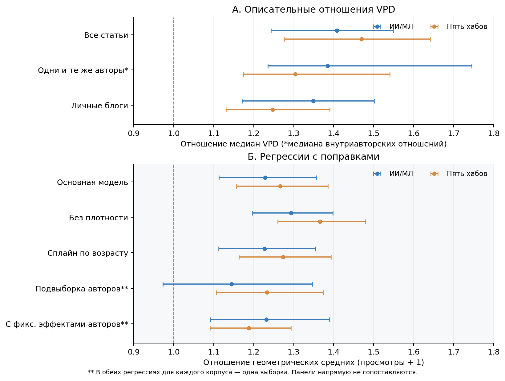

*Рисунок 5. Проверки устойчивости связи выходных с просмотрами. Верхняя панель — отношения медиан VPD, включая медиану внутриавторских отношений; нижняя — условные отношения из регрессий накопленных просмотров + 1. Сопоставлять величины оценок между панелями напрямую нельзя. Усы — 95% ДИ с учётом группировки по авторам; в нижних двух строках для каждого корпуса взята одна подвыборка.*

Сводный рисунок специально включает обычную регрессию на подвыборке фиксированных эффектов, интервал которой в ИИ/МЛ включает единицу. Общая картина не зависит исключительно от одной благоприятной спецификации.

### Личные и корпоративные блоги

Разница между типами блогов особенно интересна авторам корпоративных материалов. Чтобы проверить, различается ли именно связь выходных с просмотрами, а не просто медианы двух несопоставимых групп, добавил в исходную лог-регрессию взаимодействие признаков «выходные × корпоративный блог». Отдельно оценил вариант с плотностью и без неё. При таком взаимодействии отношение для корпоративных блогов — произведение отношения для личных и отношения отношений (в логарифмической модели — сумма коэффициентов).

{{s_blog_table}}

*Таблица 13. Взаимодействие выходных и типа блога. Условные отношения просмотров + 1; 95% ДИ по авторам, p для взаимодействия.*

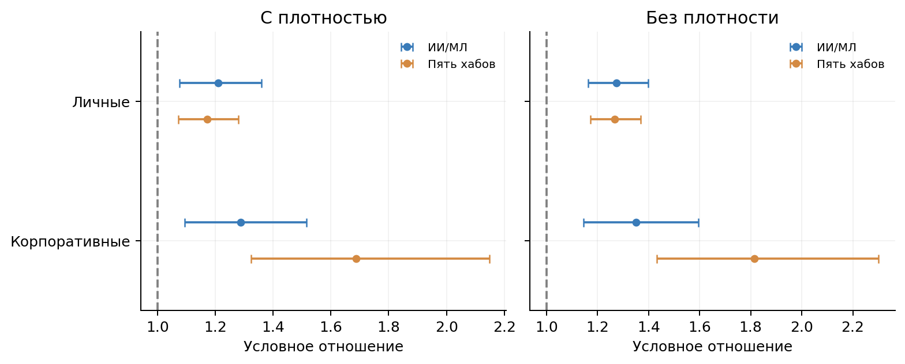

*Рисунок 6. Связь выходных с просмотрами по типам блогов, с плотностью и без. Усы — 95% ДИ с кластеризацией по авторам.*

В пяти хабах с учётом плотности у личных блогов отношение {{s_personal_wide}} (ДИ {{s_personal_ci_wide}}), у корпоративных — {{s_corporate_wide}} (ДИ {{s_corporate_ci_wide}}). Взаимодействие оценено как {{s_ratio_of_ratios_wide}} {{s_ratio_of_ratios_ci_wide}}, p = 0.004. Корпоративных статей в выходные примерно вчетверо меньше в расчёте на день (528 против 5390 в годовом окне). Без плотности знак и масштаб близки. В ИИ/МЛ убедительного различия между типами блогов не обнаружено. Это основание проверить календарь корпоративных публикаций на собственных данных, а не обещание прироста на 69%.

### Выходные и другие метрики

Просмотры — не единственная интересная метрика. В выгрузке есть ещё рейтинг публикации, комментарии и закладки. Если выходные статьи действительно чаще попадают на глаза читателям, это должно отразиться и на них. Проверим той же регрессией.

{{outcomes_table}}

*Таблица 14. Выходные и другие метрики.* Условные отношения «выходные / будни» для просмотров, комментариев и закладок по той же регрессии.

Комментарии и закладки ведут себя похоже на просмотры: для абсолютных счётчиков оценки выходных выше примерно на 20–30%, интервалы выше единицы. Но больший охват сам по себе может давать больше комментариев и сохранений. Поэтому сравнил ещё медианные удельные показатели — комментарии и закладки на 1000 просмотров каждой статьи, используя статьи с положительными просмотрами и валидными счётчиками. Разницу медиан оцениваю бутстрепом по авторам; дополнительно сравниваю отношение сумм счётчиков, чувствительное к весу популярных материалов.

{{s_engagement_table}}

*Таблица 15. Медианные удельные показатели на 1000 просмотров. Отношение сумм также рассчитано на 1000 просмотров.*

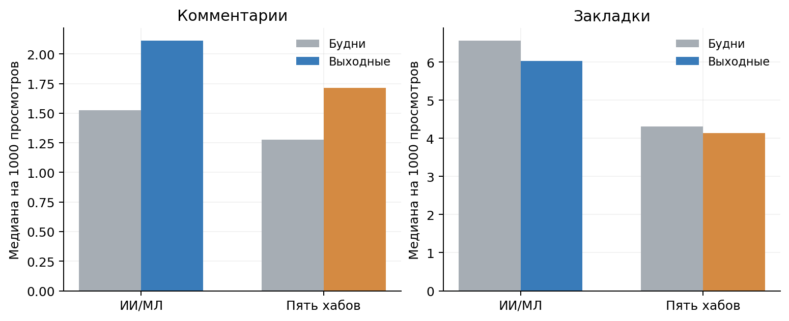

*Рисунок 7. Комментарии и закладки на 1000 просмотров (медианы индивидуальных показателей).*

В обоих корпусах медианное число комментариев на 1000 просмотров выше в выходные, а медианное число закладок ниже. Для закладок в пяти хабах интервал разницы включает ноль; при отношении сумм знак там меняется. Следовательно, данные не поддерживают простую картину «то же содержание, только больше глаз»: меняется и наблюдаемая структура взаимодействия с публикациями. Возможно, в будни читатели чаще сохраняют полезное для работы, а в выходные охотнее вступают в дискуссии; возможно, в эти дни просто публикуются разные по характеру статьи. Просмотры — не уникальные читатели, а удельные счётчики не являются прямой мерой качества текста.

С рейтингом всё менее ясно. Он дискретен, и его медиана в выходные и будни одна и та же: {{score_median}}. Информативнее доля статей с рейтингом 10 и выше. В ИИ/МЛ она почти одинакова, {{score_ge10_ai}} (выходные против будней). В пяти хабах разница заметнее, {{score_ge10_wide}}. Похоже, у выходных статей больше читателей. А вот убедительных оснований считать, что они выше оцениваются голосующими, эти данные не дают.

## 7. Плотность ленты и праздники

### Плотность ленты

На рисунке 1 мы видели, что в выходные статей выходит примерно вдвое меньше, чем в будни. Отсюда естественная гипотеза. Внимание читателей ограничено, и в насыщенной ленте статья быстрее уступает место следующей. А в выходные конкурентов меньше, поэтому каждая статья дольше остаётся на виду. Эту гипотезу высказывали и авторы прошлых разборов (из таблицы 1).

Предлагаю проверить её двумя способами. Сначала напрямую: связана ли плотность ленты с просмотрами. Потом косвенно, на праздниках. Праздник — это будний день, когда большинство не работает и статей выходит мало. Если дело в пустой ленте, праздничные статьи должны выигрывать так же, как выходные.

Сразу оговорюсь, чего у меня нет. В архиве нет сопоставимых данных о показах в ленте, позиции статьи, переходах и времени внимания. Поля `reach` и `readers` доступны лишь для части статей или несопоставимы по охвату и определению. Я вижу только, когда статьи вышли и сколько просмотров набрали. Поэтому механизм конкуренции я могу проверить лишь косвенно.

#### Связана ли плотность с просмотрами

Плотность ленты я измеряю двумя способами. Первый — сколько статей за весь период вышло в данном слоте, например во все вторники в 11 часов. Второй — сколько статей **того же корпуса** вышло за 24 часа до данной статьи (статьи, вышедшие в ту же секунду, конкурентами не считаются). Ни один из способов не показывает, что на самом деле видел в ленте конкретный читатель, ведь у каждого своя подборка хабов и подписок.

Связь плотности с просмотрами можно смотреть на разных уровнях. На самом грубом сравниваются всего семь чисел, по одному на день недели: сколько статей выходит в этот день и какой у них медианный VPD. Уровнем ниже — слоты «день × час». Ещё ниже — отдельные статьи за год. И наконец, отдельные статьи внутри каждого месяца, чтобы не смешивать плотность с ростом платформы. Результаты собраны в таблице 16.

{{density_table}}

*Таблица 16. Связь плотности публикаций исследуемого корпуса с VPD на разных уровнях.* Корреляция Спирмена — от семи агрегатов по дням недели до отдельных статей.

Сверху вниз связь тает. По семи дням недели корреляция почти идеальная и отрицательная: чем больше статей в день, тем ниже VPD. По слотам она уже умеренная. А на уровне отдельных статей её практически нет: коэффициенты около нуля, и знак в двух корпусах даже не совпадает.

Причина — в уровне агрегации. Сильная корреляция по дням недели посчитана всего по семи точкам, и почти вся она держится на разнице будней и выходных. Внутри будней число статей за день колеблется от {{wd_n_min}} до {{wd_n_max}} (примерно на {{wd_n_span}}%), а медиана VPD — от {{wd_vpd_min}} до {{wd_vpd_max}}, и одно с другим почти не связано. «Чем больше статей, тем хуже» — это та же разница выходных и будней, переписанная другими словами. Для отдельной статьи столь же сильной связи она не означает. При подсчёте плотности по объединению двух корпусов без дублей корреляции с VPD на тех же годовых выборках составили {{ed_ai_union_rho}} и {{ed_wide_union_rho}} соответственно; это по-прежнему не вся лента Хабра.

Можно считать конкурентов и иначе — по статьям, вышедшим в следующие сутки. Ведь это они сдвигают вашу статью вниз ленты. Если гипотеза конкуренции верна, такое прямое окно (t, t+24 ч) даже уместнее обратного. Но и оно даёт значения около нуля: ρ {{rho_fwd_ai}} в ИИ/МЛ и {{rho_fwd_wide}} в пяти хабах на статьях с полными сутками после публикации. Вывод от замены окна не меняется.

Есть ещё одна проверка: сравнить плотность отдельно в будни и выходные. Помимо обычной корреляции с VPD, построил в каждой группе регрессию накопленных просмотров (log10(views + 1)) на плотность предыдущих суток, логарифм возраста, месяц, тип блога и 15 индикаторов хабов. Коэффициент ниже приведён в виде отношения при десяти дополнительных статьях, интервалы с кластеризацией по авторам.

{{s_density_table}}

*Таблица 17. Плотность и просмотры отдельно в будни и выходные.*

Простые корреляции в ИИ/МЛ даже положительны. После поправок направление меняется, но лишь в будни в пяти хабах интервал условного отношения не включает единицу. В выходные интервалы широки. Это дополнительный аргумент против сильной отрицательной связи на уровне отдельных статей, но не опровержение гипотезы конкуренции: плотность измерена только по корпусу, диапазоны сужаются при разделении на будни и выходные, а лента читателя нам неизвестна.

Средний уровень, слоты, лучше всего виден на рисунке 8.

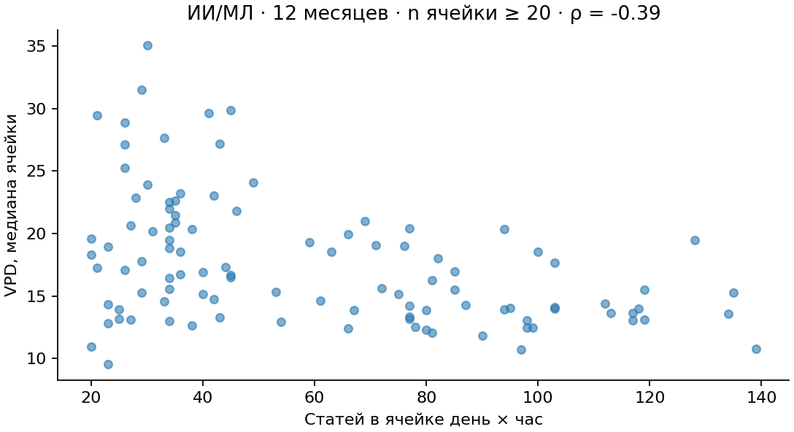

*Рисунок 8. Число статей и медианный VPD в повторяющихся слотах, ИИ/МЛ*

Каждая точка на рисунке 8 — один слот «день × час». По горизонтали — сколько статей в нём вышло за год, по вертикали — их медианный VPD. Справа, где статей больше ста, точки лежат плотной полосой в районе 12–16. Слева, где статей 20–50, они разбросаны от 10 до 35, и в среднем выше. Отсюда и отрицательная корреляция.

Но левая часть графика — это почти целиком выходные, а также ранние утренние и поздние вечерние часы будней. Высокие точки там соседствуют с низкими, а разброс большой по той же причине, что и на рисунке 2: в маленьких группах медиана шумит. Так что рисунок согласуется с гипотезой конкуренции, но не доказывает её. Для пяти хабов картина по слотам аналогична (таблица 16).

#### Сохраняется ли преимущество выходных при сходной плотности ленты

Самая очевидная проверка гипотезы лежит на поверхности. Если преимущество выходных объясняется только тем, что лента реже, то в группах со сходной плотностью выходные и будни должны идти одинаково. Чтобы это проверить, я разбил статьи на 5 равных групп (квинтилей) по плотности ленты за предыдущие сутки и внутри каждой сравнил выходные с буднями.

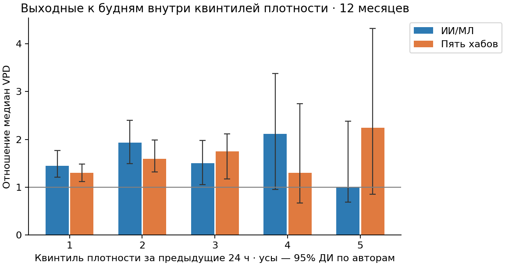

*Рисунок 9. Отношение медиан VPD выходных и будней внутри квинтилей плотности (усы — 95% ДИ по авторам)*

Серая горизонтальная линия на рисунке 9 — это единица, то есть «выходные и будни равны». Если бы всё объяснялось плотностью, столбцы стояли бы на этой линии. Столбцы выше неё. Интервал не опускается ниже единицы {{q_sure_text}}: и в группах с относительно небольшой плотностью ленты выходные статьи идут лучше.

В двух верхних квинтилях интервалы широкие и включают единицу. Там выходных статей очень мало, от {{q_top_we_min}} до {{q_top_we_max}}. В самом плотном квинтиле отношение {{q5_ratio_ai}} в ИИ/МЛ и {{q5_ratio_wide}} в пяти хабах, и при таких интервалах данные не говорят ни за, ни против.

Сама нехватка выходных статей в плотных квинтилях показательна. Квинтили равны по числу статей, но выходные почти целиком лежат в нижних. В ИИ/МЛ от первого (самая редкая лента) до пятого квинтиля выходных статей соответственно {{we_q_all_ai}}. Выходные почти всегда совпадают с редкой лентой, и разделить их в этих данных трудно.

Одна только измеренная плотность публикаций не устраняет наблюдаемую разницу между выходными и буднями. Но и сказать, какая доля эффекта приходится на конкуренцию, а какая, например, на то, что по выходным читают спокойнее, я не могу. Поведение читателей здесь не измерялось.

#### Кто публикуется в разные часы

Есть и ещё одно обстоятельство, которое легко упустить, сравнивая часы. В разное время суток публикуются разные статьи.

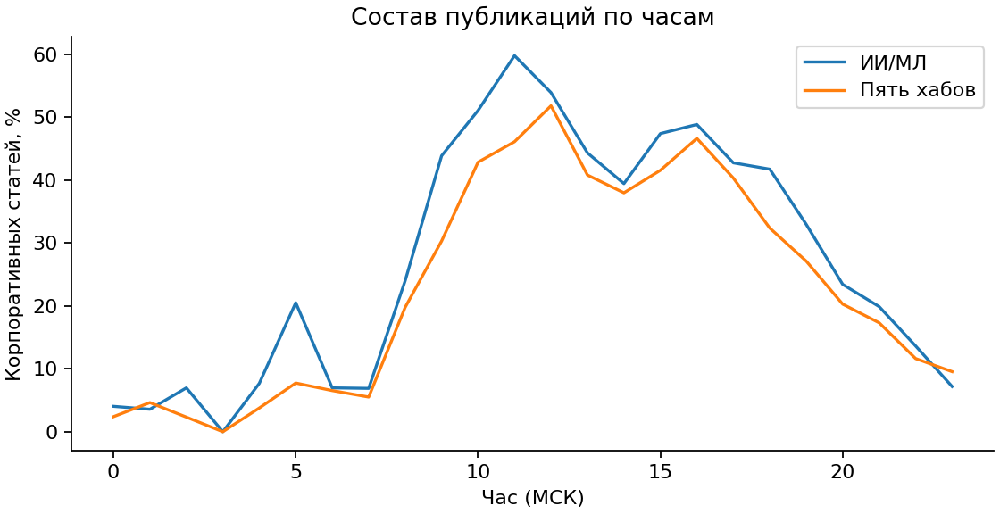

*Рисунок 10. Доля корпоративных статей по часам*

На рисунке 10 видно, что корпоративные блоги публикуются в рабочее время. Их доля резко растёт с 8 утра, достигает пика около полудня (до 60% в ИИ/МЛ) и к ночи падает почти до нуля.

Сравним это с рисунком 2. Дневной провал VPD, с 9 до 15 часов, приходится как раз на пик корпоративных публикаций. Совпадение не обязательно случайное, но и вывода «корпоративные статьи тянут день вниз» отсюда не следует. Суть в другом: сравнивая часы, мы сравниваем разный состав потока. Что стоит за различиями (корпоративное расписание, привычки читателей или и то и другое), эти данные не различают.

### Праздники

Праздник посреди недели похож на внеплановый выходной. Статей выходит мало, многие читатели свободны. Если праздничные статьи выигрывают так же, как выходные, это ещё один довод в пользу «пустой ленты» или «свободных читателей».

Праздничные дни я взял из производственного календаря России за 2016–2026 годы [13]. Это все нерабочие дни календаря, выпавшие на будни, включая перенесённые выходные. Например, 11 мая 2026 года (перенос с субботы 9 мая) или 9 марта 2026 года (перенос с воскресенья 8 марта). Рабочие субботы праздниками не считаются. Обычные субботы и воскресенья в это определение тоже не входят. Их эффект описан в разделе 6, и без разделения праздники поглотили бы эффект выходных.

Отдельно пришлось решить, что делать с одноразовыми нерабочими днями по указам Президента 2020–2021 годов (карантинные периоды и дни голосования). Это не ежегодные праздники, и люди в эти дни вели себя иначе, поэтому в праздники я их не включил. В контрольные даты они тоже не попадают, потому что остаются нерабочими.

Эти дни я проверил отдельно. В {{decree_days_ai}} будних днях указов вышло {{decree_n_ai}} статей ИИ/МЛ. С собственными контрольными датами (тот же день недели ±7, 14 и 21 день) их медианный перцентиль — {{decree_pct_ai}}, {{decree_p_ai}}. Различие не обнаружено, но это не доказывает, что его нет. Исключил я эти дни из-за особых обстоятельств, а не потому, что они как-то принципиально меняли результат.

Праздничные статьи сравниваются с контрольными статьями, вышедшими в тот же день недели за одну, две или три недели до или после праздника. Контролем может быть только рабочий день календаря. Праздники и переносы из контроля исключены, а рабочие субботы — нет. Обе группы берутся только из периода, который реально покрыт данными. При подсчёте среднего числа статей в день учитываются и дни, когда статей не было.

Источник календаря — машиночитаемые данные xmlcalendar.ru, собранные по постановлениям Правительства РФ о переносе выходных.

Первоначально я сравнивал перцентили просмотров внутри месяца публикации. Такой перцентиль снижает влияние возраста и различий между месяцами, но не снимает их полностью. Внутри месяца возраст статей различается почти на месяц. А праздники часто приходятся на его начало: в первые десять дней выходят {{pos10_holiday_ai}} праздничных статей ИИ/МЛ и {{pos10_holiday_wide}} в пяти хабах (у контрольных дат — {{pos10_control}}). Поэтому в качестве основной для праздничного сравнения использую локальную оценку.

В исходной месячной постановке проверил и ограничение контрольных дат окном ±10 дней от праздника. Разница составила {{holiday_w10_ai}} в ИИ/МЛ и {{holiday_w10_wide}} в пяти хабах. Это не устраняет возрастного смещения внутри самого перцентиля, поэтому нужна смена метрики, а не только ограничение дат контроля.

Почему не VPD? Возрастные составы групп различаются, и в разные стороны. В ИИ/МЛ праздничная группа моложе контрольной (медианы {{hol_age_ai}} и {{hol_age_ctrl_ai}} дней), в пяти хабах — чуть старше ({{hol_age_wide}} и {{hol_age_ctrl_wide}}). Поэтому отношение по VPD ({{tldr_holiday_vpd}}) зависит от возрастного состава, и я использую перцентили, рассчитанные среди статей близких дат.

Пересчитал ранги относительно статей, опубликованных в пределах ±7 календарных дней от каждой оцениваемой статьи (московские даты). Для чувствительности — окна ±3 и ±14 дней. Ранг делится на число зрелых статей того же корпуса в окне, включая саму статью; совпадающие просмотры получают средний ранг. Праздничные и контрольные даты остаются прежними. В анализе только полностью покрытые окна, минимум 20 статей в каждом. Для каждого окна пересчитал и прежнюю месячную оценку на тех же статьях, чтобы отделить изменение метрики от изменения состава.

{{s_holiday_table}}

*Таблица 18. Локальные перцентили: чувствительность к окну. ДИ рассчитаны отдельным бутстрепом (1000 повторений); интервалы месячной строки могут отличаться от основных из-за отдельного запуска.*

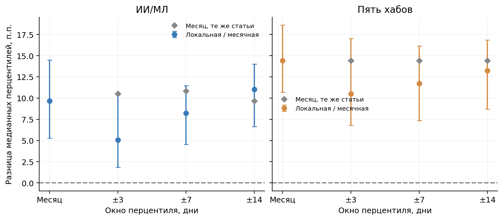

*Рисунок 11. Разница медианных перцентилей праздничных и контрольных статей. Для месячной оценки — исходные 95% ДИ по авторам, для локальных — по эпизодам и контрольным неделям; серые ромбы — месячные оценки на тех же статьях.*

В основном окне ±7 дней разница медианных перцентилей праздничных и контрольных статей составляет {{s_holiday_7_ai}} {{s_holiday_7_ci_ai}} п.п. и {{s_holiday_7_wide}} {{s_holiday_7_ci_wide}} п.п. В окне ±3 дня — {{s_holiday_3_ai}} и {{s_holiday_3_wide}} п.п.; при ±14 днях — {{s_holiday_14_ai}} и {{s_holiday_14_wide}} п.п. В ИИ/МЛ из-за ограничений на полноту окна и число статей выпадает часть ранних эпизодов. В самом узком окне месячная оценка на тех же статьях {{s_holiday_3_matched_ai}} и {{s_holiday_3_matched_wide}} п.п. соответственно; в пяти хабах состав не меняется. Следовательно, изменение состава не объясняет всю разницу оценок. Локальные окна пересекаются, контрольные даты могут повторяться между эпизодами; интервалы условны на рассчитанных рангах. Семь эпизодов широкого корпуса не дают точной оценки неопределённости. Наблюдаемая связь сохраняет знак, но её величина чувствительна к способу вычисления ранга.

{{holiday_table_pct}}

*Таблица 19. Праздничные дни против обычных: место статьи в своём месяце.* Медианный перцентиль просмотров, разница в процентных пунктах (95% ДИ — перевыборка праздничных эпизодов и контрольных недель) и вероятность превосходства.

Для сопоставления с исходной методикой таблица 19 приводит сравнение на месячных перцентилях. Оно описывает более широкую совокупность, но хуже контролирует возраст. Вероятность превосходства 0.56–0.60 означает, что случайно взятая праздничная статья обходит случайно взятую контрольную чуть чаще, чем в половине случаев.

Есть тонкость с интервалами. Праздничные статьи — не независимые наблюдения. Все статьи одного дня делят общие обстоятельства, а подряд идущие праздничные дни образуют эпизоды, например новогодние каникулы. Поэтому **в таблице 19 показаны интервалы по перевыборке целых праздничных эпизодов и контрольных недель**; их количества приведены рядом. Альтернативный бутстреп по авторам дал интервалы {{holiday_author_ci_ai}} п.п. в ИИ/МЛ и {{holiday_author_ci_wide}} п.п. в пяти хабах. Он не учитывает общий для праздника фон, поэтому я не использую его как основной.

В пяти хабах всего 7 эпизодов. С таким количеством кластеров даже эпизодический интервал нельзя считать точным. Если исключать по одному эпизоду, разница остаётся положительной: {{hol_loo_min_wide}}–{{hol_loo_max_wide}} п.п. (в ИИ/МЛ {{hol_loo_min_ai}}–{{hol_loo_max_ai}}). Это проверка устойчивости на имеющихся данных, а не гарантия результата для новых праздников.

{{holiday_table_flow}}

*Таблица 20. Праздничные дни против обычных: VPD, поток и состав.* Медианный VPD, среднее число статей в день и доля корпоративных статей.

Таблица 20 показывает, чем праздник отличается от обычного дня. Во-первых, статей выходит почти вдвое меньше. Во-вторых, ниже доля корпоративных статей (в ИИ/МЛ почти вдвое) — компании в праздники обычно тоже отдыхают. Лента в праздник и реже, и по составу другая. Это ещё пригодится в конце раздела.

Не держится ли эффект на одном Новом годе? Наш любимый оливьесодержащий праздник даёт около трети праздничных статей ({{ny_share_ai}} в ИИ/МЛ, {{ny_share_wide}} в пяти хабах)! Вместе с соседними нерабочими днями (31 декабря и переносами на 9 января) новогодний период даёт {{ny_tr_share_ai}} в ИИ/МЛ и {{ny_tr_share_wide}} в пяти хабах. Если считать на прежних месячных перцентилях, без новогодних каникул разница медиан остаётся положительной: {{holiday_excl_ny_ai}} против {{holiday_diff_ai}} п.п. в ИИ/МЛ, а в пяти хабах она даже увеличивается: {{holiday_excl_ny_wide}} против {{holiday_diff_wide}} п.п. Новый год не создаёт всю наблюдаемую разницу.

Чтобы посмотреть на праздники по отдельности на месячных перцентилях, я разбил их на блоки: Новый год, 23 февраля, 8 марта, 1 мая, 9 мая, 12 июня, 4 ноября и перенесённые выходные. Таблица 21 одна на оба корпуса. Строки в ней — блоки, а даты приведены по полному календарному окну ИИ/МЛ (окно пяти хабов — его часть с 24 июня 2025 года). У каждого блока свои контрольные даты: ±7, 14 и 21 день от его дат за все годы наблюдения, без нерабочих дней. Почему это важно, рассказано в разделе 11. У блоков, представленных лишь одним независимым праздничным эпизодом, интервал не показан, даже если в нём несколько нерабочих дней.

{{holiday_blocks_table}}

*Таблица 21. Праздники по блокам.* Разница медианных перцентилей «праздник минус контроль» в процентных пунктах; у каждого блока свои рабочие контрольные даты того же дня недели (±7, 14 и 21 день). Полные списки дат приведены в [ИИ/МЛ](data/results/part2_ai_results.json) и [пяти хабах](data/results/part2_wide_results.json), поле `holiday_blocks`. Даты в таблице относятся к окну зрелых статей; прочерк означает отсутствие подходящих праздничных статей или только один независимый праздничный эпизод, для которого интервал не рассчитывался.

Блоки ведут себя по-разному. У двух крупных блоков в ИИ/МЛ разница положительная: {{block_transfer_ai}} у перенесённых выходных и {{block_ny_ai}} у Нового года. У отдельных праздников разброс гораздо шире, от {{block_min_ai}} ({{block_min_name_ai}}) до {{block_max_ai}} ({{block_max_name_ai}}). Но статей в каждом из них немного, интервалы широкие и нередко включают ноль, так что выводы по конкретному празднику делать рано. При тесте Манна — Уитни по отдельным статьям различие обнаруживается в обоих корпусах ({{holiday_p_summarize}}). Однако этот p-value не учитывает зависимость внутри праздничных эпизодов, особенно существенную для семи эпизодов пяти хабов. Построчные оценки таблицы 21 иллюстративны; смешивать блоки в одно «праздничное» число значит усреднять разные явления.

Остаётся вопрос состава. В праздники меньше корпоративных статей, а они, как мы видели на рисунке 10, публикуются в другое время и, возможно, иначе читаются. Поэтому я сравнил корпоративные и личные статьи отдельно. Медианные перцентили внутри месяца в пяти хабах такие: {{holiday_by_type_wide}}. В ИИ/МЛ — {{holiday_by_type_ai}}. Эффект держится в обеих группах, так что дело не только в смене состава.

В праздники статьи выходят реже, а ранжируются выше в обоих корпусах. Это согласуется с объяснением через пустую ленту. Но праздники — только подобие эксперимента. В эти дни меняются и авторы, и темы, и занятия читателей. В широком корпусе праздничных дат немного. Его окно короткое, с июня 2025 года, потому что выгрузка одного из пяти хабов, «Информационной безопасности», неполна (раздел 4), и за это время праздников было мало. Такой результат особенно нуждается в повторной проверке.

### Так что же происходит по выходным?

Сведу вместе всё, что видно в разделах 6 и 7. У этих данных четыре кандидата в объяснения.

Первый — редкая лента. Статей выходит меньше, и каждая дольше остаётся на виду. В пользу этого говорят праздники и то, что в выходные статей вдвое меньше.

Второй — читатели. В выходные у них больше свободного времени, и читать они могут иначе. Косвенно в пользу этого говорит рисунок 9: в группах со сходной плотностью выходные всё равно впереди.

Третий — сами статьи. По выходным публикуются другие авторы и реже корпоративные блоги. Но сравнение автора с самим собой (таблица 5) и разбивка праздников на корпоративные и личные статьи показывают, что одним составом разницу не объяснить.

Есть и четвёртое объяснение: по выходным могут чаще публиковать обстоятельные руководства с долгим поисковым хвостом, а в будни — новости с коротким всплеском. Источники трафика и динамику конкретных статей я не измерял, поэтому разделить влияние этих механизмов по имеющимся данным не могу. Скорее всего, они действуют одновременно. Проверить это можно было бы с данными о показах в ленте, а для оценки причинного эффекта нужен эксперимент со случайным назначением времени.

Сезон и погоду я не разбирал. Для сезонной кривой нужны полные календарные годы, а у широкого корпуса в общем зрелом окне нет ни одного. В ИИ/МЛ сезон трудно отделить от роста числа публикаций и смены тем, а данных о погоде в пакете нет вовсе. Так что влияние тёплых солнечных дней и долгих зимних вечеров на публикационную и читательскую активность пока оставим для другого исследования.

## 8. Читаемость текста

До сих пор речь шла о «когда» и «кто». Из четырёх вещей Морли осталось «как» — язык текста. Можно ли получить больше внимания, если писать проще? Ильяхов и Сарычева, наверное, без раздумий бы сказали «да». Но мы вооружены данными. И здесь, увы, придётся сравнивать разные статьи, а не одну статью до и после правки.

Сначала посмотрим, как измерялась читаемость и почему эти измерения грубые. Потом — какие формальные свойства текста связаны с просмотрами. В конце — насколько выводы зависят от предобработки.

### Что именно измеряется

Перед подсчётом текст нужно очистить от всего, что не является прозой. Из HTML удаляются блоки кода, инлайн-код, таблицы, служебные элементы и формулы. Формулы распознаются по классу или по атрибуту data-tex, которым размечена часть формул-картинок. Разбор идёт по дереву документа. Границы абзацев и пунктов списков сохраняются, а предложения выделяет библиотека razdel. В счёт слов включены и односимвольные слова: «я», «и», «в», «с».

Подготовка не идеальна. Формулы могут быть картинками, списки — неполными предложениями, аббревиатуры — неоднозначными. Количество гласных служит приближением числа слогов, и для английских терминов и сокращений это приближение особенно грубое. Наконец, статьи могли быть отредактированы после публикации.

Классические индексы читаемости строятся из двух величин. Обозначим ASL — число слов на предложение, ASW — число гласных на слово (приближение числа слогов). Чем длиннее предложения и слова, тем текст формально сложнее.

Я проверял четыре формулы (см. таблицу 22). Классический индекс Флеша с английскими коэффициентами [14] и его вариант 1.3/60.1. ИУФО — индекс удобочитаемости Флеша в адаптации И. В. Оборневой (коэффициенты 1.52/65.14 приводятся в работе [15]). И ФК МОД, модифицированная формула Флеша — Кинкейда для русских текстов [15]. Для ИУФО и ФК МОД есть и вариант, где считаются только русские слова.

На рисунках 12 и 13 есть ещё три описательных показателя; TTR и MATTR не используются для основных выводов, доля английских слов обсуждается ниже. TTR (доля уникальных слов среди слов от четырёх букв) и MATTR — та же доля, усреднённая по скользящему окну в 500 слов, чтобы меньше зависеть от длины текста. Для текстов короче окна MATTR совпадает с TTR. Доля длинных русских слов — доля токенов из кириллических букв длиной не меньше 10 символов среди русских слов. Доля кода измеряется по длине содержимого блоков `<pre>` относительно исходного видимого текста HTML до очистки; это не доля строк с кодом. Время чтения readingTime взято из метаданных Хабра, а не оценено по нашему тексту.

| Индекс | Формула | Направление |
| --- | --- | --- |
| Флеш, английские коэффициенты | 206.835 − 1.015 × ASL − 84.6 × ASW | Выше — формально проще |
| Флеш, вариант 1.3/60.1 | 206.835 − 1.3 × ASL − 60.1 × ASW | Выше — формально проще |
| ИУФО, вариант 1.52/65.14 | 206.835 − 1.52 × ASL − 65.14 × ASW | Выше — формально проще |
| ФК МОД | 0.36 × ASL + 5.76 × ASW − 11.97 | Выше — формально сложнее |

*Таблица 22. Формулы индексов читаемости.* ASL — число слов на предложение, ASW — число гласных на слово.

Оригинальный индекс Флеша и русскоязычные исследования имеют разные калибровочные корпуса [14–16]. Коэффициенты 1.52/65.14 и ФК МОД приводятся в исследовательской литературе по русским учебным текстам [15]. Ни одна из формул не проверялась на статьях Хабра, поэтому я использую их как грубые линейки, а не как меру понятности. Для русскоязычного варианта ASL используется число русских слов, делённое на общее число сегментов предложений. Это дополнительная проверка чувствительности, а не самостоятельная стандартная формула.

Индексы почти дублируют друг друга — это важно для дальнейшего. Все формулы собраны из тех же двух величин, ASL и ASW, только с разными коэффициентами. Матрица корреляций индексов приведена на рисунке 12.

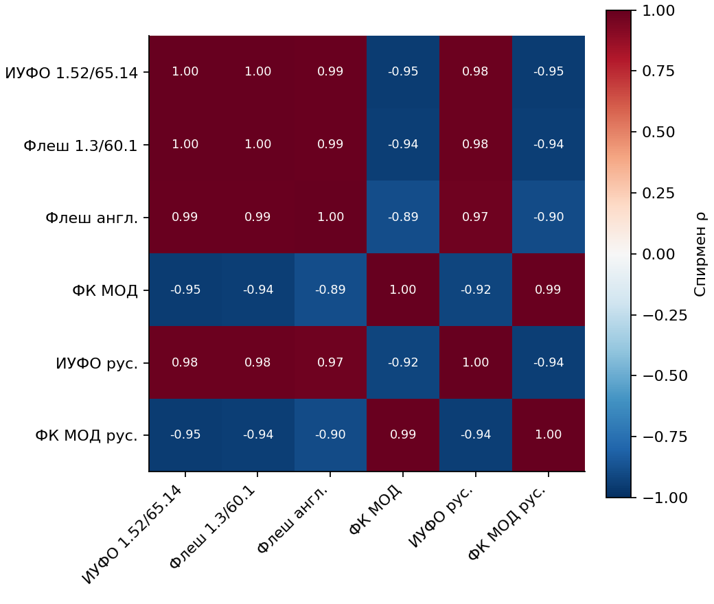

*Рисунок 12. Согласованность индексов читаемости между собой*

ФК МОД растёт со сложностью текста, а остальные индексы — с простотой. Поэтому его корреляции с ними отрицательные, и цветовая шкала идёт от −1 до +1.

Отсюда важное следствие. Если все четыре индекса покажут похожую связь с просмотрами, это будет ожидаемым следствием сходства формул, а не четырьмя независимыми подтверждениями. По сути у нас одна линейка, нарисованная четырьмя способами.

### Связь с результатом

Теперь главный вопрос раздела: связаны ли эти показатели с просмотрами?

{{readability_table}}

*Таблица 23. Связь текстовых метрик с VPD.* Корреляция Спирмена и интервал по перевыборке авторов; n — число текстов, для которых метрика посчитана.

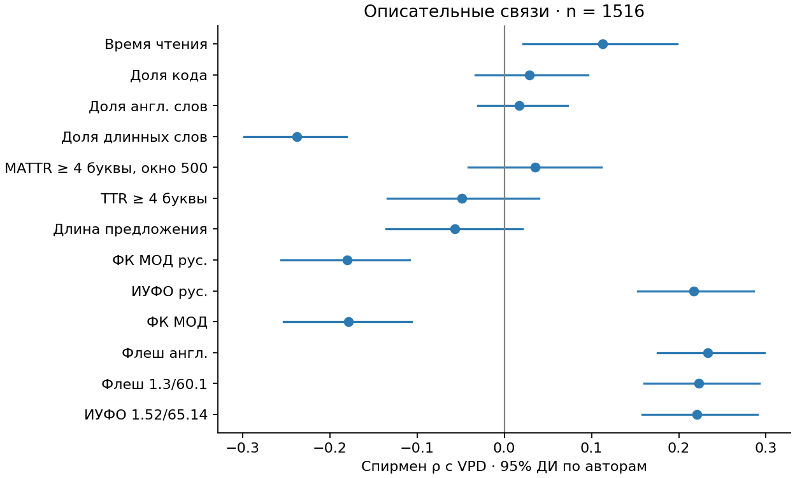

*Рисунок 13. Корреляции текстовых метрик с VPD (усы — 95% ДИ по перевыборке авторов)*

В таблице 23 и на рисунке 13 важны три вещи.

Во-первых, все индексы простоты связаны с просмотрами положительно, а ФК МОД, как индекс сложности, отрицательно. Формально более простые тексты в среднем набирают чуть больше. Связь слабая, коэффициенты около 0.2, но интервалы далеко от нуля.

Во-вторых, из двух составляющих индексов работает одна. Доля длинных слов связана с просмотрами заметно (ρ {{long_ws_rho}}), а длина предложений — почти нет, и её интервал включает ноль. Значит, индексы «видят» просмотры в основном через длину слов.

В-третьих, расчётное время чтения, указанное Хабром, связано с просмотрами слабо положительно (у 21 из 1516 статей это поле отсутствует); связь с долей кода близка к нулю. Доля английских слов также практически не связана с VPD (ρ = 0.017 [−0.03; 0.07]). По этим показателям систематического проигрыша длинных статей и статей с большим количеством кода не видно.

Отдельно про иллюстрации. Индексы читаемости их не видят, но число картинок в тексте посчитать можно (формулы, вставленные картинками, я не учитывал). Медиана — {{img_median}} на статью, а в {{img_none_share}} статей картинок нет совсем. Если пересчитать картинки на тысячу слов, связи с VPD практически нет: ρ {{img_rho}} {{img_ci}}. Статьи, где картинок больше двадцати, набирают заметно больше остальных (медианный VPD {{img_many_vpd}} против {{img_rest_vpd}}). Но таких статей всего {{img_many_n}}, и они вдвое длиннее остальных (медиана {{img_many_words}} слов против {{img_rest_words}}). По всей видимости, картинки просто сопутствуют большим обстоятельным статьям, а не добавляют просмотров сами по себе.

А насколько устойчива главная связь? Для ИУФО корреляция с VPD составляет {{read_rho}}. По корпусам отдельно она равна {{read_ai_rho}} в ИИ/МЛ и {{read_wide_rho}} в пяти хабах. Переводы в ИИ/МЛ эту связь не создают. Без них ρ равна {{read_rho_excl_ai}}, а внутри самих переводов — {{read_rho_tr_only_ai}}. В широком корпусе признака перевода нет.

Дальше я учёл то, что могло создать связь через состав выборки. Это корпус, месяц, корпоративность блога, 20 самых частых хабов текстовой выборки (она охватывает все годы, поэтому хабов в ней больше), длина текста и возраст. После таких поправок (частная ранговая корреляция) связь равна {{read_adjusted}}, то есть почти не изменилась.

По корпусам раздельно связь неоднородна. Та же процедура с теми же поправками (кроме корпуса) даёт {{read_adj_ai}} в ИИ/МЛ и {{read_adj_wide}} в пяти хабах. Для длины предложений — {{read_adj_asl_ai}} и {{read_adj_asl_wide}}. Похоже, в ИИ/МЛ язык значит больше, чем в широком корпусе. Но часть этой разницы создаёт сама поправка. Текстовая выборка ИИ/МЛ охватывает {{readcal_months_ai}} месяцев. С учётом индикаторов месяцев, хабов и остальных поправок получается {{readcal_params_ai}} параметров на {{read_n_ai}} статей. Если вместо этого учесть год и месяц года, связь ИУФО с VPD равна {{readcal_ai}} в ИИ/МЛ и {{readcal_wide}} в пяти хабах, а совсем без календаря — {{readcal_none_ai}} и {{readcal_none_wide}}. Разница между корпусами сохраняется, но становится скромнее, а интервалы частично перекрываются. Поправки ослабляют часть объяснений через состав выборки (хабы, длину, возраст), но не исключают разницу тем внутри хабов и содержательную сложность.

И последняя проверка — другая метрика успеха. Ранговая связь ИУФО с перцентилем просмотров внутри месяца равна {{read_pct_all}} в целом (с VPD было {{read_rho}}), {{read_pct_ai}} в ИИ/МЛ ({{read_ai_rho}}) и {{read_pct_wide}} в пяти хабах ({{read_wide_rho}}). Знак связи сохраняется, но её величина заметно зависит от выбора метрики, особенно в ИИ/МЛ.

### Хабы и внутриавторская проверка

Для доли длинных русских слов применил ту же процедуру частной ранговой корреляции, что и для ИУФО: остатки рангов после поправок на корпус, месяц публикации, тип блога, 20 наиболее частых хабов, log1p(длины) и log1p(возраста). Отдельно проверил связь внутри каждого представленного в текстовой выборке хаба с не менее чем 50 наблюдениями. Поскольку одна статья может иметь несколько хабов, эти оценки зависимы и приведены только описательно.

{{s_hub_table}}

*Таблица 24. Корреляции с VPD внутри отдельных хабов, без поправок. Отмечены семь хабов, образующих корпуса; остальные — сопутствующие. Выборки хабов пересекаются.*

Во всех семи основных хабах корреляция доли длинных слов отрицательна. Это не означает того же для каждого сопутствующего хаба; например, в IT-инфраструктуре она близка к нулю. У bothub высокие точечные корреляции, но подвыборка всего 57 статей, возможна тематическая неоднородность.

Можно попробовать сравнить более простые и более сложные тексты одного и того же автора. Для этого в каждом корпусе перевёл признаки и VPD в процентильные ранги и центрировал их внутри пары «автор × корпус». Внутриавторская корреляция — корреляция остатков рангов после учёта года, месяца года, типа блога, хабов, логарифмов длины текста и возраста. В качестве основной подвыборки использовал авторов с не менее чем двумя статьями внутри корпуса, порог три — чувствительность. Если остаточных степеней свободы меньше 10 или авторов меньше 20, скорректированную оценку не интерпретирую и не публикую. Интервалы рассчитаны для коэффициента наклона регрессии остатков, а не для самой корреляции; кластеризация по автору с поправкой на число фиксированных эффектов.

{{s_read_within_table}}

*Таблица 25. Читаемость с поправками и внутри авторов. ДИ относятся к наклону, а не к корреляции остатков.*

В общей выборке частная корреляция составляет {{s_partial_oborneva_all}} для ИУФО и {{s_partial_long_word_share_all}} для длинных слов. Внутри авторов при пороге две статьи — {{s_within_oborneva_2_all}} и {{s_within_long_word_share_2_all}}, при пороге три — {{s_within_oborneva_3_all}} и {{s_within_long_word_share_3_all}}. Для ИУФО оценка внутри авторов в ИИ/МЛ практически исчезает ({{s_within_oborneva_2_ai}}), в пяти хабах сохраняется ({{s_within_oborneva_2_wide}}). Доля длинных слов в ИИ/МЛ сохраняет отрицательную точечную оценку ({{s_within_long_word_share_2_ai}}), но при 94 статьях и 36 авторах остаётся лишь 14 остаточных степеней свободы; интервалы наклонов обеих метрик широки. При пороге три в ИИ/МЛ 48 статей и 13 авторов; модель перегружена поправками, поэтому скорректированные оценки не интерпретируются.

В предыдущем сравнении большее число статей автора может давать ему больше веса. Сделал ещё одну проверку: для каждого автора посчитал индивидуальную ранговую корреляцию в его корпусе, усреднил по корпусам у авторов, встретившихся в обоих, и дал каждому автору один голос. Интервалы — бутстреп по авторам. Эта схема не предусматривает тех же регрессионных поправок; она отвечает на иной описательный вопрос.

{{s_read_equal_table}}

*Таблица 26. Один автор — один голос. Среднее индивидуальных корреляций, 95% ДИ по авторам.*

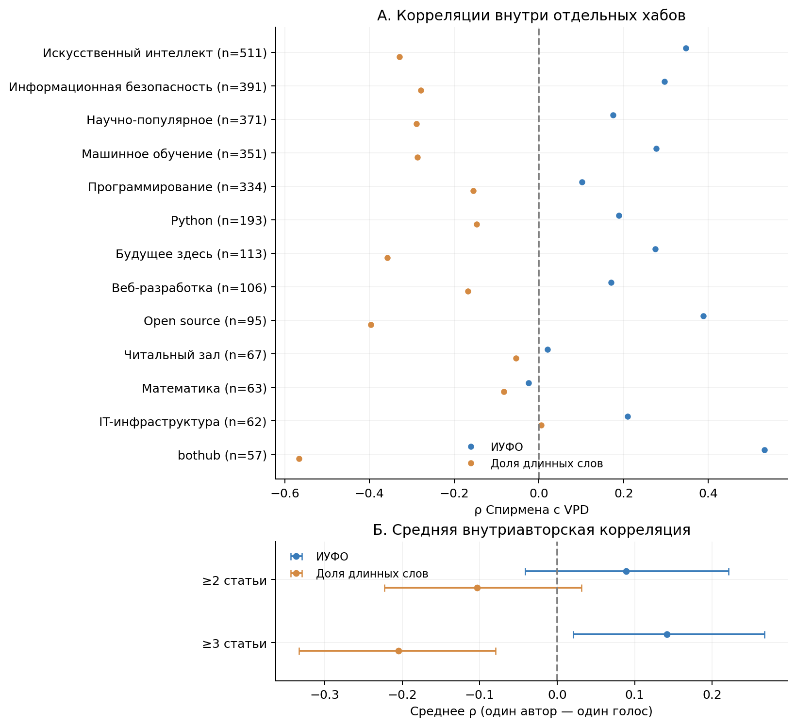

*Рисунок 14. Читаемость в отдельных хабах и внутри авторов с равными весами авторов. Верхняя и нижняя панели показывают разные описательные показатели; хабы пересекаются.*

При равных весах авторов и пороге две статьи оценки в общей выборке снижаются до {{s_equal_oborneva_2_all}} и {{s_equal_long_word_share_2_all}}, оба интервала включают ноль. При пороге три оценки сильнее, но выборка меньше; выбирать этот порог потому, что интервалы удобнее, было бы подгонкой. Таким образом, связь не сводится исключительно к различиям между хабами, но её устойчивость внутри отдельных авторов зависит от способа сравнения. Темы внутри хаба или даже одного автора остаются неизмеренными.

### Короткие предложения, длинные слова и длина статьи

Популярный совет авторам — писать короткими предложениями. Наши данные его не подтверждают (хотя я продолжу безуспешные попытки следовать этому совету). Связь с длиной предложений существенно слабее связи с долей длинных слов, а её доверительный интервал (посчитанный перевыборкой авторов) включает ноль.

Как советовал Некрасов, писать надо так, чтобы словам было тесно, а мыслям — просторно. Если понимать его буквально, будто тесно должно быть самим словам, то Хабр с ним согласен. С просмотрами заметнее связана доля длинных слов (ρ {{long_ws_rho}}), чем длина предложений или всей статьи. После поправок и внутри авторов связь неоднородна, как мы только что увидели.

Длина статьи — отдельный разговор. Медианы VPD по квартилям длины такие: {{len_quartiles}}. Связь длины с просмотрами слабо положительная (ρ {{len_rho}}, с поправкой на возраст и корпоративность — {{len_rho_adj}}). Самые длинные тексты набирают не меньше коротких. Отдельный сегмент «чем короче, тем лучше» есть только среди {{len_n_short}} самых коротких текстов до 500 слов, и это, вероятно, новостные заметки (ρ {{len_rho_short}}).

Механически заменять технические термины короткими словами тоже не стоит. Формула может улучшиться, а текст станет менее точным.

### Можно ли по индексу угадать хит

Корреляция описывает среднюю тенденцию. Но автору интереснее другое: помогает ли индекс отличить будущий шедевр от заурядной статьи? Для этого подходит AUC — вероятность, что индекс у случайной статьи из верхней группы выше, чем у случайной статьи вне неё (совпадающие значения засчитываются как половина). AUC 0.5 означает подбрасывание монетки, 1 — идеальное разделение.

Для верхнего квартиля VPD AUC индекса ИУФО равен {{auc75}}. Для верхнего дециля — {{auc90}}. Это два разных определения «хита», которые нельзя смешивать. Но в обоих случаях значения лишь умеренно выше 0.5. По индексу читаемости отдельный хит угадывается плохо.

Разобьём тексты на 10 групп по ИУФО.

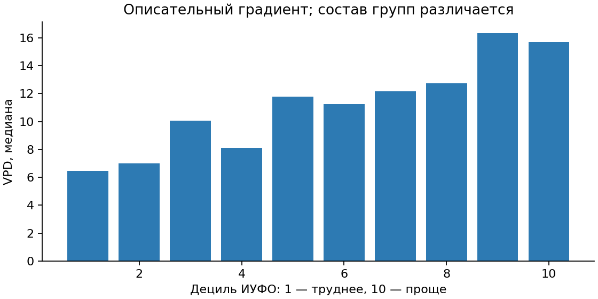

*Рисунок 15. Медианный VPD по децилям ИУФО*

На рисунке 15 медианы VPD по децилям растут от формально сложных текстов к простым (от 6.5 до 15.7). Десятый и первый децили различаются в {{decile_ratio}} раза. Рост при этом неровный — есть провалы, а последний дециль даже чуть ниже предпоследнего. Это не лестница, по которой текст поднимается при упрощении. Разные децили содержат разные тексты, а не версии одного текста после последовательного упрощения.

Вывод по читаемости такой. Формально более простые тексты, прежде всего с меньшей долей длинных слов, в среднем набирают немного больше. Связь устойчива к поправкам, но слабая, и отдельную успешную статью по ней не предсказать.

### Насколько всё зависит от предобработки

Последний вопрос этого раздела технический, но поучительный и просто мне интересный. Как сильно результат зависит от того, как именно текст очищен и разбит на слова и предложения? Я сравнил основную подготовку с упрощённой, где односимвольные слова теряются, а предложения режутся регулярным выражением.

Знак корреляции сохраняется, а её величина (таблица 27) меняется примерно на 0.02. Казалось бы, мелочь. Но различия между корпусами и между индексами, которые хочется объяснять, того же порядка. Прежде чем объяснять корреляцию, проверьте, что код правильно делит текст на слова и предложения.

{{preprocessing_table}}

*Таблица 27. Чувствительность к подготовке текста.* Корреляции индексов с VPD при упрощённой подготовке (без односимвольных слов, предложения выделяются регулярным выражением) и при основной.

Есть и независимая проверка подсчёта слов. Число слов, которое насчитал мой код, коррелирует с показанным Хабром временем чтения (ρ = {{words_rt_rho}}). Медиана отношения слов к указанным минутам равна {{words_per_minute}}. Судя по всему, время чтения Хабр сам считает по объёму текста. Так что это проверка подсчёта слов, а не скорости чтения, и независимого человеческого эталона здесь нет.

## 9. Модель: можно ли предсказать просмотры заранее

Всё, что было выше, описывает уже вышедшие статьи. Автору же хочется заглянуть вперёд: сколько наберёт моя статья, если опубликовать её тогда-то? Для этого я обучил градиентный бустинг на более ранних публикациях и посмотрел, как он справляется с более поздними. Содержания статей модель не видит: только календарь, признаки заголовка, тип блога и число прошлых публикаций автора.

**Первая попытка оказалась неудачной.** Я использовал LightGBM с пуассоновской функцией потерь: просмотры — счётчик, выбор выглядит естественным. Но естественный не значит лучший. Сравнение с простым прогнозом медианы оказалось не в пользу модели. А корреляции с накопленными просмотрами отчасти отражали возраст: более ранние статьи успели собрать больше читателей.

Поэтому я перезапустил эксперимент на тех же данных, но сравнил LightGBM и CatBoost с разными функциями потерь. Данные разделены на последовательные временные периоды: на ранних публикациях модели обучаются, на валидационном периоде выбирается конфигурация, а самый свежий период служит итоговой ретроспективной проверкой. В ИИ/МЛ обучение идёт на статьях 2016–2023 годов, выбор — на 2024-м; 2025 год служит дополнительной проверкой устойчивости, а 2026-й — итоговой ретроспективной оценкой. У пяти хабов история короче: обучение — с конца июня по декабрь 2025 года, выбор — январь–апрель 2026-го, итоговая проверка — с мая. Свежие статьи я уже видел на предыдущих этапах работы, так что называть итоговую проверку независимым тестом было бы лукавством.

Главный показатель качества — корреляция Спирмена *внутри месяца публикации*. Так статьи сравниваются с соседями примерно одного возраста. Величина ρ показывает, насколько удачно модель расставляет их по ожидаемой популярности (т.е. это не точность прогноза числа просмотров!).

{{ml_val_table}}

*Таблица 28. Корреляции внутри календарных месяцев на валидационной выборке.* Больше — лучше. Модель выбиралась только по этим числам, итоговая проверка в выборе не участвовала.

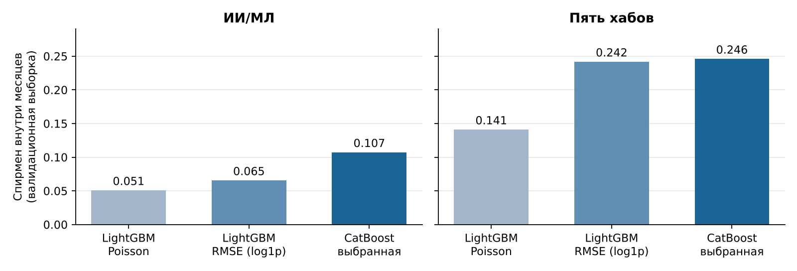

*Рисунок 16. Прогноз популярности: LightGBM с пуассоновской функцией потерь, LightGBM на логарифме просмотров и выбранная модель CatBoost. Корреляция Спирмена внутри месяцев на валидационной выборке*

На пяти хабах простая замена функции потерь уже резко улучшает LightGBM: с {{ml_lgb_pois_wide}} до {{ml_lgb_log_wide}}. CatBoost даёт {{ml_cb_wide}}. Поэтому было бы неправильно объявить весь выигрыш заслугой новой библиотеки. На ИИ/МЛ преимущество выбранной модели CatBoost заметнее, но и там ρ = {{ml_cb_ai}} не делает её оракулом. Даже при удачной функции потерь большинство различий между статьями остаётся необъяснённым.

После переобучения выбранных моделей на объединённой обучающей и валидационной выборке ранговая корреляция между прогнозируемым и фактическим числом просмотров внутри месяцев на итоговой ретроспективной проверке составила 0.12 в ИИ/МЛ и 0.27 в пяти хабах.

С абсолютным числом просмотров всё ещё хуже. На итоговой проверке медианный прогноз CatBoost выше факта в {{ml_overpred_ai}} раза на ИИ/МЛ и в {{ml_overpred_wide}} раза на пяти хабах. При этом ошибка MAE на шкале log1p лишь немного лучше константного прогноза: {{ml_mae_ai}} против {{ml_mae_base_ai}} и {{ml_mae_wide}} против {{ml_mae_base_wide}} соответственно. Важную роль, вероятно, играет разный возраст статей в обучении и в проверке, но количественно отделить его от других причин здесь нельзя. Так что прогноз модели я дальше использую **как рейтинг, а не как обещание конкретного числа просмотров**.

Чтобы проверить масштаб различия возрастов, посчитал их распределение в исходных выборках и в объединённой обучающей выборке финальных моделей. Границы выборок были зафиксированы заранее, модели не переобучались. В признаках выбранных моделей возраста статьи нет: будущий срок накопления просмотров при публикации неизвестен. Исторических счётчиков за фиксированный срок для обучения нет.

{{s_fold_table}}

*Таблица 29. Возраст и накопленные просмотры в выборках CatBoost. Финальное обучение объединяет train и validation; дополнительная проверка ИИ/МЛ в него не входит.*

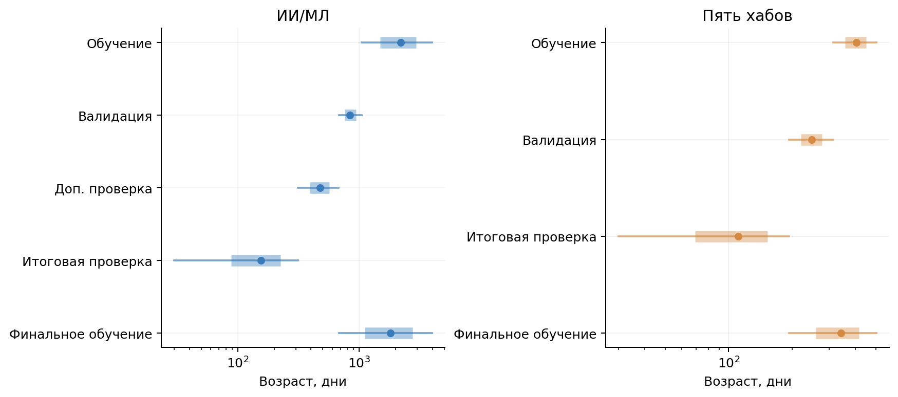

*Рисунок 17. Распределения возраста статей в выборках: минимум, максимум, межквартильный интервал и медиана (дни, логарифмическая шкала).*

Медианный возраст в финальном обучении и итоговой проверке — {{s_age_final_train_ai}} против {{s_age_audit_exposed_ai}} дней в ИИ/МЛ, {{s_age_final_train_wide}} против {{s_age_audit_exposed_wide}} дней в пяти хабах. Целевая переменная имеет разные горизонты накопления, что правдоподобно объясняет хотя бы часть завышения. Мы не измеряли просмотры по одинаковому горизонту и не можем количественно отделить возраст от изменений тематики и аудитории. Поэтому не интерпретирую ошибку калибровки как фундаментальный предел предсказуемости популярности на Хабре.

Есть ещё одна тонкость. Качество прогноза популярности не равно качеству выбора времени. Если модель угадывает, что известный автор с сильным заголовком соберёт больше просмотров, она может обойти простой признак выходных даже при полном отсутствии способности различать хорошие и плохие часы. Это мы и проверим дальше.

### Что именно обучалось и почему это не независимый прогноз

В основной конфигурации (F1_meta) использовались только признаки, известные до публикации: день недели, час и календарные флаги, свойства заголовка и блога, число предыдущих статей автора. В отдельных вариантах добавлялась ожидаемая плотность ленты, посчитанная по обучающей выборке, но выбранные модели её не используют. Реальные просмотры предыдущих статей в историю автора не включались: их ноябрьские счётчики недоступны в момент исторической публикации.

Были проверены CatBoost с RMSE на логарифме просмотров, медианной (квантильной) функцией потерь на исходных и логарифмированных просмотрах, пуассоновской и функцией Хьюбера. Для сравнения сохранялись LightGBM с пуассоновской функцией потерь и с RMSE на логарифме. Финалисты выбирались по корреляции внутри месяцев на валидационной выборке, итоговая проверка в отборе не участвовала. Выбранные модели содержат {{ml_trees_ai}} дерева для ИИ/МЛ и {{ml_trees_wide}} дерева для пяти хабов. Перед итоговой проверкой их переобучили на объединённых обучающей и валидационной выборках (в ИИ/МЛ — {{ml_ntrain_ai}} статьи).

Проверки на нескольких временных разбиениях полезны, но не позволяют буквально «вернуться в 2023 год»: все накопленные просмотры мы увидели одним срезом в ноябре 2026-го. И содержание текста, которое зачастую определяет успех публикации, не моделировалось. Подробная методика эксперимента, конфигурации, прогнозы для каждой статьи и метрики — в experiments/catboost/ репозитория.

## 10. Можно ли доверить модели выбор слота

Допустим, модель верно ожидает, что статья А наберёт больше просмотров, чем статья Б. Но автору нужен ответ на другой вопрос: станет ли *та же статья* успешнее, если выпустить её в другое время? Здесь прогноз популярности легко принять за рекомендацию, хотя это разные задачи.

Для проверки я разделил оценки модели на три режима. **A** — полный прогноз: время, заголовок, блог и история автора меняются вместе, как у реально опубликованных статей. **B1** — фиксированный профиль признаков статьи: заголовок, блог и история автора одни и те же, меняется только календарь. **B2** — личная оценка времени: для каждой статьи её фактический слот сравнивается с другими возможными слотами *для неё же*. Оценкой в B2 служит место фактического слота в этом личном рейтинге, а не разница в ожидаемых просмотрах.

Во всех трёх режимах я использовал одни и те же статьи итоговой проверки: {{ml_n_ai}} публикаций из некорпоративных блогов в корпусе ИИ/МЛ и {{ml_n_wide}} — в корпусе пяти хабов, только в слотах, достаточно представленных в обучении (не меньше 20 статей). Сравнение — с примитивным правилом «выходные лучше будней». Разность Δρ — корреляция рейтинга модели с накопленными просмотрами минус корреляция признака выходных с теми же просмотрами. Ноль означает, что дополнительной ранговой связи не обнаружено.

{{ml_modes_table}}

*Таблица 30. Дополнительная корреляция относительно правила выходных на одинаковых выборках.* Интервалы — 95% ДИ по перевыборке авторов (1000 повторений). Все результаты получены на уже знакомых данных итоговой проверки, а не на независимом тесте.

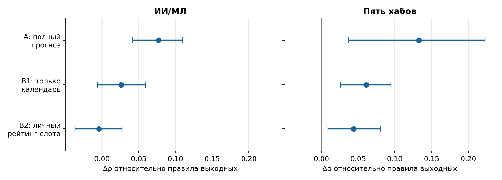

*Рисунок 18. Что остаётся от преимущества модели над выходными, когда сначала фиксируем свойства статьи, а затем оцениваем время относительно её собственных альтернатив (отрезки — 95% ДИ)*

Зафиксируем свойства статьи — и картина меняется. Полный прогноз уверенно выигрывает у признака выходных. Но в режиме B1 преимущество на ИИ/МЛ уменьшается до {{ml_b1_ai}}, и доверительный интервал включает ноль. Правда, этот вывод неустойчив. При двух других начальных значениях генератора случайных чисел (сидах) получается {{ml_b1_seeds_other_ai}}, и там интервалы уже не задевают ноль. А на других временных разбиениях ИИ/МЛ разница колеблется от {{ml_b1_folds_min_ai}} до {{ml_b1_folds_max_ai}}.

На пяти хабах небольшой дополнительный календарный сигнал есть при всех трёх сидах: {{ml_b1_wide}}, интервал целиком выше нуля. При сравнении с перцентилем просмотров внутри месяца, дополнительной защите от влияния возраста, значения близки: {{ml_b1_pct_ai}} и {{ml_b1_pct_wide}}.

В личном рейтинге (B2) результаты скромнее: {{ml_b2_ai}} для ИИ/МЛ и {{ml_b2_wide}} для пяти хабов. Во втором корпусе интервал выше нуля, то есть небольшая дополнительная наблюдательная связь есть. Но шкала B2 была выбрана после знакомства с итоговой проверкой: результат следует считать **разведочным**, а не независимо подтверждённым. Кроме того, о фактическом переносе это ничего не говорит. Для каждой статьи мы знаем результат только в том слоте, который выбрал её автор; просмотров той же статьи в альтернативные часы в данных нет.

Если оставить только будние публикации, календарный рейтинг (B1) всё ещё различает часы: корреляция с просмотрами {{ml_wd_rho_ai}} в ИИ/МЛ и {{ml_wd_rho_wide}} в пяти хабах, а верхняя треть рейтинга набирает больше нижней в {{ml_wd_ratio_ai}} и {{ml_wd_ratio_wide}} раза. Похоже, это та же разница вечера и дня, что на рисунке 2. А вот конкретные лучшие слоты меняются между временными разбиениями. Рекомендовать «среду в 20:00» вместо «четверга в 19:00» эти результаты не позволяют. Да и с общей лентой закономерности могут измениться (раздел 4).

**Вывод. Ранжировать статьи** модель научилась заметно лучше первой пуассоновской версии — во многом благодаря функции потерь. Для времени полезность гораздо скромнее: основной сигнал — выходные и, возможно, вечер. На пяти хабах есть небольшой дополнительный календарный сигнал, на ИИ/МЛ он ещё меньше и неустойчив. Но даже статистически положительная связь не означает, что перенос конкретной статьи увеличит её просмотры. Для такого ответа нужен эксперимент или хотя бы повторные измерения на одинаковом горизонте.

### Как я проверял личные слоты и что в этой проверке нельзя доказать

Для B1 зафиксированы три профиля статьи: новичок, опытный личный автор и корпоративный блог. Внутри одного календарного слота все признаки профиля, кроме времени, неизменны. В таблице 30 показан профиль новичка, у двух других результаты близки. Для B2 каждой статье сопоставлена сетка допустимых альтернатив её месяца. Модели предъявляются календарно согласованные реальные даты, а фактический слот оценивается строго по исходным признакам той же статьи. В личный рейтинг входят только слоты, достаточно представленные в обучении.

Я сравнил три шкалы B2: разность прогнозов фактического слота и медианы альтернатив, логарифм их отношения и долю альтернатив, которые модель оценивает не выше фактического слота. Первые две шкалы смешивают удачность времени с ожидаемой популярностью самой статьи: у сильной статьи и разность больше. Поэтому основной стала третья. Выбор этот я сделал уже после первого взгляда на итоговую проверку, и третья шкала оказалась самой благоприятной для модели. Поэтому привожу и остальные. Разность прогнозов даёт {{ml_b2_abs_ai}} в ИИ/МЛ (весь интервал ниже нуля) и {{ml_b2_abs_wide}} в пяти хабах. Логарифм отношения — {{ml_b2_rel_ai}} и {{ml_b2_rel_wide}}.

Тестовые публикации сравниваются по накопленным просмотрам и отдельно по перцентилю внутри календарного месяца. Доверительные интервалы посчитаны парным бутстрепом по авторам, проверки по неделям и другим периодам вынесены в репозиторий. Модели выбраны только по валидационной выборке, по правилу, зафиксированному до обучения.

Отдельная проблема — один срез просмотров. Если очень хочется выяснить, действительно ли время *помогает* статье, нужны просмотры через одинаковые 1, 3, 7 и 30 дней либо случайный выбор слота для сопоставимых материалов. В текущих данных таких контрфактических исходов нет.

## 11. Грабли, на которые я наступил

Раздел скорее для тех, кто сам делает подобный анализ. Почти каждая ошибка ниже ретроспективно очевидна, но давала правдоподобный и красивый результат, поэтому искать её не хотелось. Расскажу, в чём была ошибка и как я её нашёл.

**Будущие результаты в истории автора.** Для прогноза февральской статьи нельзя использовать просмотры январской, накопленные к ноябрю 2026 года. Январская статья вышла раньше, но её счётчик относится к будущему по отношению к февралю. Фильтр publication_time < current_time решает только половину задачи, нужен ещё observation_time <= prediction_time. Вторая утечка: авторам без истории подставлялась глобальная медиана по всему датасету, включая тестовые статьи.

От автора в модели остались только число его предыдущих публикаций в корпусе и признак наличия истории. Публикации с одинаковым временем не считаются предшествующими, а неизвестные авторы не объединяются в одного общего автора.

Насколько сильно утечка искажала результат, видно в таблице 31. Для этой проверки я вернулся к исходной модели и менял в ней только авторские признаки.

{{leakage_table}}

*Таблица 31. Утечка через историю автора.* Корреляция Спирмена на тесте при разных вариантах авторских признаков; остальные настройки одинаковы.

Диагностика выполнена на выборке {{leak_n_train}} / {{leak_n_test}} статей ИИ/МЛ (обучение / тест). Гиперпараметры взяты из исходной модели, как и её цель: исходная модель предсказывала логарифм VPD, а не сами просмотры, как текущая. Так эффект утечки отделяется от смены настроек. Модели раздела 9 обучаются на других выборках и с другим разбиением по времени, поэтому числа таблиц 28 и 31 напрямую не сравниваются.

Когда-то я сделал вывод, что история автора даёт половину предсказательной силы модели. Таблица 31 показывает, что этот вывод был артефактом утечки. С поздними результатами прошлых статей корреляция поднималась до {{leak_orig}}, а честное число прошлых публикаций даёт только {{leak_count}} против {{leak_none}} без авторских признаков вообще.

**Выбор победителей после просмотра ответа.** В первой проверке слотов три дециля с самыми высокими **фактическими** медианами на тесте сравнивались с тремя самыми низкими, и это отношение я называл выигрышем от рекомендаций. Но на случайном шуме такая величина почти всегда больше единицы: лучшие группы, выбранные по ответу, всегда лучше худших. Теперь пороги низкого, среднего и высокого прогнозов определяются только по обучающей выборке, а результаты теста не участвуют ни в выборе границ, ни в выборе победителей (раздел 10).

**Календарь без переносов и лишние дни в среднем.** Изначально праздники были представлены списком фиксированных дат без переносов. Кроме того, при подсчёте среднего числа статей в праздничный день я делил число статей на число праздничных дней. И в это число дней попадали дни за пределами наблюдаемого периода, как будто в них вышло ноль статей. Из-за этого падение числа публикаций в праздники «получалось» в 2.3 раза вместо {{tldr_holiday_volume}}. Теперь используется настоящий производственный календарь с переносами и рабочими субботами, а дни считаются только внутри периода, покрытого данными (раздел 7).

**Общий пул контролей праздничных блоков.** Все праздничные блоки делили один пул контрольных дат всех праздников. Блоку «8 марта» доставались в контроль декабрь с маем, и к его эффекту подмешивались сезонность, возраст и состав чужих месяцев. Теперь у каждого блока свои контрольные даты в пределах трёх недель (раздел 7).

**Плотность за 1000 дней.** Код ожидал метки времени в наносекундах, а после перехода в ходе исследования на pandas 3 они оказались в микросекундах (для воспроизведения итоговых расчётов в репозитории зафиксирована версия pandas 2.2.3). После исправления код явно приводит метки к наносекундам. Окно до исправления расширилось в тысячу раз: вместо суток считалась тысяча дней. Медианная плотность выросла с 8 до 4788, и «плотность» начала объяснять то, чего не было. Защита — тест единиц времени в обоих представлениях и обязательный прогон тестов внутри общего пересчёта.

**Не та важность признаков.** В ранней диагностике LightGBM я пытался показать, насколько модель опирается на каждый признак. LightGBM умеет считать это по-разному. По умолчанию он считает, сколько раз признак использовался для разбиения (split), а ось рисунка была подписана как gain, то есть выигрыш в точности. При подсчёте по числу разбиений непрерывные признаки вроде длины заголовка выглядят важнее, чем они есть. Теперь тип важности задан явно.

**Две задачи под одной метрикой.** Сначала я сравнивал полный прогноз популярности с признаком выходных и принимал его преимущество за способность выбирать время. Но полный прогноз знает и заголовок, и историю автора. После фиксации свойств статьи (раздел 10) календарный выигрыш заметно уменьшился.

**Календарь, который отвечал по-разному.** В одной версии эксперимента обычные выходные в альтернативных слотах ошибочно получали праздничный флаг. Из-за этого прогноз фактического слота у части статей не совпадал с прогнозом тех же признаков в другом режиме. Помогли единый источник календарных флагов и тест идентичности прогнозов.

**Потерянные короткие слова.** Регулярное выражение для подсчёта слов теряло односимвольные слова: «я», «и», «в», «с». Из-за этого отношение числа слов ко времени чтения на Хабре выходило 174 слова в минуту. После исправления стало 190.4. Хорошее напоминание, что это не скорость чтения человека, а отношение двух расчётных величин, которое меняется вместе с кодом.

Самое прискорбное здесь, что неправильный расчёт часто даёт правдоподобный результат, особенно если этот результат заранее нравится. Как заметил Томас Гексли, великая трагедия науки — уродливый факт, способный погубить прекрасную гипотезу.

Остался самый большой подводный камень — метрика. Делению просмотров на возраст посвящён раздел 5. И общий принцип: даже исправленные расчёты отвечают на вопрос «чем отличаются статьи, выбравшие разные слоты», а не «что будет, если перенести статью» (раздел 1).

## 12. Что делать автору Хабра

Дам несколько практических советов. Они скромнее, чем хотелось бы, но, надеюсь, честнее, чем «публикуйте во вторник в 11».

Если статья не привязана к срочной новости, выходные разумно включить в список вариантов. В обоих корпусах выходные статьи набирали больше и после поправок на возраст, хабы и тип блога, и при сравнении автора с самим собой. С конкретным часом сложнее: отдельные пики на графиках слишком ненадёжны, чтобы превращать их в рекомендации.

Для собственного блога полезнее проверить время на своих статьях. Заранее выберите несколько удобных интервалов и сравнивайте результаты по одной метрике на одинаковом горизонте, например по просмотрам через семь дней. Чтобы потом было с чем сравнивать, ведите простую табличку. Когда вышла статья, сколько просмотров набрала через неделю, о чём она, в каком формате, продвигалась ли и попала ли в подборки.

Распределяйте публикации между выбранными интервалами случайно, а не оставляйте лучшие тексты на хороший день. Иначе вы сравните не время публикации, а свои лучшие тексты с остальными.

### Сколько статей нужно для эксперимента?

Это зависит от минимального эффекта, который мы хотим обнаружить. Для ориентира взял две независимые группы одинакового размера, двусторонний тест средних log10(views + 1), уровень значимости 0.05 и мощность 0.80 (вероятность обнаружить заданный эффект, если он есть). Эффект задан как log10(m), где m — отношение просмотров + 1. Оценил стандартное отклонение по накопленным просмотрам годового окна, остаткам основной регрессии и остаткам внутриавторской регрессии. Последние два сценария — иллюстрация потенциального уменьшения разброса, а не гарантия такого уменьшения в новом эксперименте.

{{s_power_table}}

*Таблица 32. Приблизительный размер каждой из двух равных групп, округлённый вверх.*

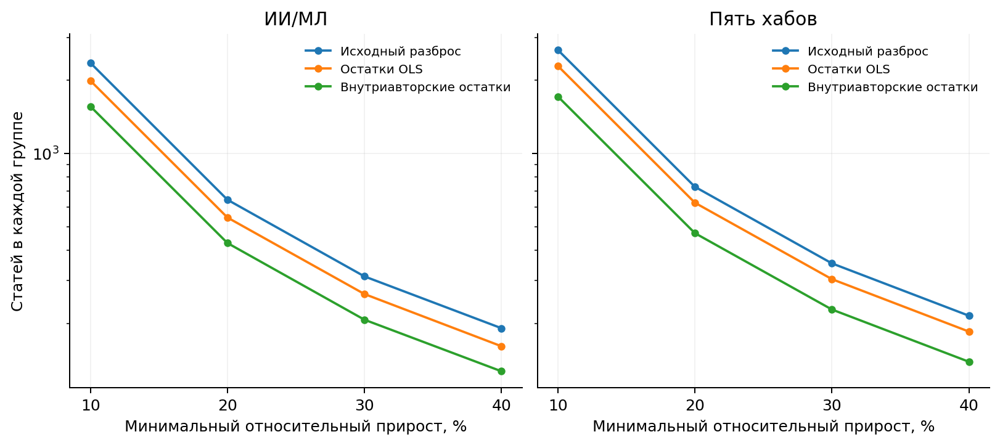

*Рисунок 19. Требуемый размер каждой группы при заданном минимальном относительном приросте. Точки — рассчитанные сценарии, линии соединяют их для удобства чтения.*

При эффекте 20% нужны ориентировочно 645–729 статей в каждой группе (1290–1458 всего), даже при оптимистичном снижении разброса — 428–470 на группу. При эффекте 40% — около двух сотен на группу при исходном разбросе. Для автора с 5–10 статьями в год это едва ли реалистично. Но эти числа получены по накопленным просмотрам, а дисперсия просмотров за первые семь дней нам неизвестна. При кластеризации, нескольких сравниваемых слотах или неравных группах расчёт изменится. Для реального эксперимента сначала нужен пилот с фиксированным горизонтом и заранее заданный дизайн.

### Ещё несколько советов

Редактировать тяжёлые фразы стоит, прежде всего, ради вашего читателя. Признаюсь, что у меня с этим всегда были проблемы, ведь рука сама тянется нанизать большое количество причастных и деепричастных оборотов, придаточных предложений, обильно снабдив их лирическими отступлениями в скобках, богато приправленными осторожными отсылками к ограничениям, не забыв при этом отдать долг уважаемым коллегам и предшественникам, дабы не быть уличённым неизвестным мне, но придирчивым читателем, в высокомерии или отсутствии общей эрудиции. Связь с формальными индексами — повод уделять языку внимание, но она не обещает, что удаление длинных слов увеличит охват. Техническая точность и ясность важнее оптимизации формулы. Длинное слово не всегда канцелярит, короткое предложение не всегда понятно.

Для корпоративного блога охват, комментарии, закладки и рейтинг считайте раздельно, в том числе удельные показатели. Как мы видели в разделе 6, они ведут себя по-разному. Именно для корпоративных блогов в пяти хабах обнаружилась более сильная условная связь выходных с просмотрами, так что такой тест особенно интересен.

Наконец, я бы не откладывал готовую статью надолго ради предполагаемого идеального часа. Как в той якобы китайской поговорке (которую цитируют на каждом углу): лучшее время посадить дерево было двадцать лет назад, а второе лучшее — сейчас. У меня есть наблюдательные ориентиры, но нет надёжной формулы прироста. Практическая польза этой работы скорее в другом. Она сужает набор гипотез, которые стоит проверять, и показывает, где цифрам из подобных разборов (включая мои) можно доверять, а где нет.

Напоследок о будущем, которое эти данные предсказать не могут. Если, прочитав статью, все дружно перенесут публикации на субботу, выходные перестанут быть тихими и, возможно, перестанут давать прибавку. Хорошо там, где нас нет, — выходные были хороши, пока нас там было мало. Впрочем, мне такой исход был бы только на руку. Это почти тот эксперимент, которого здесь не хватает. Исчезнет прибавка вместе с пустотой ленты — это станет дополнительным аргументом в пользу конкуренции. Сохранится — в пользу читателей, у которых по выходным больше времени. Чистым такой эксперимент, правда, не будет: вместе с авторами могут поменяться и темы, и привычки читателей.

## 13. Хабр уже переписал правила игры

Пока я собирал данные для этой статьи, Хабр решил перестроить систему публикаций. 9 ноября 2026 года он объявил об объединении статей, новостей и постов в один тип публикации — статью. Различать материалы теперь предлагается по форматам: обзор, туториал, кейс, аналитика и другим. Короткие тексты система автоматически относит к формату «Пост», а читатели могут фильтровать общую ленту по форматам [12].

Общая лента со статьями, новостями и постами существовала ещё с 2023 года [17]. Поэтому 9 ноября изменились прежде всего классификация публикаций, отдельные ленты и способы фильтрации, а не сам факт соседства разных материалов. Миграция старых постов тогда ещё продолжалась.

**Что это меняет**

Во-первых, меняется состав сравниваемых публикаций. Я отбирал материалы прежнего типа «статья». Теперь это общее название для разных форматов, в том числе коротких постов. Прежний фильтр больше не обязательно выделяет тот же набор текстов. Значит, повторить сбор через полгода и напрямую сравнить полученные медианы будет неправильно.

Во-вторых, меняется смысл плотности ленты. В исследовании я считал, сколько статей выбранных хабов вышло за предыдущие 24 часа. Но для конкуренции за внимание важен весь поток публикаций, который видит читатель, включая короткие посты и другие форматы. При этом каждый читатель может использовать собственные фильтры. Так что даже подсчёт всех публикаций не даст нам точного числа конкурентов конкретной статьи.

Наконец, неизвестно, сохранится ли преимущество выходных. Возможно, в новой системе изменятся часы и дни публикационной активности, а с ними и конкуренция. Возможно, читательские привычки окажутся устойчивее изменений интерфейса. Пока у меня нет данных, чтобы выбрать одно из этих объяснений. Результаты статьи описывают прежний период, но не гарантируют, что те же отношения сохранятся в новой системе.

**Куда копать дальше**

Для начала придётся адаптировать сборщик: сохранять формат публикации, различать прежние и новые категории, а плотность рассчитывать не только для длинных статей, но и для всего доступного потока. При этом старые определения нужно сохранить отдельно, иначе мы потеряем возможность содержательного сравнения.

Второе, и куда более важное изменение — перейти от одного снимка накопленных просмотров к их динамике. Сохранять показатели новых публикаций через 1, 3, 7 и 30 дней, а затем сравнивать статьи одинакового возраста. Заготовка такого сборщика (collect_panel.py) уже есть в репозитории, но её ещё предстоит доработать, чтобы она повторно обращалась к статьям, выпавшим из свежей выдачи.

Через несколько месяцев можно будет снова проверить выходные, часы и плотность ленты, отдельно для разных форматов. Даже сравнение до и после 9 ноября не станет чистым экспериментом: вместе с правилами публикации продолжают меняться аудитория, авторы, темы и сама платформа.

Хабр успел поменять правила игры ещё до того, как я закончил исследовать старые. Похоже, материал для следующей статьи уже есть. Осталось собрать данные.

## 14. Ограничения и дальнейшие исследования

В целом ограничения этой работы богатой россыпью раскиданы у меня по всему тексту. Повторю ключевые, принципиально влияющие на интерпретацию результатов.

— Это наблюдения, а не эксперимент. Авторы сами выбирают время публикации, поэтому ни одно сравнение здесь не говорит, что будет с конкретной статьёй, если её перенести.

— Содержание статей не оценивалось. Тема, глубина, качество изображений и польза текста входят в «силу» автора или остаются неизмеренными. Влияние котиков и мемов — предмет отдельного исследования!

— Данные охватывают два набора хабов, причём один из них покрыт неполно. На весь Хабр выводы переносить стоит осторожно.

— Механизм эффекта выходных не установлен. Данных о показах в ленте и поведении читателей у меня нет.

— Характер комментариев остался за скобками, так что не учитывалось влияние провокационных статей, например, откровенно слабых, провоцирующих дать обратную связь (надеюсь, таких исчезающе мало).

Техническое ограничение — счётчики. Все просмотры сняты один раз, в ноябре 2026 года, и у каждой статьи это сумма за всю её жизнь. В одном числе смешаны возраст статьи, время её выхода, изменения аудитории и развитие самих хабов, и разделить эти влияния нельзя. Нужны повторные замеры статей на фиксированных горизонтах, чтобы сравнивать просмотры за одинаковый срок. Как их собирать после изменения ленты, рассказано в разделе 13.

Фиксированные эффекты автора, удельные комментарии и закладки, локальные перцентили праздников, альтернативные возрастные спецификации и внутриавторские оценки читаемости уже проверены на имеющемся срезе. Повторить сравнение CatBoost на действительно новых данных с фиксированным горизонтом пока не удалось: итоговая проверка остаётся ретроспективной и ранее использованной для анализа.

Следующий шаг — отделить содержание от времени. Помогут пары похожих по теме статей, вышедших в разные дни, более подробные признаки текста и учёт постоянных особенностей авторов. Они не заменят случайного назначения времени публикации, но сделают наблюдательный анализ сильнее.

Ориентировочный расчёт мощности для двух групп уже приведён в разделе 12. Для настоящего эксперимента его нужно пересчитать по дисперсии просмотров на выбранном одинаковом горизонте и с учётом схемы рандомизации. Заранее нужно выбрать одну основную метрику и горизонт, определить, когда остановить эксперимент, и не менять критерий «лучшего» времени задним числом, глядя на результаты.

Читаемость требует независимой проверки. Для неё нужны оценки понятности самими читателями, вопросы на понимание или сравнение разных редакций одного материала. Число просмотров не говорит, понятен ли текст: популярную статью могли открыть и не дочитать. Если подгонять индекс под просмотры, получится индекс популярности, который может закрепить тематические различия вместо качества языка.

Свои ограничения и у выборки. Хабы отобраны вручную, часть истории неполна, удалённые материалы отсутствуют, а тексты взяты в нынешнем виде, а не в первоначальном. Бутстреп по авторам не моделирует все временные и тематические зависимости. Текстовая выборка отобрана по квартилям и затем отфильтрована, поэтому её интервалы относятся именно к ней, а не гарантированно ко всему Хабру. И наконец, многочисленные разведочные проверки требуют независимого подтверждения на новых данных.

| Что проверено | Что остаётся неизвестным |
| --- | --- |
| Выходные: авторские и недельные интервалы, FE авторов, узкие возрастные окна, сплайн, медианная регрессия | Просмотры той же статьи при переносе, одинаковый горизонт накопления, меняющиеся темы и продвижение |
| Праздники: контрольные даты, исключение эпизодов и Нового года, локальные перцентили | Точная оценка при малом числе праздничных эпизодов, причинная роль праздника |
| Плотность: до/после, уровни агрегации, внутри будней/выходных, поправки | Показы и конкуренция в персональной ленте, причинный механизм |
| Тип блога и вовлечённость: взаимодействие, удельные метрики | Качество содержания, уникальные читатели, характер комментариев |
| Читаемость: контролируемые корреляции, хабы и сравнения внутри авторов | Содержательная сложность, фактическое понимание, эффект редактирования того же текста |
| CatBoost: временные разбиения, функции потерь, B1/B2, возраст выборок | Независимый прогноз на новом срезе, контрфактический выигрыш от переноса |
| Ориентир мощности для двух групп на накопленных просмотрах | Дисперсия на фиксированном горизонте и мощность реального эксперимента |

*Таблица 33. Сводка выполненных проверок и границ выводов.*

Дополнительные проверки проведены после знакомства с исходными результатами; это проверки чувствительности, а не независимое подтверждение. Пермутационную оценку максимума по календарным ячейкам оставляю для дальнейшей работы.

В пакете сохранены идентификаторы статей, описания фильтров, вычисленные таблицы и тесты. Это позволяет продолжить исследование с проверяемой отправной точки. Дальнейшие действия со сборщиком динамики просмотров описаны в разделе 13.

## 15. Список использованных источников и литературы

1. Tsagkias M., Weerkamp W., de Rijke M. *News Comments: Exploring, Modeling, and Online Prediction*. ECIR, 2010, pp. 191–203. [Страница публикации в репозитории UvA](https://www.dare.uva.nl/id/75d42404-4800-43ae-b801-fd89a0821b23).

2. Cheng J. et al. *Can Cascades Be Predicted?* WWW, 2014. [arXiv:1403.4608](https://arxiv.org/abs/1403.4608).

3. Bandari R., Asur S., Huberman B. A. *The Pulse of News in Social Media: Forecasting Popularity*. ICWSM, 2012. [arXiv:1202.0332](https://arxiv.org/abs/1202.0332).

4. Liu Y. et al. *A survey on social media popularity prediction: concepts, technologies, applications, and challenges*. 2026. [DOI 10.1007/s44443-026-00909-x](https://doi.org/10.1007/s44443-026-00909-x).

5. jehy. *ХаброСтатистика — в какое время лучше публиковать статью на хабре?* 2016. [Хабр](https://habr.com/ru/articles/279607/).

6. Sistemaalex. *Первые три дня жизни поста на Хабре*. 2019. [Хабр](https://habr.com/ru/articles/469881/).

7. TatarnikovEgor. *Когда лучше публиковаться на Хабре. Статистический анализ связи времени публикации и охвата статей*. 2026. [Хабр](https://habr.com/ru/articles/1050172/).

8. ShyDamn. *Разобрал 1233 статьи Хабра: всё, что советуют авторам, объясняет 6% результата*. 2026. [Хабр](https://habr.com/ru/articles/1061238/).

9. Flammmable. *Считаем чужие просмотры: из чего соткан Хабр?* 2026. [Хабр](https://habr.com/ru/articles/990994/).

10. moccachin. *48 часов жизни вашей публикации на Хабре*. 2015. [Хабр](https://habr.com/ru/articles/262617/).

11. Exosphere. *Хабр для взрослых: готовим статью к бою*. 2021. [Хабр](https://habr.com/ru/articles/598391/).

12. Nomad_77. *На Хабре теперь одна лента для статей, новостей и постов*. Блог компании Хабр, 9 ноября 2026. [Хабр](https://habr.com/ru/companies/habr/articles/1105376/).

13. xmlcalendar.ru. *Производственный календарь России, 2016–2026* (по постановлениям Правительства РФ о переносе выходных дней). Дата загрузки — 11.11.2026. [xmlcalendar.ru](https://xmlcalendar.ru/); перекрёстная проверка — [Производственный календарь 2024–2025, КонсультантПлюс](https://www.consultant.ru/law/ref/calendar/proizvodstvennye/2025/).

14. Flesch R. *A New Readability Yardstick*. 1948. [DOI 10.1037/h0057532](https://doi.org/10.1037/h0057532).

15. Solovyev V., Ivanov V., Solnyshkina M. *Assessment of reading difficulty levels in Russian academic texts: Approaches and metrics*. 2018. [DOI 10.3233/JIFS-169489](https://doi.org/10.3233/JIFS-169489).

16. Solnyshkina M., Ivanov V., Solovyev V. *Readability Formula for Russian Texts: A Modified Version*. MICAI 2018, онлайн-публикация 2019. [DOI 10.1007/978-3-030-04497-8_11](https://doi.org/10.1007/978-3-030-04497-8_11).

17. Boomburum. *Общая лента публикаций Хабра*. Блог компании Хабр, 21 декабря 2023 года. [Хабр](https://habr.com/ru/companies/habr/articles/782308/).

## 16. Воспроизведение результатов

Полный перечень сохранённых материалов Хабра находится в `data/sources/sources_index.csv`. Команды установки и пересчёта — в [README](README.md), детали проверок — в [документации](docs/reproducibility.md).

Команда `python run_analysis.py --metrics-only` проверяет входные SHA-256, повторяет исходный описательный анализ и дополнительные проверки на том же срезе, строит рисунки и собирает `article.md` из `article_template.md`. Численные результаты дополнительного анализа пересчитываются и сверяются с сохранённым снимком; для публикационной сборки используются проверенные сохранённые значения. Это разделяет проверку численного воспроизведения и стабильность округлённого текста статьи.

| Материал | Источник | Проверка в CI |
| --- | --- | --- |
| Исходные метаданные, календарь и готовые текстовые признаки | `data/input_manifest.json` | SHA-256, точное совпадение |
| Основной анализ: таблицы 3–6, 8–9, 14, 16, 19–21, 23, 27, 31 | `run_analysis.py`, результаты этапов 02–16 | Повторный расчёт; структуры и целые значения — точно, вещественные значения — с допусками |
| Дополнительные таблицы 7, 10–13, 15, 17–18, 24–26, 29, 32 | `17_final_sensitivity.py`, `data/results/17_final_sensitivity.json` | Повторный расчёт и сравнение по группам показателей; диагностика числа итераций и версии среды не являются числовыми метриками |
| Рисунки 1–3 | `02_explore_ai_12m.py` | Построение из данных или сохранённых результатов; PNG не сравниваются побайтово |
| Рисунок 8 | `04_calendar_ai.py`, `habrpub/calendar_analysis.py` | Построение из данных или сохранённых результатов; PNG не сравниваются побайтово |
| Рисунки 9–10 | `05_density.py` | Построение из данных или сохранённых результатов; PNG не сравниваются побайтово |
| Рисунки 12–13, 15 | `07_readability.py` | Построение из данных или сохранённых результатов; PNG не сравниваются побайтово |
| Рисунки 4–7, 11, 14, 17, 19 | `18_sensitivity_figures.py` | Построение из данных или сохранённых результатов; PNG не сравниваются побайтово |
| Рисунки 16 и 18 | `15_ml_figures.py`, `experiments/catboost/results/` | Построение из данных или сохранённых результатов; PNG не сравниваются побайтово |
| Обложка | Генеративный ИИ | Готовая иллюстрация; не пересоздаётся |
| CatBoost: таблицы 28 и 30 | `experiments/catboost/results/` | Контракты и сохранённые метрики; обучение в обычном CI не повторяется |
| Таблицы 1–2, 22, 33, литература и пояснения | Авторский текст и источники | Проверка структуры и формата; не результат численного пересчёта |
| Полная статья | `10_build_article.py`, шаблон, JSON | Проверка побайтового совпадения собранного Markdown |
| Сокращённая статья | Авторская редакция | Формат, иллюстрации, ссылки и согласованность ключевых чисел |

Полные HTML-тексты чужих статей не публикуются. Лексические признаки можно пересчитать после загрузки текстов по `data/text_sample_manifest.json` командой `python run_analysis.py`; тексты за это время могли измениться. Сами модели CatBoost не переобучаются обычным запуском. Подробное описание процедуры обучения и сохранённые метрики, модели и прогнозы описаны в [experiments/catboost/README.md](experiments/catboost/README.md). Новый сбор с Хабра даст другой срез, а не архив 9–10 ноября 2026 года.

Дополнительные проверки относятся к тому же ретроспективному исследованию и не обеспечивают независимого подтверждения на новых данных. Отдельно их можно повторить командой `python 17_final_sensitivity.py --check`; она не заменяет сохранённый JSON. Подробности допусков и тестов — в [docs/reproducibility.md](docs/reproducibility.md). Основные расчётные таблицы подставляются из JSON; отдельные поясняющие и округлённые числа также приведены в авторском тексте. Дополнительный рисунок для пяти хабов — `figs/04_competition_wide.png`, аналог рисунка 8. Журнал методологических исправлений — [docs/audit.md](docs/audit.md).

Настоящий материал (информация) произведён и распространён с применением технологий искусственного интеллекта, либо касается деятельности, связанной с искусственным интеллектом.

Генеративный ИИ использовался для:

1. Работы с кодом (рефакторинг, тесты и комментарии) — GLM

2. Поиска источников — GLM

3. Создания изображения-обложки — ChatGPT

4. Критической вычитки статьи — ChatGPT, Claude Opus, GLM, DeepSeek, GigaChat, Алиса, Mistral (разногласия по стилю и особенности восприятия юмора разными генеративками достойны отдельной статьи).

Негенеративный ИИ использовался для создания предсказательных моделей — LightGBM, CatBoost.
