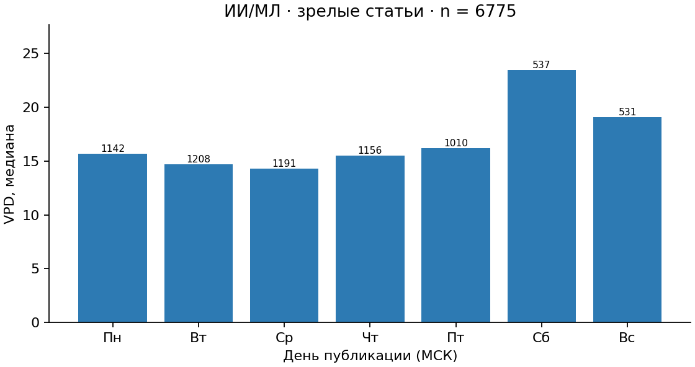
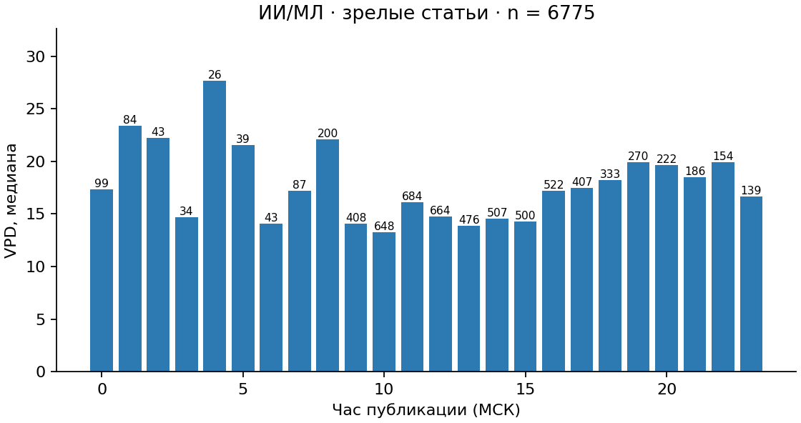
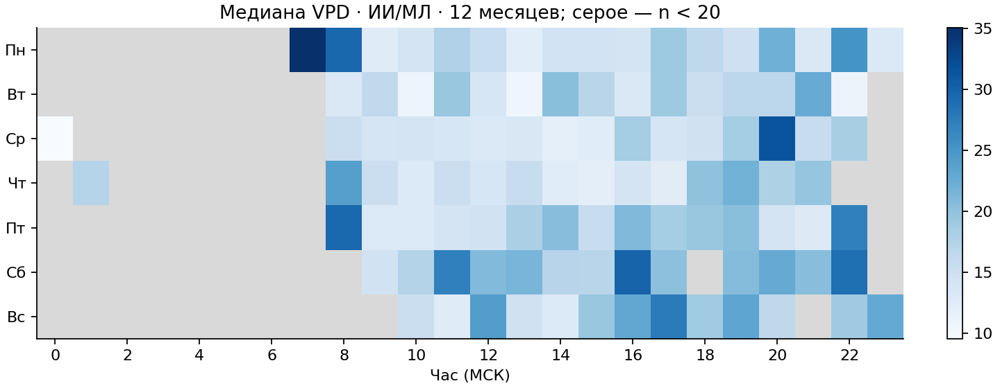
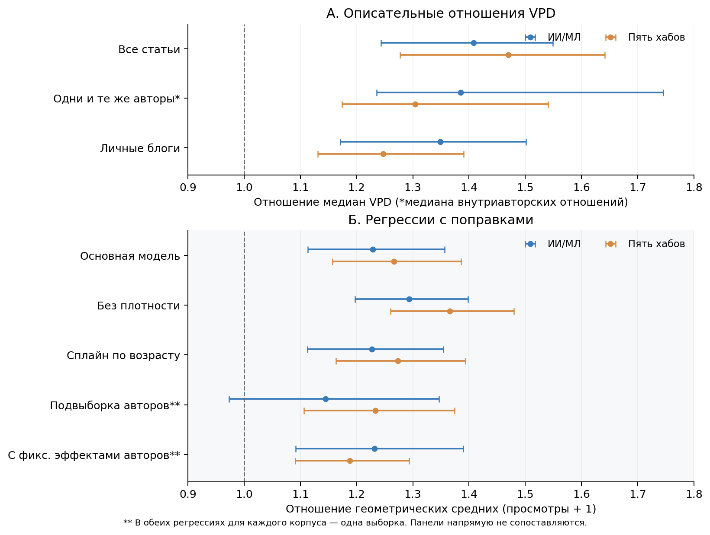
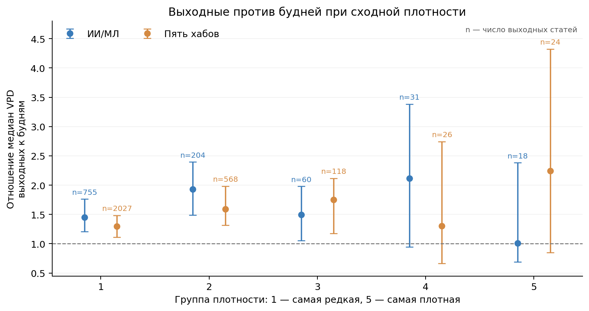
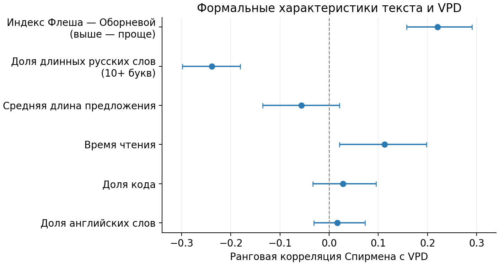

# Выходные, автор и длинные слова: с чем связаны просмотры 46 тысяч статей Хабра

*Белый Кролик сверяется с часами. Иллюстрация сгенерирована ИИ по мотивам работ Д. Тенниела к «Приключениям Алисы в Стране чудес» Л. Кэрролла (1865)*

Пока моя первая статья для Хабра ждала правок от редактора, я задался простым вопросом: когда её лучше публиковать? Почитал существующие разборы, но прямого ответа не нашёл. Пришлось разбираться глубже. Так появилась вторая статья, которая, по иронии судьбы, выходит раньше первой. Неплохое начало для исследования о времени публикации.

Лорду Морли приписывают слова: «В речи имеют значение три вещи: кто говорит, как говорит и что говорит. Из этих вещей наименьшее значение имеет третья». К ним я добавил четвёртую — когда — и попробовал проверить, что из этого видно на Хабре.

Я собрал данные о 46845 статьях, изучил язык 1516 текстов и построил модели прогноза популярности. Из-за собственных ошибок несколько выводов пришлось вычеркнуть. Самые поучительные промахи разобрал в разделе 9.

**Содержание статей (темы, пользу, аргументацию и качество) не оценивал.** Речь пойдёт о времени, авторах и формальных свойствах текста.

**TL;DR:** выходные статьи в наших данных набирали больше просмотров. Медиана среднедневных просмотров за время жизни статьи (VPD) выше в 1.4–1.5 раза, оценки отношения просмотров в регрессиях с поправками — около 1.2–1.3. Преимущество сохраняется и при сравнении статей одного автора, хотя примерно 39% выходных статей не превосходят типичную будничную по VPD. По праздникам наблюдается похожая связь. Результативность авторов различается в разы, связь простоты текста с просмотрами слабая и чувствительна к способу сравнения. Модели прогноза найти «идеальный час» не помогли.

**Это наблюдения, а не эксперимент.** Если опубликованные в субботу статьи набирали больше просмотров, это ещё не означает, что ваша статья выиграет от переноса со среды на субботу. Полная методология, результаты и код лежат в [репозитории исследования](https://github.com/vadimkaa/habr_analytics/tree/v1.1.0). Здесь — только самое интересное.

## 1. Сверим часы

Как говорится, месяц в лаборатории экономит час в библиотеке. Я решил не экономить и начал с чужих исследований.

В [разборе десятилетней давности](https://habr.com/ru/articles/279607/) ([@jehy](https://habr.com/ru/users/jehy/), 2016) лучшим оказался час, на который пришлось всего две статьи, причём одна была хитом. [Е. Татарников](https://habr.com/ru/articles/1050172/) ([@TatarnikovEgor](https://habr.com/ru/users/TatarnikovEgor/), 2026) тоже обнаружил преимущество нерабочих часов, предположив, что оно связано с меньшей конкуренцией за внимание читателей. А [Д. Шубин](https://habr.com/ru/articles/1061238/) ([@ShyDamn](https://habr.com/ru/users/ShyDamn/), 2026) на 1233 статьях показал, как мало объясняют формальные признаки текста.

На маленькой выборке идеальный час находится легко, особенно среди 168 сочетаний дня и часа. В дополнение к прежним работам я сравнил статьи одних авторов, изучил праздники и проверил разницу между групповыми и индивидуальными корреляциями.

Собрав метаданные Хабра 9–10 ноября 2026 года по типу публикации «статья», действовавшему до реформы (см. раздел 11), получил два пересекающихся корпуса: «Искусственный интеллект» и «Машинное обучение» — 21389 статей; «Информационная безопасность», «Программирование», «Научно-популярное», «Веб-разработка» и «Python» — 29399. Общих статей 3943, уникальных — 46845. Корпуса пересекаются, что даёт два среза, а не два независимых подтверждения.

Для сравнения выходных и будней взял последний год: так оба корпуса можно сопоставлять на общем временном окне, не смешивая современную активность с существенно более ранними этапами Хабра. Включал статьи не моложе 30 дней (далее — «зрелые»): 6775 публикаций ИИ/МЛ и 16577 из пяти хабов. Для разных задач использовались разные подвыборки; для праздников ИИ/МЛ — история с 2016-го.

У Хабра доступен накопленный счётчик просмотров, но не просмотры за первую неделю. Поэтому я использовал VPD (views per day) = все просмотры, делённые на возраст статьи в днях. И тут есть нюанс. Две статьи набрали по 10000 просмотров, но одной 100 дней, другой 1000: VPD у них будет 100 и 10 соответственно, хотя охват одинаков. [Основная активность](https://habr.com/ru/articles/469881/) приходится на первые дни, а деление на возраст этого не учитывает.

VPD здесь лишь описательная метрика. Поэтому я проверял выводы и иначе: сравнивал статьи близкого возраста, их места по просмотрам среди публикаций того же месяца, строил регрессии. Просмотры за одинаковый срок эти методы не заменяют.

Выходными считал субботы и воскресенья, кроме рабочих суббот по производственному календарю. В нашем годовом окне рабочих суббот не оказалось. Праздничные будни входят в будни основного сравнения; отдельно их рассмотрю в разделе 6. Время публикации брал из временных меток в метаданных Хабра; для календарных группировок выбрал московский часовой пояс (да простят меня читатели из Владивостока). Заголовки, хабы и счётчики сняты на момент сбора данных; удалённые и снятые с публикации статьи в выборку не попали, что могло привести к смещению (ошибке выжившего).

## 2. Суббота наносит ответный удар

Я начинал с простой гипотезы: вышедшие в выходные статьи набирают больше просмотров.

*Рисунок 1. Медианный VPD по дням недели в ИИ/МЛ. Над столбцами — число статей. Сравнение без поправки на возраст; дополнительные проверки приведены в разделе 4.*

На рисунке 1 бросается в глаза, что будни почти не отличаются друг от друга. Медианный VPD с понедельника по пятницу лежит в узком диапазоне (14.3–16.2). Суббота заметно выше, да и воскресенье тоже выигрывает у будней.

В ИИ/МЛ медианные VPD составляют 21.3 в выходные против 15.1 в будни (отношение 1.41), а в пяти хабах — 21.7 против 14.8 (отношение 1.47). Для этих отношений 95% доверительные интервалы (далее — ДИ), рассчитанные [бутстрепом](https://habr.com/ru/articles/829336/) по авторам, составляют [1.24; 1.55] и [1.28; 1.64]; интервалы по неделям тоже выше единицы.

Обратим внимание, что в субботу и воскресенье выходит примерно вдвое меньше статей, чем в любой будний день (см. числа над столбцами). Просится объяснение: конкурентов меньше, публикация дольше на виду. Но число статей в корпусе ещё не равно конкуренции за внимание читателя. К этой гипотезе вернусь в разделе 5, а пока посмотрим на часы и дни.

*Рисунок 2. Медианный VPD по часам в ИИ/МЛ. Маленькие группы сильно шумят.*

Днём (с 9 до 15 часов) медианный VPD по часам обычно около 13–16, вечером (с 16 до 22) — 17–20. Вечер выглядит лучше дня и отдельно в будни (17.4 против 13.9 в ИИ/МЛ, 17.5 против 13.1 в пяти хабах), и в выходные (23.0 против 17.5 и 21.9 против 20.6). Но в выходные пяти хабов различие невелико. Дневные публикации выходных не уступают вечерним публикациям будней в ИИ/МЛ, а в пяти хабах даже превосходят их. Любопытное исключение — 8 утра: VPD 22.1 на 200 статьях. А вот ночью разброд и шатание: максимум в 4 часа (до минут я не смотрел, возможно, это 4:20), но там всего 26 статей. Как и в разборе @jehy, несколько хитов могут сдвинуть медиану. Мы знаем время публикации, а не чтения, поэтому проверить гипотезу о свободном времени читателей не получится.

*Рисунок 3. Тепловая карта «день недели × час». Серым — сочетания, где меньше 20 статей.*

Тепловая карта (рисунок 3) добавляет ещё несколько заманчивых пиков — это понедельник в 7 утра и среда в 8 вечера (их клетки одни из самых тёмных), а ведь там всего 30 и 29 статей соответственно. Выглядят они как окна возможностей, однако, как говорил товарищ Саахов, торопиться не надо. Чем мельче делим время, тем вероятнее найдём пик в шуме.

Гораздо интереснее две нижние строки (суббота и воскресенье). 22 из 26 выходных ячеек с достаточным числом статей выше медианы будних ячеек. Значит, преимущество выходных не сводится к одному случайно выпавшему удачному часу. Выходные выделяются почти в любой час. А рекомендаций уровня «среда, 20 часов» из этой карты не получится.

## 3. Кто здесь главный — автор или календарь?

У корпоративного блога есть редакционный календарь с дедлайнами и медиапланом, а у «личного» автора — свободные вечера и выходные, отпуск или внезапное вдохновение. Если разные авторы выбирают разные дни, наблюдаемое преимущество выходных может отражать не столько календарь, сколько различия между авторами.

Поэтому я отобрал авторов, у которых за год нашлось хотя бы по две зрелые статьи в будни и выходные. Для каждого посчитал отношение медианных VPD, затем взял медиану этих отношений. Один автор — один голос.

Таких авторов оказалось 111 в ИИ/МЛ и 220 в пяти хабах. У типичного автора отношение выходных к будням составило 1.39 и 1.30 соответственно (ДИ [1.24; 1.74] и [1.17; 1.54]). Преимущество сохраняется и при сравнении публикаций одних и тех же людей. Разницу нельзя списать только на состав авторов. Но это ещё не доказывает влияния дня публикации: во вторник человек может писать короткие заметки по инфоповоду, а в воскресенье — пространные руководства. К тому же в сравнении участвовали лишь активные авторы.

А насколько календарь важен на фоне того, кто пишет статью? Для каждого автора с тремя и более зрелыми статьями за год я посчитал медианный VPD. У половины таких авторов он лежит в диапазоне 9.5–28.5 в ИИ/МЛ и 8.1–28.8 в пяти хабах. В обоих корпусах верхняя граница диапазона как минимум втрое выше нижней. Это уже совсем другой масштаб, чем наблюдаемое преимущество выходных. Но речь идёт о разбросе результативности авторов, а не об эффекте смены автора.

Итак, «кто» здесь заметно связан с результатом, но от «что» отделить его нельзя: темы, качество текста и продвижение, напомню, не учитывались. Так что самый провокационный тезис Морли, будто содержание имеет наименьшее значение, остаётся за пределами этого исследования.

## 4. Поправка на возраст и состав

Проверим другие объяснения: возраст статей, переводы и крупные блоги.

В обоих корпусах выходные впереди во всех трёх крупных возрастных группах и почти во всех 15-дневных интервалах (21 из 22 в ИИ/МЛ и 22 из 22 в пяти хабах по точечным оценкам). При этом медианный возраст вышедших в выходные статей даже немного выше, чем у опубликованных в будни. А ведь у более старых статей VPD, как правило, ниже. Одним возрастом разницу объяснить трудно.

Ни сравнение внутри месяца, ни исключение переводов (в ИИ/МЛ), самых активных авторов или крупнейших корпоративных блогов картину не меняют.

Наконец, я проверил, сохраняется ли преимущество выходных после учёта других различий между статьями. Для этого построил регрессионную модель, учитывающую возраст и месяц публикации, хаб, тип блога, а также плотность публикаций (число статей в исследуемом корпусе, вышедших за предыдущие сутки). В качестве целевой переменной взял логарифм просмотров: log10(просмотры + 1).

С учётом этих различий оценка отношения просмотров выходных к будням составляет 1.23 в ИИ/МЛ и 1.27 в пяти хабах (строго говоря, отношение [геометрических средних](https://ru.wikipedia.org/wiki/Среднее_геометрическое) величины «просмотры + 1»). Плотность может быть частью механизма связи, поэтому сравнил варианты с ней и без неё (во втором случае оценки выше).

Ещё одна проверка — регрессия с фиксированными эффектами авторов (в ней постоянные различия между авторами учтены). Для неё взял 2586 статей 360 авторов ИИ/МЛ и 8963 статьи 657 авторов пяти хабов, публиковавшихся и в будни, и в выходные. Использовал те же поправки. Оценки отношения просмотров выходных к будням составили 1.23 и 1.19 (ДИ [1.09; 1.39] и [1.09; 1.29] соответственно).

На рисунке 4 собраны результаты разных проверок. Все точечные оценки выше единицы. Любопытно, что в ИИ/МЛ на одной и той же подвыборке учёт фиксированных эффектов авторов повышает оценку с 1.14 (ДИ включает единицу) до 1.23: постоянные различия между авторами не обязательно завышают оценку календарной связи. Подробности расчётов — в [полной версии](https://github.com/vadimkaa/habr_analytics/blob/v1.1.0/article.md#6-выходные-часы-и-автор).

*Рисунок 4. Проверки устойчивости преимущества выходных. Верхняя и нижняя панели показывают разные статистические показатели; напрямую сопоставлять величины оценок между панелями нельзя. Усы — 95% ДИ с учётом группировки по авторам. В нижних двух строках для каждого корпуса использована одна подвыборка авторов. «Личные блоги» — только некорпоративные публикации. Сплайн — гибкая поправка на возраст.*

А вот разница между личными и корпоративными блогами оказалась интересной. В пяти хабах после поправок оценка отношения выходных к будням составляет 1.69 (ДИ [1.32; 2.15]) для корпоративных и 1.17 для личных публикаций; различие статистически значимо. При этом корпоративных статей в выходные примерно вчетверо меньше в расчёте на день (528 против 5390 в годовом окне). В ИИ/МЛ убедительного различия между типами блогов нет. Корпоративные публикации выходных могут отличаться по содержанию.

## 5. Чеширская корреляция

Вернёмся к гипотезе Татарникова о конкуренции. По выходным выходит меньше статей, а у читателей больше свободного времени. Если на странице меньше конкурентов, каждый материал, возможно, дольше остаётся заметным.

Для проверки этой гипотезы я использовал уже знакомый нам показатель плотности публикаций (число статей *исследуемого корпуса*, вышедших за предыдущие 24 часа). Это лишь косвенная оценка конкуренции за внимание читателя: его лента зависит от подписок и фильтров, а сопоставимых данных о показах и переходах у меня нет.

На агрегированных данных получается впечатляющая связь. Если взять семь точек, по одной на каждый день недели, ранговая корреляция (ρ, мера согласованности порядка значений) числа статей с медианным VPD равна −0.93 для ИИ/МЛ и −0.86 для пяти хабов. Кажется, доказательство готово: чем реже лента, тем больше просмотров.

Но стоит спуститься с уровня дня недели к отдельной статье — и связь почти исчезает: на статьях годового окна корреляция между плотностью публикаций и VPD составляет 0.05 для ИИ/МЛ и −0.05 для пяти хабов; при сравнении статей внутри отдельных месяцев корреляция также близка к нулю. Даже при расчёте плотности по объединению корпусов без дублей корреляции близки к нулю (−0.003 и −0.009). Это всё ещё не вся лента Хабра. Если считать публикации за следующие сутки вместо предыдущих, вывод не меняется. Сильной отрицательной связи не появилось и при сравнении плотности отдельно в будни и выходные, в том числе после поправок на возраст и состав статей.

При группировке статей по дням недели низкая плотность публикаций и высокий VPD совпадают прежде всего по выходным. Поэтому сильная корреляция на семи точках может отражать уже обнаруженное различие между буднями и выходными, а не влияние конкуренции. Переносить закономерности, выявленные на уровне групп, на отдельные объекты без дополнительной проверки — значит допускать известную в статистике [экологическую ошибку](https://habr.com/ru/articles/1099632/) (ecological fallacy). В нашем случае для отдельных публикаций столь сильной связи не наблюдается.

Я сделал ещё одну проверку: разделил статьи по плотности публикаций на 5 групп примерно одинакового размера; внутри каждой группы сравнил медианные VPD выходных и будних статей (рисунок 5).

*Рисунок 5. Отношение медиан VPD выходных и будней внутри групп плотности публикаций для обоих корпусов. Усы — 95% доверительные интервалы по авторам.*

В трёх группах с относительно низкой плотностью публикаций преимущество выходных сохраняется. Но чем выше плотность публикаций, тем меньше в группе статей, вышедших в выходные: в ИИ/МЛ их число от первой группы к пятой падает с 755 до 18. В двух последних группах ДИ широки и включают единицу: данных недостаточно для уверенного вывода о различии.

Учёт плотности в регрессиях уменьшает оценку преимущества выходных, но не устраняет его. Одной загруженностью ленты разницу объяснить не получается; это не опровергает гипотезу конкуренции. (Показов-то мы не видим, а узкий диапазон плотности внутри групп может ослаблять связь.)

В аналогичных регрессиях с комментариями и закладками в качестве целевых переменных оценки для выходных тоже выше — примерно на 20–30%. Но на 1000 просмотров в выходные приходится больше комментариев (медианное число выше примерно на треть в обоих корпусах), а закладок — меньше в ИИ/МЛ; в пяти хабах разница в закладках статистически неразличима. С рейтингом связь слабее и неоднородна: доля статей с рейтингом не ниже 10 в пяти хабах выше у выходных, в ИИ/МЛ примерно одинакова.

Получается, что в выходные различается не только число просмотров, но и характер взаимодействия со статьями. Может быть, в будни мы читаем Хабр скорее для работы (и сохраняем полезное), а в выходные — для удовольствия (и охотнее вступаем в дискуссии)?

В отдельные рабочие часы доля корпоративных публикаций в ИИ/МЛ достигает 60%. Выходит, сравнивая часы, мы невольно сравниваем и состав публикаций. Различаться может и их характер: например, в выходные могут чаще выходить обстоятельные руководства с долгим поисковым хвостом, а в будни — статьи по свежим инфоповодам с кратким всплеском просмотров. Отделить эти объяснения от различий в читательских привычках по динамике просмотров и источникам трафика я не могу (таких данных в открытом доступе нет).

## 6. Праздник, который всегда с тобой

Обычно в году порядка 118 нерабочих дней (почти треть года!). Помимо выходных, в это число входят праздничные и перенесённые нерабочие дни, приходящиеся на будни. Нерабочий будний день чем-то напоминает неожиданный выходной: многие не работают, статей выходит меньше, а свободного времени у читателей может быть больше. Если праздник даёт похожий результат, это косвенный довод в пользу того, что дело не в субботе или воскресенье как таковых, а в нерабочем дне.

Здесь календарь оказался сложнее списка фиксированных праздничных дат: нужно учитывать переносы и рабочие субботы. Я взял [производственный календарь](https://xmlcalendar.ru/) за 2016–2026 годы, исключил обычные выходные и особые нерабочие дни 2020–2021 годов. Чтобы снизить влияние дня недели и сезонности, для каждого праздника подобрал *контрольные даты* — рабочие дни того же дня недели за одну, две и три недели до или после праздника.

Для сравнения популярности статей я использовал перцентиль просмотров (относительное место статьи по числу просмотров среди публикаций близких дат). Сначала сравнивал статьи внутри месяца публикации, но праздники часто приходятся на его начало, а такие статьи могут успеть накопить больше просмотров.

Основная оценка — по перцентилям среди статей, вышедших в пределах семи дней до и после каждой публикации, при тех же контрольных датах. Медианный перцентиль праздничных статей выше контрольных на 8.2 процентного пункта (п.п.) в ИИ/МЛ и 11.7 п.п. в пяти хабах (95% ДИ [4.5; 11.5] и [7.4; 16.2] по эпизодам и контрольным неделям).

При изменении ширины окна от ±3 до ±14 дней разница остаётся положительной (5.1–11.0 и 10.5–13.2 п.п. соответственно). В локальном окне должно быть не менее 20 статей, поэтому меняется и состав выборки.

Сравнение в окне ±7 дней охватывает 62 праздничных эпизода в ИИ/МЛ и всего 7 в пяти хабах: история широкого корпуса ограничена покрытием хаба «Информационная безопасность». Контрольные даты могут относиться к нескольким эпизодам; малое число эпизодов ограничивает надёжность второго ДИ. В праздничные дни статей выходит почти вдвое меньше; доля корпоративных публикаций тоже ниже.

Не держится ли всё на Новом годе? Наш любимый оливьесодержащий праздник действительно даёт около трети праздничных статей. По исходным месячным перцентилям исключение новогодних каникул уменьшает разницу с 9.7 до 7.9 п.п. в ИИ/МЛ, а в пяти хабах она даже увеличивается — с 14.4 до 15.9 п.п. При исключении любого отдельного эпизода в пяти хабах разница остаётся положительной.

Другие праздники тоже различаются: по месячным перцентилям для 8 марта оценка в ИИ/МЛ даже отрицательная (видимо, в этот день находятся дела поважнее Хабра), для 9 мая — положительная, но выборки невелики. Искать здесь идеальный праздник — столь же сомнительная затея, как и искать идеальный час.

Праздники вписываются в общую идею: публикаций меньше, а вышедшие в эти дни статьи занимают более высокие места по просмотрам среди близких по дате публикаций. Но в праздники, как и в выходные, могут меняться темы, авторы и поведение читателей.

## 7. Имеет ли размер значение?

Мы поговорили про «когда» и «кто». Осталось «как». Можно ли получить больше внимания, если писать проще? Авторы книги «Пиши, сокращай», вероятно, сказали бы «да». Проверим.

Для анализа текста задал пропорции корпусов вручную и отбирал статьи по квартилям VPD; после фильтрации осталось 1516 публикаций (385 из ИИ/МЛ и 1131 из пяти хабов). Распределение по квартилям VPD в итоговой выборке практически совпадает с распределением среди всех зрелых статей соответствующих корпусов. Но это ещё не гарантирует репрезентативности по другим характеристикам, например темам или форматам.

Для индексов читаемости из HTML удалялись код, таблицы и формулы; затем считались слова и предложения. Доля кода измерялась отдельно до очистки (по объёму блоков ``<pre>`` относительно исходного текста). Подготовка неидеальна: формулы бывают картинками, а технические термины плохо подходят для подсчёта русских слогов.

Я проверил несколько индексов читаемости на основе длины слов и предложений ([формулы лежат в полной версии](https://github.com/vadimkaa/habr_analytics/blob/v1.1.0/article.md#8-читаемость-текста)), и они похожи, хотя близкие результаты не означают независимых подтверждений. Просто одна линейка, нарисованная несколькими способами. На рисунке 6 оставил один из индексов.

*Рисунок 6. Связь шести формальных характеристик текста с VPD. Чем дальше точка от нуля, тем сильнее наблюдаемая связь; «усы» показывают 95% доверительные интервалы по авторам (у 21 из 1516 статей отсутствует оценка времени чтения).*

Формально более простые тексты в среднем набирают немного больше просмотров. У индекса удобочитаемости Флеша в адаптации Оборневой (ИУФО) ранговая корреляция с VPD составляет 0.22, а с поправками на возраст, длину, месяц публикации, корпус, тип блога и хабы — 0.20.

Самое любопытное — длина предложений почти ни при чём. ДИ её корреляции с VPD включает ноль. Зато доля слов длиной не меньше 10 букв среди русских слов связана с VPD заметнее (−0.24, после поправок −0.20). Чем больше таких слов, тем в среднем ниже VPD. Но длинные слова нередко означают сложную тему, а содержание и его качество я здесь не измерял.

Внутри каждого из семи хабов, из которых собраны корпуса, связь с долей длинных слов тоже отрицательная. При сравнении статей одного автора внутри корпуса корреляции с поправками слабее: 0.17 для ИУФО и −0.15 для доли длинных слов (713 статей, 139 авторов). Для ИУФО в ИИ/МЛ связь почти исчезает (0.06; всего 94 статьи 36 авторов), в пяти хабах сохраняется (0.19). В объединённой выборке при равном весе авторов обе оценки ещё ближе к нулю, а ДИ включают ноль. Скорректированные корреляции приведены без ДИ; поправка на множественные сравнения описана в [полной версии](https://github.com/vadimkaa/habr_analytics/blob/v1.1.0/article.md#8-читаемость-текста).

Некрасов советовал писать так, чтобы словам было тесно, а мыслям — просторно. Если понимать это как призыв к употреблению слов покороче (хотя поэт имел в виду другое), то Хабр, судя по этим данным, скорее с ним согласен. Правда, не стоит впадать в крайности и механически заменять, например, «гиперпараметры» на «настройки». Длинное слово может быть точным техническим термином. А короткие предложения не гарантируют ясности. Я сравнивал разные статьи, а не одну и ту же до и после редактуры, поэтому утверждать, что сокращение слов принесёт просмотры, нельзя.

Самые длинные статьи не проигрывают коротким, да и расчётное время чтения слабо положительно связано с VPD (0.11). Доля кода, доля английских слов и число иллюстраций на тысячу слов практически не связаны с VPD. Тексты с большим абсолютным числом картинок выглядят сильнее, но они и сами длиннее.

И главный вопрос: можно ли по индексу угадать будущий хит? Если считать успешными верхние 25% статей по VPD в текстовой выборке, индекс читаемости различает их и остальные лишь немного лучше случайного ранжирования (AUC = 0.59; это метрика различения двух групп, где 0.5 означает случайное ранжирование, а 1 — идеальное). Это оценка на имеющейся выборке, а не проверенный прогноз для новой статьи Хабра. Как и в работе Шубина, формальные признаки слабо предсказывают популярность.

## 8. Ответ есть. Вопрос был другой

До сих пор мы смотрели в прошлое. Но автору-то нужен ответ на вопрос: когда выпустить свою ещё не вышедшую публикацию? Для начала я попробовал подойти к нему через прогноз популярности.

### Можно ли предсказать популярность статьи?

Модели не читали содержание статьи. Им были доступны календарные признаки, формальные признаки заголовка, тип блога и ограниченная информация о прошлых публикациях автора. Обучались они на более ранних статьях, проверялись на более поздних.

Сравнил LightGBM и CatBoost ([методика](https://github.com/vadimkaa/habr_analytics/blob/v1.1.0/experiments/catboost/README.md)). Среди вариантов CatBoost по результатам валидации выбраны модели с квантильной функцией потерь для ИИ/МЛ и с RMSE для пяти хабов (обе на логарифмической шкале). В пяти хабах замена пуассоновской функции потерь в LightGBM на обучение на логарифмической шкале дала почти весь выигрыш CatBoost (0.141 → 0.242 → 0.246 на валидации). Но даже выбранные модели ранжировали статьи слабо: корреляция внутри месяцев на итоговой проверке — 0.12 и 0.27. Итоговый период я уже видел в ходе исследования, поэтому проверка ретроспективная, не независимая.

Абсолютные просмотры модели завышали (в медиане в 3.57 и 1.97 раза). Возможная причина — разный срок накопления: медианный возраст статей в финальном обучении и проверке — 1808 и 156 дней в ИИ/МЛ, 341 и 111 в пяти хабах. Будущий срок накопления заранее неизвестен, а счётчиков за фиксированный срок у нас нет.

### А можно ли предсказать удачное время?

Но предсказать популярность статьи и выбрать удачное время для её публикации — это две большие разницы. Представим пару статей: одну написал опытный автор с богатой историей публикаций, другую — новичок. Модель может правильно предсказать, какая наберёт больше просмотров, даже если абсолютно не умеет оценивать влияние времени публикации. Это ещё не рекомендация по времени.

Календарный рейтинг дал немного. Для трёх типовых профилей (новичок, опытный автор, корпоративный блог) менял только дату и час и сравнивал рейтинг времени от модели с простым правилом «выходные лучше будней». У новичка прирост ранговой корреляции с просмотрами — всего 0.03 и 0.06; у других профилей близко. В ИИ/МЛ прирост неустойчив к разбиению и инициализации (от −0.08 до +0.04 на других разбиениях), в пяти хабах знак сохранялся.

Личный рейтинг времени тоже мало помог: сравнивая фактический день и час с альтернативами при неизменных признаках публикации, получил прирост −0.004 и +0.044. Этот способ из трёх вариантов выбрал после просмотра итоговой проверки, поэтому оценка разведочная.

Наконец, лучшие слоты менялись от одного временного периода к другому. Поэтому советов в духе «публикуйте в четверг в 19, а не в среду в 20» не будет.

## 9. Если результат слишком хорош, проверьте код

Выводы выше получены уже *после* исправления ошибок, о которых пойдёт речь ниже. Некоторым первоначальным «победам» доверять было нельзя, и именно их разбор убедил меня внимательнее проверять остальные моменты.

**Назад — в будущее.** Сначала я пытался прогнозировать популярность статьи по просмотрам предыдущих публикаций того же автора. Логика вроде железная: январская статья вышла раньше февральской, значит, в феврале мы уже знаем январские просмотры. А счётчики собраны *в ноябре* 2026 года. Получается, что при прогнозировании февральской статьи модель уже знала, сколько просмотров январская наберёт к ноябрю. Со счётчиками из этого самого будущего тестовая корреляция Спирмена старой модели равнялась 0.297. А без просмотров предыдущих статей — совсем другая история: 0.155, если из авторских признаков оставить только число прошлых публикаций, и 0.128, если убрать их совсем. Это диагностика прежней модели с другим набором признаков и способом оценки, поэтому напрямую сопоставлять её числа с результатами раздела 8 нельзя.

**Ставки после финиша.** В одной из ранних проверок я выбрал три самые успешные группы слотов по фактическим просмотрам, сравнил их с тремя самыми неуспешными и получил замечательный «выигрыш от рекомендаций». Вот только победителей определил, уже посмотрев на результат, как если бы мы после забега объявили, что всегда рекомендовали ставить на тех, кто пришёл первым. Таким способом можно обнаружить закономерность даже там, где есть только случайный шум.

**Слишком много праздников.** В первой версии анализа заметно преувеличил влияние праздников на число публикаций: не учёл переносы выходных, а дни за пределами собранной истории принял за дни, когда ничего не выходило. В результате число статей в праздники якобы падало в 2.3 раза, хотя после исправления ошибок падение составило 1.7–1.9 раза. Вскрылось и то, что для сравнения с праздниками использовался один общий набор рабочих дней (например, 8 марта могло сравниваться с рабочими днями декабря или мая, хотя активность авторов в разные месяцы может различаться). Пришлось подбирать контрольные даты отдельно для каждого праздника.

**Не думай о секундах свысока.** Это моя любимая ошибка. Хотел посчитать, сколько других статей вышло за 24 часа до каждой публикации, но код ожидал время в наносекундах, а после перехода в ходе исследования на pandas 3 временные метки оказались в микросекундах (для воспроизводимости закреплена pandas 2.2.3). В результате «предыдущие сутки» растянулись примерно на тысячу дней, а медианное число соседних публикаций выросло с 8 до 4788. Зависимости получились настолько красивыми, что искать ошибку не хотелось. Код теперь явно приводит метки к наносекундам; есть регрессионный тест.

**Маленькие слова — большие последствия.** Регулярное выражение, которым я подсчитывал слова, не учитывало односимвольные «я», «и», «в», «с». После исправления на минуту времени чтения, указанного Хабром, стало приходиться 190.4 слова вместо 174. Разумеется, это не реальная скорость чтения: сайт оценивает время автоматически, а не измеряет, сколько читатели тратят на статью.

Самое прискорбное здесь, что неправильный расчёт часто даёт правдоподобный результат, особенно если этот результат заранее нравится. Как заметил Томас Гексли, великая трагедия науки — уродливый факт, способный погубить прекрасную гипотезу. Поэтому в [репозитории](https://github.com/vadimkaa/habr_analytics/tree/v1.1.0) лежат не только итоговые числа и графики, но и тесты, описание методики экспериментов, примеры найденных ошибок и проверки воспроизводимости.

И всё-таки даже после исправлений остаётся вопрос, на который имеющиеся данные ответить не могут: сколько просмотров набрала бы та же статья, если бы мы опубликовали её в другой день?

## 10. Публиковать нельзя откладывать

Практические рекомендации получились скромнее, чем хотелось бы. Но, надеюсь, честнее, чем «публикуйте во вторник в 11».

Во-первых, если статья не привязана к срочной новости, выходные разумно включить в список возможных дат. В наших корпусах выходные статьи показывали лучшие результаты при разных способах сравнения, включая сравнение одного автора с самим собой. Одной субботы для успеха явно недостаточно (см. TL;DR).

Во-вторых, не ищите лучший час по самому высокому столбцу: ночные пики основаны на десятках статей. Вечер выглядит лучше дня, но выигрыш от переноса не доказан.

В-третьих, корпоративным блогам стоит проверить выходные на своих данных: в пяти хабах их преимущество заметнее, чем у личных. Выберите несколько удобных интервалов, распределяйте между ними сопоставимые публикации случайно и сравнивайте просмотры через одинаковый срок, например семь дней. Для оценки масштаба: при наблюдаемом разбросе логарифма накопленных просмотров, чтобы обнаружить прирост в 20% (мощность 80%, уровень значимости 5%), понадобилось бы около 650–730 статей в каждой из двух групп. Для семидневных просмотров разброс может быть другим, но при 5–10 личных статьях в год такой тест вряд ли даст надёжный ответ. Без случайного назначения легко перепутать влияние календаря с различием самих текстов.

В-четвёртых, упрощайте текст для читателя, не для индекса. Признаюсь, что у меня с этим всегда были проблемы, ведь рука сама тянется нанизать большое количество причастных и деепричастных оборотов, придаточных предложений, обильно снабдив их лирическими отступлениями в скобках, богато приправленными осторожными отсылками к ограничениям, не забыв при этом отдать долг уважаемым коллегам и предшественникам, дабы не быть уличённым неизвестным мне, но придирчивым читателем в высокомерии или отсутствии общей эрудиции. Точность и ясность важнее числа букв; хороший текст не обязан быть коротким.

В-пятых, для корпоративного блога считайте просмотры, комментарии, закладки и рейтинг отдельно: они отвечают на разные вопросы. Большой охват не гарантирует столь же заметного прироста голосов.

И наконец, я бы не откладывал готовую публикацию надолго ради предполагаемого идеального часа. Если статья готова в четверг, суббота уже близко; если в понедельник — ждать почти неделю только ради выходных незачем. Как в той якобы китайской поговорке: лучшее время посадить дерево было двадцать лет назад, а второе лучшее — сейчас.

Есть ещё и забавный эффект самой публикации результатов. Если все прочитают эту статью и дружно перенесут свои материалы на субботу, выходные перестанут быть тихими и, возможно, потеряют преимущество. Хорошо там, где нас нет: выходные были хороши, пока нас там было мало. Такой исход даже пригодился бы для новой проверки гипотезы о конкуренции.

## 11. Хабр уже переписал правила игры

Есть ещё одно ограничение, особенно важное для выводов о плотности публикаций. 9 ноября 2026 года Хабр [объявил](https://habr.com/ru/companies/habr/articles/1105376/) об объединении прежних типов статей, новостей и постов в один тип публикации с разными форматами. Общая лента [существовала ещё с 2023 года](https://habr.com/ru/companies/habr/articles/782308/), изменились классификация и способы фильтрации материалов.

Прежний фильтр типа «статья» после реформы может возвращать другой набор материалов, поэтому выводы о плотности ленты особенно важно проверить заново. К тому же мой срез данных собирался 9–10 ноября, идеально попав в период объявления изменений. Исходные ответы API не сохранились, и полностью исключить влияние реформы на состав корпуса нельзя.

Дальше нужны повторные измерения (просмотры каждой статьи через 1, 3, 7 и 30 дней; [сборщик](https://github.com/vadimkaa/habr_analytics/blob/v1.1.0/collect_panel.py) уже в репозитории), но даже они не покажут, что дал бы перенос той же статьи — здесь нужен эксперимент с распределением сопоставимых материалов по датам.

## 12. Вниз по кроличьей норе

Выходные, автор и длинные слова кое-что рассказали нам о просмотрах. Но самое сложное, пожалуй, осталось за кадром. Мы разобрались, когда публикуются статьи, и немного узнали о том, кто их пишет и как устроен текст. А вот вопрос, *что* в этих статьях написано и показано, остался за рамками исследования. Темы, аргументы, примеры, содержание иллюстраций и кода, юмор — всё это ещё предстоит изучить.

И здесь начинается настоящая кроличья нора. Анализ содержания текстов и изображений может привести к куда более сильным и неожиданным результатам. А может оказаться, что после нескольких месяцев работы мы снова придём к выводу: «Всё страньше и страньше!»

В [полной версии исследования на GitHub](https://github.com/vadimkaa/habr_analytics/blob/v1.1.0/article.md) можно найти больше подробностей, результатов и открытых вопросов. А заодно попробовать поискать ответы самостоятельно.

Если из всей истории оставить одну мысль, то такую: статистика хорошо помогает находить закономерности, но гораздо хуже отвечает на вопрос, что произойдёт, если мы специально попробуем ими воспользоваться.

В конце концов, никто не обещал, что кроличья нора обязательно ведёт в Страну чудес.

P.S. Статья была готова ещё в четверг. Но, как видите, даже автору исследования трудно устоять перед соблазном опубликоваться в субботу. Ведь единственный способ избавиться от искушения — поддаться ему!

Генеративный ИИ использовался для работы с кодом (рефакторинг, тесты и комментарии), поиска источников, создания изображения-обложки и критической вычитки статьи.

Методы машинного обучения применялись для создания предсказательных моделей.
