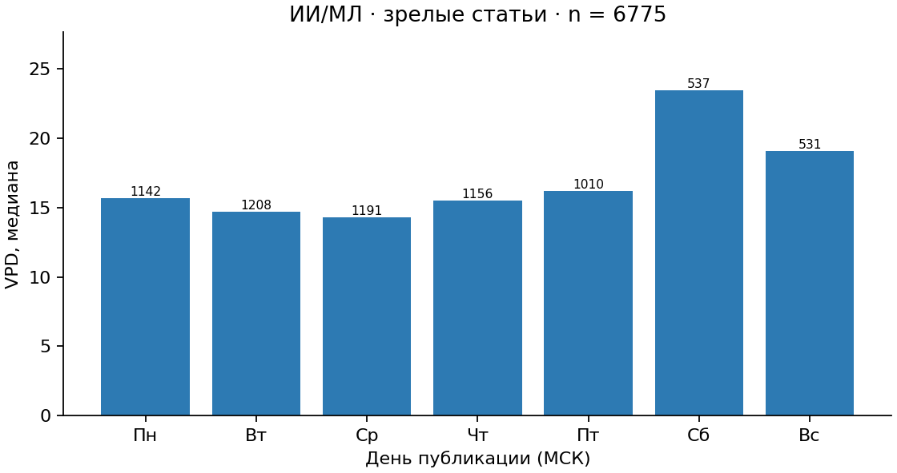
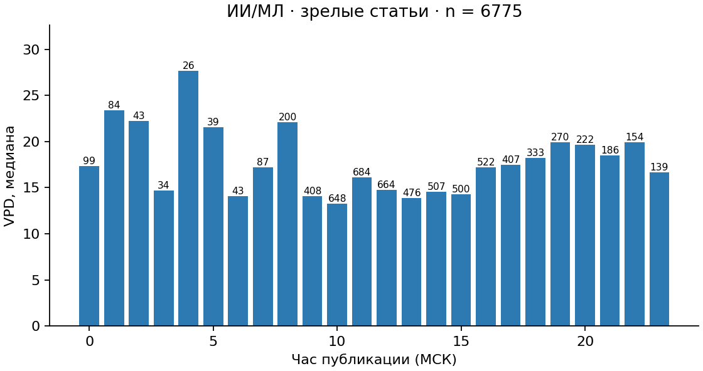
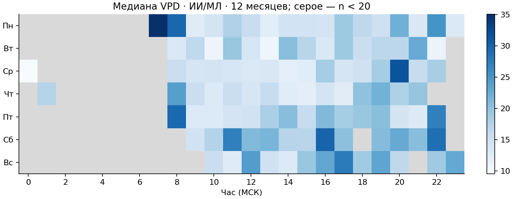
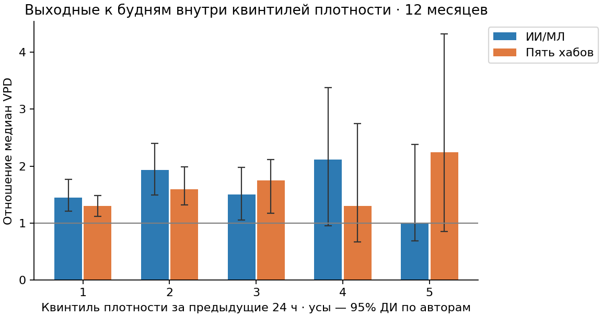
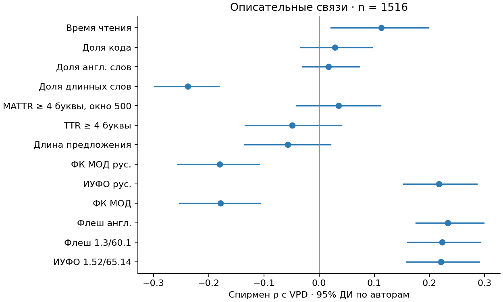

# Выходные, автор и длинные слова: с чем связаны просмотры 46 тысяч статей Хабра

Белый Кролик с часами. По мотивам Джона Тенниела

*Белый Кролик сверяется с часами. Иллюстрация сгенерирована ИИ по мотивам работ Д. Тенниела к «Приключениям Алисы в Стране чудес» Л. Кэрролла (1865)*

Пока моя первая статья ждала правок от редактора, я задался простым вопросом: когда её лучше публиковать? Почитал существующие разборы, но прямого ответа не нашёл. Пришлось разбираться глубже. Так появилась ещё одна статья. С выбором времени её публикации теперь тоже всё непросто.

Лорду Морли приписывают слова: «В речи имеют значение три вещи: кто говорит, как говорит и что говорит. Из этих вещей наименьшее значение имеет третья». К ним я добавил четвёртую — когда — и попробовал проверить, что из этого видно на Хабре.

Я собрал данные о 46845 статьях, изучил язык 1516 текстов и построил модели прогноза популярности. Несколько выводов пришлось вычеркнуть из-за ошибок. Самые поучительные оставил в разделе 9.

**Содержание статей (темы, пользу, аргументацию и качество) не оценивал.** Речь пойдёт о времени, авторах и формальных свойствах текста.

**TL;DR:** выходные в наших данных выглядят лучше будней, но гарантированной прибавки от переноса статьи нет. В регрессии накопленных просмотров с учётом измеренных различий условное отношение составляет 1.2–1.3; в простом сравнении медианного VPD — 1.4–1.5. Это разные показатели и способы оценки, поэтому трактовать разницу как эффект поправок нельзя. По праздникам наблюдается похожая связь. Авторские различия заметно сильнее календарных; «идеальный час» найти не удалось. Простота текста связана с просмотрами слабо и не заменяет качество содержания, которое я не оценивал.

Это наблюдения, а не эксперимент. Если опубликованные в субботу статьи набирали больше просмотров, это ещё не означает, что ваша статья выиграет от переноса со среды на субботу. Полная методология, результаты и код лежат в [репозитории исследования](https://github.com/vadimkaa/habr_analytics/tree/v1.0.0). Здесь — только самое интересное.

## 1. Сверим часы

Как говорится, месяц в лаборатории экономит час в библиотеке. Я решил не экономить и начал с чужих исследований.

В [разборе 10-летней давности](https://habr.com/ru/articles/279607/) ([@jehy](https://habr.com/ru/users/jehy/), 2016) лучшим оказался час, на который пришлось всего 2 статьи, причём одна была хитом. [Е. Татарников](https://habr.com/ru/articles/1050172/) ([@TatarnikovEgor](https://habr.com/ru/users/TatarnikovEgor/), 2026) тоже обнаружил выгоду нерабочих часов; возможно, из-за меньшей конкуренции. А [Д. Шубин](https://habr.com/ru/articles/1061238/) ([@ShyDamn](https://habr.com/ru/users/ShyDamn/), 2026) на 1233 статьях показал, как мало объясняют формальные признаки текста.

На маленькой выборке идеальный час находится легко, особенно среди 168 сочетаний дня и часа. В дополнение к прежним работам я сравнил статьи одних авторов, изучил праздники и проверил разницу между групповыми и индивидуальными корреляциями.

Собрав метаданные Хабра 9–10 ноября 2026 года по прежнему типу публикации «статья», получил два пересекающихся корпуса: «Искусственный интеллект» и «Машинное обучение» — 21389 статей; «Информационная безопасность», «Программирование», «Научно-популярное», «Веб-разработка» и «Python» — 29399. Общих статей 3943, уникальных — 46845. Корпуса пересекаются, что даёт два среза, а не два независимых подтверждения.

Для сравнения выходных и будней взял последний год: так оба корпуса можно сопоставлять на общем временном окне, не смешивая современную активность с существенно более ранними этапами Хабра. Включал статьи не моложе 30 дней: 6775 публикаций ИИ/МЛ и 16577 из 5 хабов (история у них неполная — общее окно начинается 24 июня 2025 года). Для праздников ИИ/МЛ использована история с 2016-го.

У Хабра доступен накопленный счётчик просмотров, но не просмотры за первую неделю. Поэтому я использовал VPD (views per day) = все просмотры, делённые на возраст статьи в днях. И тут есть нюанс. Две статьи набрали по 10000 просмотров, но одной 100 дней, другой 1000: VPD у них будет 100 и 10, соответственно, хотя охват одинаков. [Основная активность](https://habr.com/ru/articles/469881/) приходится на первые дни, а деление на возраст этого не учитывает.

VPD здесь лишь описательная метрика. Я также сравнивал статьи близкого возраста, их место в месяце и регрессионные оценки. Просмотры за одинаковый срок эти методы не заменяют.

Выходные и праздники определялись по российскому производственному календарю, с переносами и рабочими субботами. Время публикации брал из временных меток в метаданных Хабра; для календарных группировок выбрал московский часовой пояс, хотя читатели живут в разных регионах. Заголовки, хабы и счётчики сняты на момент сбора данных; удалённых статей нет, поэтому неудачные и снятые публикации в выборку не попали. Исследование описывает доступный исторический срез.

### Термины — краткая нематематическая справка

**VPD** — накопленные просмотры, поделённые на возраст статьи в днях; это не просмотры за первые сутки.

**Доверительный интервал (ДИ)** — диапазон неопределённости. Здесь 95%-е интервалы получены бутстрепом — повторной случайной перевыборкой целых групп статей: авторов, недель или праздничных эпизодов.

**Перцентиль внутри месяца** — место статьи среди материалов, вышедших в том же месяце: 0.58 означает, что она обошла примерно 58% соседей.

**Корреляция рангов (ρ)** — насколько согласован порядок статей по двум показателям: +1 — полное совпадение, 0 — отсутствие ранговой связи, −1 — полностью обратный порядок.

R² — доля разброса целевой переменной, объясняемая моделью. Прирост R² показывает, сколько добавляет новый признак к базовой модели.

AUC — способность показателя отличать статьи одной группы от другой: 0.5 соответствует случайному ранжированию, 1 — идеальному различению.

## 2. Суббота наносит ответный удар 

Гипотеза, с которой я начинал: статьи, вышедшие в выходные, набирают больше просмотров.

Медианный VPD по дням недели

*Рисунок 1. Медианный VPD по дням недели в ИИ/МЛ. Над столбцами — число статей.*

Первое, что бросается в глаза, — будни почти не отличаются друг от друга. Медианный VPD с понедельника по пятницу лежит в узком диапазоне (14.3–16.2). Явного «магического вторника» здесь не видно. Суббота заметно выше, да и воскресенье тоже выигрывает у будней.

В ИИ/МЛ медианные VPD составляют 21.3 в выходные против 15.1 в будни (т.е. отношение 1.41), а в пяти хабах — 21.7 против 14.8, соответственно (отношение 1.47). У них ДИ по авторам \[1.24; 1.55\] и \[1.28; 1.64\]; по неделям тоже выше единицы.

Обратим внимание, что в субботу и воскресенье выходит примерно вдвое меньше статей, чем в любой будний день (см. числа над столбцами). Просится объяснение: конкурентов меньше, публикация дольше на виду. Но число статей в корпусе ещё не равно конкуренции за внимание читателя. К этой гипотезе вернусь в разделе 5, а пока посмотрим на часы и дни.

Медианный VPD по часам

*Рисунок 2. Медианный VPD по часам в ИИ/МЛ. Маленькие группы сильно шумят.*

Днём (с 9 до 15 часов) медианный VPD обычно около 13–16. К вечеру он подрастает — с 16 до 22 часов держится примерно на 17–20. Вечер ожидаемо выглядит немного лучше дня (люди на работе обычно трудятся, а не читают статьи на Хабре, не так ли?). А вот дальше столбцы дают странные флуктуации, в том числе приходящийся на 4 ночи абсолютный максимум (до минут я не смотрел, возможно, на самом деле это 4:20). Но в 4 вышло всего 26 статей за год. Несколько хитов сдвинут медиану — чем больше гранулярность выберем, тем вероятнее найдём пик в шуме.

Медианный VPD по дням и часам

*Рисунок 3. Тепловая карта «день недели × час». Серым — сочетания, где меньше 20 статей.*

Тепловая карта добавляет ещё несколько заманчивых пиков — это понедельник в 7 утра и среда в 8 вечера (их клетки одни из самых тёмных), а ведь там всего 30 и 29 статей, соответственно. Выглядят они как окна возможностей, однако, как говорил товарищ Саахов, торопиться не надо.

Гораздо интереснее две нижние строки (суббота и воскресенье). 22 из 26 выходных ячеек с достаточным числом статей выше медианы будних ячеек. Значит, общий рисунок выходных не держится на одном случайно выпавшем удачном часе. Выходные дают устойчивый описательный сигнал, вечер — более слабый. А рекомендаций уровня «среда, 20 часов» из этой карты не получится.

## 3. Кто здесь главный — автор или календарь?

У корпоративного блога есть редакционный календарь с дедлайнами и медиапланом, а у «личного» автора — свободные вечера и выходные, отпуск или внезапное вдохновение. Если эти две разные группы авторов системно выбирают разные дни, мы должны заметить разницу по календарю.

Поэтому я сравнил каждого автора с самим собой и взял тех, у кого за год нашлось хотя бы по две зрелые статьи в будни и выходные, затем для каждого посчитал отношение медианных VPD и взял медиану этих отношений. Один автор — один голос.

Таких авторов оказалось 111 в ИИ/МЛ и 220 в пяти хабах. У типичного автора отношение выходных к будням составило 1.39 и 1.30 соответственно (ДИ \[1.24; 1.74\] и \[1.17; 1.54\]). Преимущество сохраняется и при сравнении публикаций одних и тех же людей. Разницу нельзя списать только на состав авторов. Но это ещё не доказывает влияния дня публикации: во вторник человек может выпускать новости, а в воскресенье — руководства. К тому же в сравнении участвовали лишь активные авторы.

А насколько календарь важен на фоне того, *кто* пишет статью? Чтобы сопоставить их описательную связь с просмотрами, за базу взял регрессию логарифма просмотров на возраст статьи. Затем по отдельности добавлял признак выходного дня или результативность остальных публикаций автора.

«Силу автора» я оценивал по *другим* его публикациям, исключая текущую. Это просмотры, накопленные к моменту сбора данных, а не только известные на день публикации. Показатель смешивает аудиторию, темы и продвижение и годится лишь для описательного сопоставления.

Сравнивал, насколько каждый признак увеличивает долю объяснённого моделью разброса (R²) относительно базовой модели. Логарифм просмотров уменьшает влияние отдельных сверхпопулярных статей. Выходной день добавил всего 1.1–1.7 п.п. на фоне влияния результативности других публикаций автора в 18–26 п.п.

Правда, признаки неравноценны: выходной — всего лишь ответ «да» или «нет», тогда как показатель автора объединяет его аудиторию, темы и прошлые результаты. Поэтому разница не означает автоматически, что авторское мастерство на порядок важнее календаря, и не позволяет оценить причинный вклад каждого фактора.

Итак, «кто» здесь тесно связан с результатом, но от «что» отделить его нельзя: темы, качество текста и продвижение не измерялись. Самый провокационный тезис Морли, будто содержание имеет наименьшее значение, остаётся за пределами этого исследования.

## 4. Поправка на возраст и состав

Преимущество выходных сохраняется при сравнении публикаций одних и тех же авторов. Но статьи могут различаться по возрасту, наличию перевода и другим характеристикам. Проверим, насколько это меняет результат.

В трёх возрастных группах (30–89, 90–179 и 180–364 дня) отношение медиан VPD выше единицы в обоих корпусах. Выходные публикации даже несколько старше будних, а в сравнении внутри одного месяца тоже оказываются выше.

Без переводов в ИИ/МЛ отношение составляет 1.34 против 1.41 по всем статьям. Удаление самых активных авторов или крупнейших корпоративных блогов картину тоже не меняет.

Наконец, я проверил, сохраняется ли преимущество выходных после учёта других различий между статьями. Для этого построил регрессионную модель, учитывающую возраст и месяц публикации, хаб, тип блога, а также количество публикаций за предыдущие сутки. Количество просмотров предварительно преобразовал с помощью логарифма, чтобы отдельные сверхпопулярные статьи меньше влияли на результат.

Результат: условное отношение выходных к будням 1.23 в ИИ/МЛ и 1.27 в пяти хабах. При альтернативных календарных и возрастных поправках величина меняется мало. Без поправки на плотность оценки выше (1.29 и 1.37). Плотность может быть частью механизма связи, поэтому разница между вариантами не измеряет точный «вклад конкуренции».

1.41 и 1.47 — отношения медиан VPD, а 1.23 и 1.27 — оценки другой модели и другой целевой переменной. Нельзя говорить, что поправки «снизили эффект с 1.4 до 1.2». Разные подходы показывают связь одного знака.

В аналогичных регрессиях, но с комментариями и закладками в качестве целевых переменных, условные отношения выходных к будням тоже обычно выше единицы — примерно на 20–30%. В пяти хабах статьи с рейтингом не ниже 10 встречаются заметно чаще среди выходных (40.9% против 36.3%), в ИИ/МЛ — одинаково (40.3% и 39.9%). Вывод: связь с рейтингом неоднородна между корпусами и слабее связи с просмотрами.

## 5. Чеширская корреляция

Вернёмся к самому естественному механизму. По выходным выходит меньше статей, а у читателей есть больше времени. Если на странице меньше конкурентов, каждый материал, возможно, дольше остаётся заметным.

Я измерил плотность публикаций: сколько статей *исследуемого корпуса* вышло за предыдущие 24 часа. Это не реальное число конкурентов у читателя — его лента зависит от подписок и фильтров (показов и переходов у меня нет).

На агрегированных данных получается впечатляющая связь. Если взять семь точек, по одной на день недели, корреляция числа статей с медианным VPD равна −0.93 для ИИ/МЛ и −0.86 для пяти хабов. Кажется, доказательство готово: чем реже лента, тем больше просмотров.

Но спустимся с уровня дня недели к отдельной статье — и связь почти исчезает. На статьях годового окна корреляции 0.05 и −0.05. Если сравнивать статьи внутри месяца, они также около нуля. Попытка учесть публикации в *следующие* сутки вместо предыдущих результата не меняет.

При группировке статей по дням недели низкая плотность публикаций и высокий VPD совпадают прежде всего по выходным. Поэтому сильная корреляция на семи точках может отражать уже обнаруженное различие между буднями и выходными, а не влияние конкуренции. Переносить такую групповую корреляцию на отдельные статьи — известная экологическая ошибка: для отдельных публикаций столь сильной связи не наблюдается.

Я сделал ещё одну проверку: разбил статьи на 5 примерно равных по числу публикаций групп по плотности ленты и внутри каждой сравнил выходные с буднями.

Выходные против будней при сходной плотности

*Рисунок 4. Отношение медиан VPD выходных и будней внутри групп плотности. Усы — 95% доверительные интервалы по авторам.*

В трёх группах с относительно редкой лентой выходные остаются впереди. Но на наиболее плотных участках данных мало: в ИИ/МЛ число выходных статей от 1 к 5 группе падает с 755 до 18. В двух верхних группах интервалы широкие и включают единицу.

Измеренная плотность не устраняет разницу, но и гипотезу конкуренции это не опровергает. Показов мы не видим. В отдельные рабочие часы доля корпоративных публикаций ИИ/МЛ достигает 60%: сравнивая часы, мы одновременно сравниваем и состав материалов. Читательские привычки тоже могут меняться. Например, в выходные могут чаще выходить обстоятельные руководства с долгим поисковым хвостом, а в будни — новости с кратким всплеском просмотров. Истории источников трафика у меня нет.

## 6. Праздник, который всегда с тобой

В среднем в году около 118 нерабочих дней. Нерабочий будний день чем-то напоминает неожиданный выходной: многие не работают, статей выходит меньше, а свободного времени у читателей может быть больше. Если праздник даёт похожий результат, это косвенный довод в пользу гипотезы о конкуренции или читательских привычках.

Здесь календарь оказался сложнее списка дат: переносы, рабочие субботы. Я взял [производственный календарь России](https://xmlcalendar.ru/) за 2016–2026 годы, исключил обычные выходные и особые нерабочие дни 2020–2021 годов. Для каждого праздника подобрал рабочие даты того же дня недели за одну, две и три недели до или после.

Основной показатель — перцентиль просмотров внутри месяца публикации, а не VPD: праздничные и контрольные статьи заметно различаются по возрасту.

В корпусе ИИ/МЛ медианный перцентиль праздничных публикаций — 0.58 против 0.49 у контрольных; разница 9.7 процентного пункта. В пяти хабах — 0.62 против 0.48, разница 14.4 пункта. Медианы здесь округлены до сотых, а разницы рассчитаны до округления. В праздничные дни статей выходит почти вдвое меньше. Доля корпоративных публикаций тоже заметно ниже.

В ИИ/МЛ анализ охватывает 68 праздничных эпизодов (групп последовательных нерабочих дней), а в пяти хабах — всего 7. Поэтому оценки для пяти хабов менее надёжны. Впрочем, даже если исключить из анализа любой из этих 7 периодов, разница остаётся положительной. Контрольные окна отдельных эпизодов могут частично пересекаться, поэтому наблюдения нельзя считать полностью независимыми.

Не держится ли всё на Новом годе? Наш любимый оливьесодержащий праздник действительно даёт около трети праздничных статей. Но если исключить новогодние каникулы, разница сохраняется: 7.9 вместо 9.7 пункта в ИИ/МЛ и 15.9 вместо 14.4 в пяти хабах (при этом в пяти хабах исключение Нового года оценку даже немного поднимает).

Отдельные праздники различаются: для 8 марта оценка в ИИ/МЛ даже отрицательная (видимо, находятся дела поважнее писательства), для 9 мая — положительная, но выборки невелики. К тому же праздники часто приходятся на начало месяца; при сравнении с рабочими днями в окне ±10 суток разница всё равно положительна: 8.8 п. п. в ИИ/МЛ и 13.6 п. п. в пяти хабах. Идеальный праздник искать здесь столь же опасно, как идеальный час.

Праздники вписываются в общую идею: публикаций меньше, а вышедшие в эти дни статьи занимают более высокие места по просмотрам среди публикаций своего месяца. Но это не эксперимент. В праздники могут меняться темы, авторы и поведение читателей. Данных о показах в ленте и истории ежедневных просмотров у меня нет, поэтому отделить влияние конкуренции от других факторов не получается.

## 7. Имеет ли размер значение?

Мы поговорили про «когда» и «кто». Осталось «как». Можно ли получить больше внимания, если писать проще? Авторы [книги «Пиши, сокращай»](https://sokratil.ru/), вероятно, сказали бы «да». Но в наших данных сравниваются разные статьи, а не один текст до и после редактуры.

Для анализа текста отбирал статьи по квартилям VPD внутри каждого корпуса; после фильтрации осталось 1516 публикаций (385 из ИИ/МЛ и 1131 из пяти хабов). Это отбор по самому результату, который мы пытаемся объяснить: наблюдаемые корреляции могут быть как выше, так и ниже значений для всего Хабра. Обобщать их на все публикации нельзя.

Для индексов читаемости из HTML удалялись код, таблицы и формулы; затем считались слова и предложения. Доля кода измерялась отдельно до очистки, по объёму блоков `<``pre``>` относительно исходного текста. Подготовка неидеальна: формулы бывают картинками, а технические термины плохо подходят для подсчёта русских слогов.

Я проверил несколько индексов читаемости на основе длины слов и предложений ([формулы лежат в полной версии](https://github.com/vadimkaa/habr_analytics/blob/v1.0.0/article.md)), и они похожи. Четыре одинаковых результата не означают четырёх независимых подтверждений. Просто одна линейка, нарисованная четырьмя способами.

Корреляции формальных характеристик текста с VPD

*Рисунок 5. Связь формальных характеристик текста с VPD. Чем дальше точка от нуля, тем сильнее наблюдаемая связь; «усы» показывают 95%-е доверительные интервалы.*

Формально более простые тексты в среднем набирают немного больше просмотров. Например, у индекса удобочитаемости Флеша в адаптации Оборневой (ИУФО) ранговая корреляция с VPD составляет 0.22 без поправок, а после учёта возраста, длины текста и других измеренных различий — около 0.20. Связь слабая: более простой текст вовсе не обязательно получит больше просмотров.

Самое любопытное — длина предложений почти ни при чём. Её корреляция с VPD составляет −0.056, а доверительный интервал включает ноль. Зато доля длинных русских слов (не меньше 10 букв) связана с VPD заметнее: −0.238. Чем больше таких слов, тем в среднем ниже VPD. Но длинные слова нередко означают сложную тему, а содержание и его качество я здесь не измерял. Жаль, что нет данных о возрасте читателей — было бы интересно проверить, различается ли эта связь у разных поколений. А там, глядишь, и до гипотезы о клиповом мышлении добрались бы.

Некрасов советовал писать так, чтобы словам было тесно, а мыслям — просторно. Если понимать это как призыв к употреблению слов покороче (хотя поэт имел в виду другое), то Хабр с ним согласен. Правда, не стоит впадать в крайности и механистически заменять, например, «гиперпараметризацию» на «настройку». Длинное слово может быть точным техническим термином. А короткие предложения не гарантируют ясности. Я сравнивал разные статьи, а не одну и ту же до и после редактуры, поэтому утверждать, что сокращение слов принесёт просмотры, нельзя.

Самые длинные статьи не проигрывают коротким; доля кода практически не связана с VPD, как и число иллюстраций на тысячу слов. Тексты с множеством картинок выглядят сильнее, но они и сами существенно длиннее.

И главный вопрос: можно ли по индексу угадать будущий хит? Если считать успешными верхние 25% статей по VPD, индекс читаемости различает их и остальные лишь немного лучше случайного ранжирования (AUC = 0.593 при случайном уровне 0.5). Это оценка для специально отобранной по популярности выборки, а не прогноз качества для случайной статьи Хабра. Как инструмент для предсказания популярности статьи он явно слабоват. Подробности расчёта — [в полной версии](https://github.com/vadimkaa/habr_analytics/blob/v1.0.0/article.md).

## 8. Ответ есть. Вопрос был другой

До сих пор мы смотрели в прошлое, анализируя уже опубликованные статьи. Но автору-то нужен ответ на вопрос, когда выпустить свою ещё не вышедшую публикацию? Для начала я попробовал подойти к этой задаче через прогнозирование популярности с помощью градиентного бустинга.

Модель не читала содержание статьи. Ей были доступны календарные признаки, заголовок, тип блога и ограниченная информация о прежних публикациях автора. Для обучения использовались более ранние статьи, для проверки — более поздние.

Первая модель ранжировала статьи слабо (корреляция внутри месяцев составляла 0.051 в ИИ/МЛ и 0.141 в пяти хабах). Затем я сравнил несколько вариантов LightGBM и CatBoost с разными функциями потерь (подробности экспериментов — [на GitHub](https://github.com/vadimkaa/habr_analytics/tree/v1.0.0/experiments/catboost)). На валидации корреляция выбранных моделей выросла до 0.107 и 0.246 соответственно, но до хорошего предсказания всё ещё далеко. Эти значения относятся именно к валидации, а не к итоговой проверке.

С абсолютными просмотрами дела обстояли ещё хуже. На итоговой ретроспективной проверке модель систематически завышала прогнозы (отношение предсказанного числа просмотров к фактическому составляло в медиане 3.57 для ИИ/МЛ и 1.97 для пяти хабов), поэтому надёжно предсказывать число просмотров отдельной статьи с её помощью нельзя. В лучшем случае модель позволяет приблизительно ранжировать статьи по ожидаемой популярности, да и то с большим шумом.

Но предсказать популярность статьи и выбрать удачное время для её публикации — это две большие разницы. Представим пару статей: одну написал известный автор с сильным заголовком, другую — новичок. Модель может правильно предсказать, какая наберёт больше просмотров, даже если совсем не умеет оценивать влияние времени публикации. Если назвать такой прогноз «рекомендацией времени публикации», мы (пусть и непреднамеренно) введём читателя в заблуждение.

Поэтому я отдельно проверил, что модель может сказать именно о календаре. Для этого задал три типовых профиля — новичок, опытный автор и корпоративный блог — и посмотрел, как меняются оценки при изменении только даты и времени публикации. По сравнению с простым правилом «выходные лучше будней» модель лишь немного улучшила ранговую корреляцию с просмотрами: на 0.026 для ИИ/МЛ и на 0.061 для пяти хабов. В ИИ/МЛ даже этот небольшой прирост оказался неустойчивым: результат зависит от случайной инициализации модели и разбиения данных по времени. В пяти хабах преимущество заметнее, но всё равно довольно скромное на фоне полного прогноза популярности.

Однако такой календарный рейтинг не учитывает особенности конкретной статьи. Поэтому я провёл дополнительную проверку: для каждой публикации модель сравнивала выбранные автором день и час с другими возможными вариантами (далее — слотами), сохраняя остальные характеристики статьи неизменными. Прирост ранговой корреляции относительно того же правила выходных оказался ещё скромнее, составив −0.004 в ИИ/МЛ и +0.044 в пяти хабах. Учитывая, что реальные просмотры известны только для выбранного автором времени, никак нельзя проверить, помог бы перенос публикации. К тому же способ оценки, при котором модель выглядела лучше всего, я выбрал уже после знакомства с результатами.

Наконец, в календарном рейтинге конкретные лучшие слоты менялись между временными периодами. Поэтому не рискну давать советы в духе «публикуйте в четверг в 19, а не в среду в 20». Дополнительная связь с календарём видна в первую очередь в пяти хабах, но даже там нет доказательств, что выбор другого времени публикации принесёт статье больше просмотров.

## 9. Если результат слишком хорош, проверьте код

Выводы выше получены уже *после* исправления ошибок, о которых пойдёт речь ниже. Некоторым первоначальным «победам» доверять было нельзя, и именно их разбор убедил меня внимательнее проверять остальные моменты.

**Назад — в будущее.** Сначала пытался прогнозировать популярность статьи по просмотрам предыдущих публикаций того же автора. Логика вроде железная: январская статья вышла раньше февральской, значит, в феврале мы уже знаем январские просмотры. А счётчики собраны *в ноябре* 2026 года. Получается, что при прогнозировании февральской статьи модель уже знала, сколько просмотров январская наберёт к ноябрю. Со счётчиками из этого самого будущего тестовая корреляция Спирмена старой модели равнялась 0.297, только с числом прошлых публикаций — 0.155, без блока автора — 0.128. Совсем другая история. Это отдельная диагностика, не сопоставимая напрямую с нынешней моделью.

**Ставки после финиша.** В одной из ранних проверок я выбрал три самые успешные группы слотов по фактическим просмотрам, сравнил их с тремя самыми неуспешными и получил замечательный «выигрыш от рекомендаций». Вот только победителей определил, уже посмотрев на результат, как если бы мы после забега объявили, что всегда рекомендовали ставить на тех, кто пришёл первым. Таким способом можно обнаружить закономерность даже там, где есть только случайный шум.

**Слишком много праздников.** В первой версии анализа заметно преувеличил влияние праздников на число публикаций: не учёл переносы выходных, а дни за пределами собранной истории принял за дни, когда ничего не выходило. В результате число статей в праздники якобы падало в 2.3 раза, хотя после исправления ошибок падение составило 1.7–1.9 раза. Вскрылось и то, что для сравнения с праздниками использовался один общий набор рабочих дней (например, 8 марта могло сравниваться с рабочими днями декабря или мая, хотя активность авторов в разные месяцы может различаться). Пришлось подбирать контрольные даты отдельно для каждого праздника.

**Не думай о секундах свысока**. Это моя любимая ошибка. Хотел посчитать, сколько других статей вышло за 24 часа до каждой публикации. Но код ожидал время в наносекундах, а после перехода на pandas 3 данные оказались в микросекундах. В результате «предыдущие сутки» растянулись примерно на тысячу дней, а медианное число соседних публикаций выросло с 8 до 4788. Зависимости получились настолько красивыми, что искать ошибку не хотелось.

**Маленькие слова — большие последствия.** Регулярное выражение, которым я подсчитывал слова, не учитывало односимвольные «я», «и», «в», «с». После исправления на минуту времени чтения, указанного Хабром, стало приходиться 190.4 слова вместо 174. Разумеется, это не реальная скорость чтения: сайт оценивает время автоматически, а не измеряет, сколько читатели тратят на статью.

Самое прискорбное здесь, что неправильный расчёт часто даёт правдоподобный результат, особенно если этот результат заранее нравится. Поэтому в [репозитории](https://github.com/vadimkaa/habr_analytics/tree/v1.0.0) лежат не только итоговые числа и графики, но и тесты, описание методики экспериментов, примеры найденных ошибок и проверки воспроизводимости результатов.

И всё-таки даже после исправлений остаётся вопрос, на который имеющиеся данные ответить не могут: сколько просмотров набрала бы та же статья, если бы мы опубликовали её в другой день?

## 10. Публиковать нельзя откладывать

Практические рекомендации получились скромнее, чем хотелось бы. Но, надеюсь, честнее, чем «публикуйте во вторник в 11».

Во-первых, если статья не привязана к срочной новости, выходные разумно включить в список возможных дат. В наших корпусах выходные статьи показывали лучшие результаты при разных способах сравнения, включая сравнение одного автора с самим собой. Но гарантировать дополнительные просмотры от переноса конкретной статьи эти данные не позволяют.

Во-вторых, не ищите лучший час по самому высокому столбцу: ночные пики основаны на десятках статей. Вечер выглядит лучше дня, но выигрыш от переноса не доказан.

В-третьих, если публикуете много материалов (например, в корпоративном блоге), можно проверить расписание на своих данных. Выберите несколько удобных интервалов, распределяйте между ними сопоставимые публикации случайно и сравнивайте просмотры через одинаковый срок, например семь дней. При 5–10 личных статьях в год такой тест вряд ли даст надёжный ответ. Без случайного назначения легко перепутать влияние календаря с различием самих текстов.

В-четвёртых, упрощайте текст для читателя, не для индекса. Признаюсь, что у меня с этим всегда были проблемы, ведь рука сама тянется нанизать большое количество причастных и деепричастных оборотов, придаточных предложений, обильно снабдив их лирическими отступлениями в скобках, богато приправленными осторожными отсылками к ограничениям, не забыв при этом отдать долг уважаемым коллегам и предшественникам, дабы не быть уличённым неизвестным мне, но придирчивым читателем в высокомерии или отсутствии общей эрудиции. Точность и ясность важнее числа букв; хороший текст не обязан быть коротким.

В-пятых, для корпоративного блога считайте просмотры, закладки и рейтинг отдельно: они отвечают на разные вопросы. Большой охват не гарантирует столь же заметного прироста голосов.

И наконец, я бы не откладывал готовую публикацию надолго ради предполагаемого идеального часа. Как в той якобы китайской поговорке: лучшее время посадить дерево было двадцать лет назад, а второе лучшее — сейчас.

Есть ещё и забавный эффект самой публикации результатов. Если все прочитают эту статью и дружно перенесут свои материалы на субботу, выходные перестанут быть тихими и, возможно, потеряют преимущество. Хорошо там, где нас нет: выходные были хороши, пока нас там было мало. Такой исход даже пригодился бы для новой проверки гипотезы о конкуренции.

## 11. Хабр уже переписал правила игры

Есть ещё одно ограничение применимости советов. 9 ноября 2026 года Хабр [объявил](https://habr.com/ru/companies/habr/articles/1105376/) об объединении прежних типов статей, новостей и постов в один тип публикации с разными форматами. Общая лента [существовала ещё с 2023 года](https://habr.com/ru/companies/habr/articles/782308/), изменились классификация и способы фильтрации материалов.

Изменения значимые, так как фильтр прежнего типа «статья» теперь может дать другой набор материалов. И без того условная оценка плотности ленты стала менее сопоставимой с прежним периодом. Поскольку мои результаты описывают историческую выборку (собранную в ноябре 2026 года), после этих новаций особенно важно заново проверить выводы о плотности ленты — новый поток материалов не обязательно сопоставим с прежним. Снимок собирался 9–10 ноября, то есть в период объявления реформы. Исходные ответы API не сохранились, поэтому её возможное влияние на состав собранного среза полностью исключить нельзя.

Дальше нужны повторные измерения (просмотры каждой статьи через 1, 3, 7 и 30 дней), но даже они не покажут, что дал бы перенос той же статьи — здесь нужен эксперимент с распределением сопоставимых материалов по датам.

## 12. Вниз по кроличьей норе

Выходные, автор и длинные слова кое-что рассказали нам о просмотрах. Но самое сложное, пожалуй, осталось за кадром. Мы разобрались с тем, когда публикуются статьи, кое-что узнали о том, кто их пишет и как устроен текст. А вот что в этих статьях написано и показано, мы практически не исследовали. Темы, аргументы, примеры, иллюстрации, код, юмор — всё это ещё предстоит исследовать.

И здесь начинается настоящая кроличья нора. Анализ содержания текстов и изображений может привести к куда более сильным и неожиданным результатам. А может оказаться, что после нескольких месяцев работы мы снова придём к выводу: всё гораздо сложнее, чем казалось.

В [полной версии исследования на GitHub](https://github.com/vadimkaa/habr_analytics/tree/v1.0.0) можно найти больше подробностей, результатов и открытых вопросов. А заодно попробовать поискать ответы самостоятельно.

Если из всей истории оставить одну мысль, то такую: статистика хорошо помогает находить закономерности, но гораздо хуже отвечает на вопрос, что произойдёт, если мы специально попробуем ими воспользоваться.

В конце концов, никто не обещал, что кроличья нора обязательно ведёт в Страну чудес.

Настоящий материал (информация) произведен и распространен с применением технологий искусственного интеллекта, либо касается деятельности, связанной с искусственным интеллектом.

Генеративный ИИ использовался для:

1.  Работы с кодом (рефакторинг, тесты и комментарии) — GLM 5.3

2.  Поиска источников — GLM 5.3

3.  Создания изображения-обложки — ChatGPT

4.  Создания перечня критических замечаний по статье перед публикацией — ChatGPT, Claude Opus, GLM 5.3, DeepSeek, GigaChat, Алиса, Mistral (разногласия по стилю и восприятие юмора разными генеративками достойны стать предметом отдельной статьи)

Негенеративный ИИ использовался для создания предсказательных моделей — LightGBM, CatBoost.
